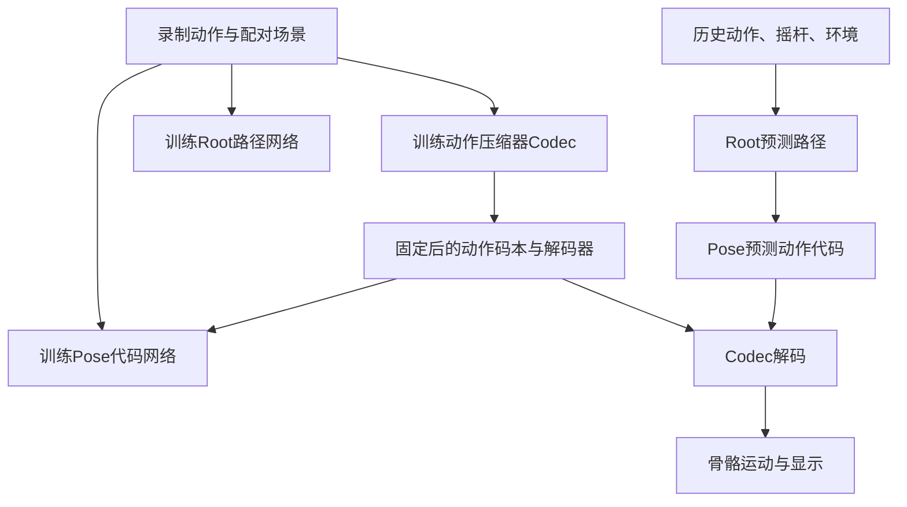
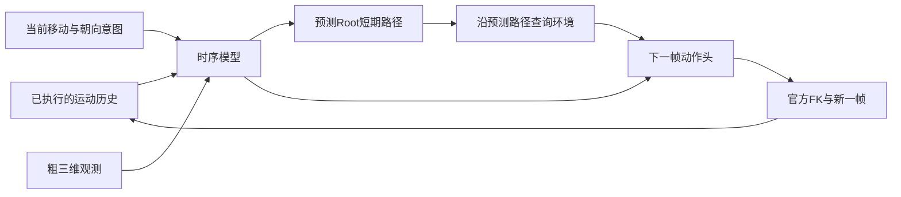

# TerrainAwareKinetics：从零认识我们的数据、模型与项目进展

更新日期：2026 年 10 月 23 日。最近一次完成的实验复核：2026 年 10 月 22 日。

10 月 23 日的数据更新：[BONES 地形候选调查](records/bones_terrain_survey_pro6000_20261023.md) 已在 PRO6000 完成。142,220 条标注中有 19,935 条命中候选类别；每类 30 条固定抽样已发布，用于审查关键词误报。模型训练账本保持原记录。

这份文档面向第一次接触动作生成、机器学习和本项目的读者。先读第 1～4 节可以了解全貌；想理解模型，继续读第 7～10 节；想接手开发，最后看第 15 节。

| 阅读主题 | 直接跳转 |
| --- | --- |
| 目标、术语和历史 | [项目目标](#1-我们想做出什么)、[术语表](#3-先认识这些词)、[历史路线](#4-项目经历过哪些路线) |
| 全部数据和处理流程 | [已有数据](#5-我们已经有哪些数据)、[怎样准备样本](#6-原始动作怎样成为训练样本) |
| 模型和三维感知 | [MotionBricks](#7-架构一我们改造过的地形感知-motionbricks)、[环境观测](#8-我们的环境观测到底是什么)、[逐帧模型](#9-架构二逐帧-gru-与轻量-transformer) |
| 机器人分支与其他尝试 | [G1物理执行](#10-架构三mb参考g1物理执行)、[其他原型](#11-另外做过哪些原型与设计) |
| 实验结果和后续工作 | [训练账本](#12-训练做过多少结果怎样)、[评价标准](#13-我们怎样判断模型真的变好了)、[下一步](#14-当前最重要的下一步) |
| 接手源码 | [仓库导航](#15-仓库里从哪里开始看)、[详细记录](#16-进一步阅读) |

## 1. 我们想做出什么

我们希望做出一个可以用手柄实时控制的角色：左摇杆决定往哪里移动，右摇杆独立决定身体朝向。角色看到附近的三维环境后，应当自然地走、跑、停、侧移、倒退和转身，并及时适应台阶与崎岖地面。更长远的目标包括扶撑、翻越、攀爬、蹲行、匍匐，以及这些动作之间的连续转换。

目前的重点是**人体的运动学生成**：模型直接产生身体下一时刻的姿态和位置，然后把角色画出来。我们也尝试过让模型驱动物理仿真中的 G1 机器人，那是一条独立的研究分支。

截至这份文档：

- 已有真实动作数据、动作与地形的配对数据、15 张 PFNN 演示地图，以及统一的人体骨架和皮肤模型。
- 已训练过地形感知 MotionBricks，也完成了较小的逐帧 GRU 模型和 Transformer 对照实验。
- 已实现浏览器演示、WASD、Xbox 双摇杆、地图切换和同窗口调参，部分版本实测达到约 30fps。
- 最新模型能改善单步动作拟合，但连续生成时仍有支撑滑动、漂移和穿透；最终的全地形交付质量尚未通过。
- 接触与物理关系建模已有调研和设计，部分闭环训练目标已有代码；完整的物理关系生成器还没有训练完成。

## 2. 一次操控怎样变成动作

以“向前走上台阶”为例：

1. 用户推左摇杆，系统收到期望移动方向和速度。
2. 系统读取角色刚刚实际生成的动作，知道它现在在哪里、哪条腿在动。
3. 系统查询附近地形，发现前方的高度、表面朝向和可用空间。
4. 模型预测接下来要走的路径，并沿这条预测路径再看一次环境。
5. 模型生成身体动作，骨骼计算得到手脚位置，皮肤随骨骼变形，画面显示出来。
6. 下一次计算从刚刚生成的真实状态继续，重新读取最新摇杆输入。

“实时”包含两个要求：计算跟得上时间，以及身体及时响应输入。画面每秒显示 30 次，但角色松杆后还滑行几米，仍然没有达到我们的控制目标。

## 3. 先认识这些词

| 词 | 可以怎样理解 | 项目里的例子 |
| --- | --- | --- |
| 帧、30Hz | 每隔一小段时间记录或产生一次身体状态 | 30Hz 是每秒 30 帧，一帧约 33.3 毫秒 |
| 姿态 Pose | 身体各关节怎么转动 | 膝盖弯多少、脚尖朝哪里 |
| Root | 身体在场景中的整体位置与朝向参考 | 人物整体前进、升高或转向 |
| 骨架、骨骼绑定 rig | 关节的连接关系、长度与初始姿态 | 我们的人体主要使用 SOMA30 |
| 蒙皮 skin | 覆盖骨架的可见人体表面 | 质量检查使用 18,056 个皮肤顶点 |
| FK，正向运动学 | 从关节旋转和骨长计算手脚位置 | 膝盖转动后，脚会到哪里 |
| IK，逆向运动学 | 根据想要的手脚位置反求关节姿态 | 动作转换或机器人参考约束中用过 |
| 运动学 kinematics | 描述位置、姿态、速度怎样变化 | 直接生成并显示人体动作 |
| 动力学 dynamics | 解释力、质量、惯量怎样使身体运动 | 地面支撑力如何让身体加速 |
| 训练 | 用示例反复调整模型参数 | 给模型看动作和地形，纠正预测误差 |
| 推理 | 使用已经训练好的模型产生新动作 | 用户操控页面中的实时生成 |
| checkpoint、权重 | 某一时刻保存下来的模型参数 | 可以加载继续研究或运行推理 |
| loss，损失 | 对预测错误的量化评分 | 关节位置偏差、脚底滑动、接触预测错误 |
| batch、更新次数 | 一次看多少训练样本、调整了多少次参数 | batch 2048、更新 12 次是 24,576 次样本曝光 |
| 样本曝光 | 一个训练样本被模型使用一次 | 同一窗口看 100 遍，计 100 次曝光 |
| 窗口 window | 从长动作截取的一小段 | PFNN 常用 33 帧窗口 |
| 闭环、自回归 | 生成结果成为下一次生成的输入 | 下一步使用自己刚刚生成的姿态 |
| teacher history | 使用录制动作作为历史输入 | 用于检查给定正确历史时的一步预测 |
| generated history | 使用模型自身生成的历史 | 更接近实际操控中的输入 |
| GRU | 带一小块持续记忆的神经网络 | P1 逐帧模型的时序骨干 |
| Transformer、注意力 | 从多份输入中学习该关注哪些信息 | 从过去帧或不同地形区域中取信息 |
| token | 一块经过编码的信息 | 既可能是动作代码，也可能是一块空间特征 |
| SDF，带符号距离 | 一个点离表面多远、在实体内还是外 | 用来表示地形、墙和顶棚附近的几何 |
| stance，支撑期 | 源动作中脚与支撑面接触的时段 | 这时脚底不应无故快速滑动 |
| P50、P99 | 一组测量值的中位数、99% 分位数 | P99 耗时 20ms 表示 99% 测量不超过它 |
| 消融实验 | 控制条件，比较一个模块的作用 | 比较平均地形特征与空间注意力 |

本文里的“运动学数据”指三维动作轨迹；不是把 Kinetics 视频动作识别数据集作为当前训练集。

## 4. 项目经历过哪些路线

| 时期 | 我们做了什么 | 得到了什么 |
| --- | --- | --- |
| 10 月初 | 盘点已有数据，把 BONES 的人体动作转换到统一骨架，做压缩器和行走小试 | 建立数据转换、接触标注、骨架与特征检查流程 |
| 10 月 5～7 日 | 接入 LAFAN walk/run，进行 SOMA 转换、原生 MotionBricks 训练及 UE 源动作回放 | 区分了源动作播放、压缩重建、模型生成这三种效果 |
| 10 月 8～10 日 | 接入 PARC 动作与地形，扩增短场景和长路线，混合 BONES 训练 | 获得地形配对动作、合成数据和长路线训练资产 |
| 10 月 10～14 日 | 尝试近远地形、距离场、身体关键点观测、Root 高度和解码端适配 | 明确了坐标一致、源历史与生成历史差异的重要性 |
| 10 月 15～16 日 | 完成 PFNN 数据处理，与 PARC/BONES 做三阶段正式训练 | 完成 3,840 万次样本曝光；模型最终质量检查失败 |
| 10 月 17 日 | 加入全部 PFNN 地图、快速切图、同窗口调参、预测路径观测和不同前瞻长度 | 交互链路更完整，发现加长前瞻或提频仍可能破坏步态 |
| 10 月 18 日 | 探索 scene_control_v2/v3，增加全身三维查询和因果控制接口 | v2 有真实模型接线；v3 完成未训练架构的性能验证 |
| 10 月 18～20 日 | 将 MB 参考转换到 G1，分别接 SONIC、ProtoMotions 和 MuJoCo | 物理执行链搭通，但重定向、跟踪和在线接续都暴露问题 |
| 10 月 20～21 日 | 返回人体运动学，接入 Xbox，检查逐帧/多帧重规划和历史来源 | 确认快速计算与稳定闭环必须分别解决 |
| 10 月 22 日 | 训练真正逐帧的 P1 GRU，迁移到 PRO6000；补做 A/B/C 架构小试 | 单步拟合改善，支撑和闭环仍不稳定 |
| 最新复核 | 补齐 C 的结果，统一源接触评分，检查统计和物理评测代码 | 纠正了架构排名、损失敏感度和力旋量的过强结论 |

这里按方法阶段归纳。历史文件中的 v1、v2、v3 通常只是某个分支自己的版本号，不是同一条全局版本序列。

## 5. 我们已经有哪些数据

### 5.1 已进入本项目处理或训练的数据

| 数据 | 已有内容与数量 | 主要用途 | 怎样理解这些数量 |
| --- | --- | --- | --- |
| BONES-SEED | 早期盘点确认 71,132 个 SOMA Uniform 原始 BVH；后续筛选平地移动动作 | 站立、走跑、转向、侧移、倒退等动作先验 | 71,132 是原始资源盘点量，实际训练使用筛选子集 |
| BONES V7 小集 | 191 段：训练 152、验证 19、测试 20 | 早期转换、接触与压缩重建研究 | 是早期版本，不与后来的大子集相加 |
| BONES 混合训练子集 | 一版长路线混合集包含训练 2,003 段、验证 19、测试 20；训练时长约 4.69 小时 | 平地运动与地形数据混合 | 这是该混合数据版本的来源统计 |
| LAFAN1-resolved walk/run | 已接入 16 段、231,636 个原始帧，约 64.34 分钟 | 走跑、转换、原生 MB 基线 | 属于作者 resolved walk/run 来源，不是完整原始 LAFAN1 的全部规格 |
| LAFAN→SOMA 合格集 | 9 段、约 35.514 分钟；训练/验证/测试为 5/2/2 段 | 统一人体骨架下的训练与回放 | 其余 7 段保留为失败记录 |
| PARC 发布数据 | 已取得并转换动作与配对地形；一版 native 划分为 437/48/49 段 | 地形动作、物理跟踪结果与场景配对 | 这些处理片段不是同等数量的独立真人录制 |
| PARC 合成扩增 | 一轮新增 85 个长训练片段、5,031.8667 秒，约 84 分钟 | 延长路线、增加地形组合和动作过渡 | 合成结果有独立来源和质量记录 |
| PFNN 全量来源 | 40 个原始动作文件＋40 个镜像动作文件，另有一个单帧 rest 姿态 | 地形移动主线、完整来源覆盖 | 镜像来自原动作，不增加独立录制 |
| PFNN→SOMA 30Hz | 233,010 个实际时间戳帧，包含原始和镜像两份 | 统一骨架、统一时间尺度的地形训练 | 原始录制本身约 1.079 小时，镜像不翻倍录制时长 |

例如，一版 PARC 长路线混合集有 89 个生成训练片段，其中已经包括那一轮 85 个新长片段和 4 个此前片段。不能把 85 和 89 当作两份互不重叠的数据相加。

### 5.2 当前 PFNN 训练数据怎样组成

PFNN 原始动作先转换成 SOMA，然后为具体动作区间配对地形，并检查身体与地面的关系。处理时考虑过 **7,125 条动作—场景配对记录**；最终缓存包含 **16,195 个合格的配对窗口**，四方向联合旋转后得到 **64,780 行样本**。

这几种计数分别对应“配对记录”“截取窗口”和“增强行”，不能互相替代。

| 划分 | 录制家族 | 合格配对窗口 | 四方向增强行 |
| --- | ---: | ---: | ---: |
| 训练集 | 28 | 12,058 | 48,232 |
| 验证集 | 4 | 3,533 | 14,132 |
| 测试集 | 2 | 604 | 2,416 |
| 合计 | 34 | 16,195 | 64,780 |

录制家族可以理解为同一次或密切相关的一组动作来源。镜像、不同朝向、重叠窗口会跟随原录制放在同一划分，避免“训练时见过近似副本，测试时又把它当新动作”。

已处理的地形类别包括：

| 类别 | 合格配对窗口 | 直观含义 |
| --- | ---: | --- |
| flat | 9,955 | 平地移动 |
| jumpy | 2,182 | 跳跃相关地形动作 |
| rocky | 3,859 | 起伏、崎岖地形 |
| beam | 199 | 狭窄支撑等动作 |

当前原验证划分只有 flat 和 rocky；jumpy、beam 的额外拟合检查使用了明确标为训练集的样本。它们的训练拟合成绩与未见数据的泛化成绩分开记录。

PFNN 的配对地形使用作者式 patch/RBF 构造方法，并结合重定向后的 SOMA 支撑几何。它是与动作匹配的构造环境，不是整个原始采集现场的三维扫描。

### 5.3 历史混合训练缓存

一版正式混合缓存共有 **397,308 个增强动作短窗**，包含所有训练、验证、测试划分：

- PFNN：64,780 行。
- PARC＋BONES：332,528 行。
- 其中训练划分为 PFNN 48,232、PARC 88,344、BONES 231,980 行。

以前的正式混合训练按 PFNN/PARC/BONES 的 50%/25%/25% 配额抽样。最近的逐帧 P1 改成完整遍历 PFNN 训练划分，每轮 48,232 个基础行，再补采 12,058 行平衡不同行为。

397,308 个短窗里有大量时间重叠、旋转增强和重复场景来源，不能据此宣称拥有几十万段独立录制。

### 5.4 地图与三维场景

| 场景资产 | 目前的内容 | 用途 |
| --- | --- | --- |
| PFNN 演示地图 | 15 张独立原始高度图，已做完整地图选择和切换 | 浏览器实时操控、地形压力测试 |
| 动作配对地形 | 每个合格动作区间对应自己的场景与接触记录 | 模型训练与源对齐评估 |
| 固定平地场 | 64 米见方的事先固定平面 | 长时静止、起停、侧移、倒退测试 |
| 真正三维的工程场景 | 已实现低顶、侧墙、台阶、桥上/桥下等受控几何 | 检验三维查询和运行性能 |
| MuJoCo 场景 | 已尝试将 PFNN 地形及独立障碍转换成物理引擎场景 | G1 物理执行分支 |

“15 张演示地图”和“成千上万条动作配对地形记录”用途不同。地图选择菜单能显示某个场景，也不等于模型已经在该场景的所有路线可靠通行。

### 5.5 做过盘点、但尚未成为当前主线训练集的资源

下表来自 10 月 4 日的服务器资源盘点，表示当时确认的资源；当前主线没有重新扫描这些磁盘。

| 资源 | 当时记录的内容 | 当前角色 |
| --- | --- | --- |
| MotionPersonaX | 128 个体型版本；清单 328,960 行、2,570 个源片段名 | 体型、风格方向的资源储备 |
| MotionPersona refined | 365 个 BVH，约 2.407 GiB | 已盘点的动作集合 |
| Motion100 processed | 237 个 BVH，约 15.093 GiB | 已盘点的动作集合 |
| LAFAN 派生测试片段 | 29 个各 1,000 帧的 BVH，约 16.11 分钟 | 早期测试资源，与上面的 resolved 来源分别记录 |
| BEAT 索引 | 1,945 条路径，抽样确认可访问 | 偏手势的数据，尚未纳入当前地形移动训练 |

MotionPersonaX 的同一动作被转换到许多体型。清单展开后的约 4,112 小时，不是约 4,112 小时独立采集；按每体型展开约 32.13 小时的口径理解更合适。

早期目录索引还出现过 AMASS、原始完整 LAFAN1、100STYLE、MotionX、CMU 等名称，但抽样旧路径失效，不能把这些名字直接当成“当前已有且可训练”。

### 5.6 研究过、等待接入的数据方向

LINGO、TRUMANS、CIRCLE、OmniRetarget、SAMP、HUMANISE、OMOMO、BEHAVE、PROX 已做过文献或发布说明调研。它们分别可能补充爬行、手物交互、室内场景、机器人轨迹或身体避障。

本项目目前没有完整接入验收记录的部分，归类为“候选来源”。其论文中的小时数不会计入上面的已有训练数据总量。

## 6. 原始动作怎样成为训练样本

不同数据的骨架、单位和帧率各不相同，不能直接拼起来训练。

主要步骤是：

1. **解读原始格式。** BVH 描述关节层级、骨长和每帧运动，不同来源的关节顺序和旋转含义可能不同。
2. **转换骨架。** 把来源动作映射到我们的人体模型，核对脚、膝盖、躯干等部位的位置和方向。
3. **转换时间。** 按原动作的实际时间采样；例如 120Hz 变为 30Hz 不会凭空增加动作时长。
4. **保持场景一起变换。** 人物旋转 90 度时，配对地形也旋转 90 度。
5. **检查并记录失败。** 不合格动作留在失败记录中，合格样本进入相应版本的训练缓存。

我们的主要人体合同是 **SOMA30：30 个用于建模的关节，完整人体皮肤 18,056 个顶点**。部分数据来源或蒙皮过程使用更完整的 SOMA 层级，不能按数组下标直接混用。

旧 MB 相关代码常见的 366、370、365，分别是不同动作特征布局的维度，不是关节数量。它们包含 Root、旋转、位置、速度、接触等信息。重建这些特征时，官方骨骼计算是位置和朝向的一致性依据。

## 7. 架构一：我们改造过的地形感知 MotionBricks

### 7.1 三个主要部件

| 部件 | 简单解释 | 负责什么 |
| --- | --- | --- |
| Codec / VQ-VAE | 动作压缩器和解压器 | 把一段动作表示成简短代码，再恢复身体运动 |
| Root Transformer | 路径规划网络 | 根据历史、控制和环境预测身体整体路径 |
| Pose Transformer | 动作代码生成网络 | 根据 Root 路径等条件生成动作代码 |

可以把 Codec 理解为先学会一套“动作词汇”，Root 决定身体往哪里走，Pose 决定沿这条路怎样迈腿、摆臂和转身。

### 7.2 我们实际使用过的动作字典

10 月正式 SOMA 混合模型的量化器使用 **8 组独立码本，每组 10 个 32 维向量**，合起来构成 256 维动作潜在表示。它不是只有 80 个完整动作；每一组都选择一个代码，组合后表示一段动作。

这版 Codec 把时间压缩 4 倍，一个时间 token 对应约 4 帧。Pose 用四轮掩码预测逐步填好动作代码，然后由解码器恢复身体运动。

训练 Codec 时，编码器可以读取完整录制窗口来学压缩。实际操控时，Pose 负责预测未知动作代码，不能读取尚未发生的真人未来动作。

### 7.3 训练与推理的关系

我们 10 月 15～16 日的正式执行顺序是 **Root → Codec → Pose**。Root 阶段先学习共享场景特征；后续阶段冻结这部分特征，Pose 阶段再冻结 Codec 与码本，保证“同一个代码代表什么动作”不会在训练标签里不断改变。

这一顺序是那次实际工作流的设置，不代表所有早期实验都按完全相同的顺序运行。

### 7.4 这版模型的规模

| 模块 | 已审阅的实际配置 |
| --- | --- |
| Root | 宽度 512，16 个注意力头，两段各 3 层 |
| Codec | 卷积宽度 512，4 倍时间压缩，256 维潜在表示 |
| Pose | 宽度 1024，16 个注意力头，16 层，Pose及适配部分约 1.414 亿可训练参数元素 |
| 共享三维环境编码器 | 15 维点特征，输出 24 个 128 维空间 token |
| 常用运行配置 | 4 帧历史、8 个动作时间 token、24 帧可播放预测、4 轮 Pose 预测 |

原版 MB 已使用 Transformer。最近讨论的“改用轻量 Transformer”是逐帧新分支的设计，不是说旧 MB 完全没有注意力网络。

### 7.5 我们在它上面做过哪些改造

- 从机器人或其他人体布局适配到 SOMA30，并核对原生特征、单位与朝向。
- 加入本地高度/地形条件，后来扩展为距离场与三维体积观测。
- 让 Root、Pose 和解码阶段接收环境信息。
- 将精细观察方向从纯摇杆方向扩展到模型预测的 Root 路径。
- 优化几何查询、模型执行图、地图切换、输入接收和播放调度。
- 试过不同前瞻长度与更频繁的重规划，并保留发生停步、抖动和漂移的失败记录。

这些改造使模型能在真实页面中被操控，但源码接通、运行够快和动作质量是三个分别检查的项目。

## 8. 我们的环境观测到底是什么

### 8.1 高度图与三维几何

高度图给每个水平位置一个地面高度，适合表达平地、台阶和起伏地面。同一水平位置若既有桥面又有桥下通道，只给一个高度就不够。

我们的三维查询接口可以把地形实体与箱体、侧墙、顶棚等三维实体一起查询，回答某个空间点到实体表面的距离、表面朝向和是否已知。工程测试已有桥上/桥下和低顶场景。

**训练数据的覆盖仍以 PFNN 高度地形为主。** 查询接口能够表达顶棚，不会自动补出真人在顶棚下爬行的训练示例。

### 8.2 每帧观察哪些位置

目前 PFNN 逐帧分支保留三个区域，每个区域采样 8×8×8＝512 个点，总共 **1,536 个三维点**：

| 区域 | 作用 |
| --- | --- |
| 身体周围 | 了解脚下、侧面和身体附近空间 |
| 当前期望移动方向 | 了解用户希望前进的方向 |
| 当前实际运动方向 | 了解角色受惯性或步态影响正在进入的区域 |

每个点都有位置、距离、法线、朝向/区域标记以及有效性信息。未知区域明确标成未知。

Root 先预测 8 个路径位置，覆盖未来约 0.1～0.8 秒，再沿这条路径重新查询 512 个走廊点。这里的路径来自模型自己的预测。身体和实际速度区域可以在同一帧内复用。

### 8.3 为什么会出现 24 个空间 token

环境编码器把每个区域分为 8 个空间组，三个区域共输出 **24 个 128 维向量**。

这里的空间 token 代表不同位置的几何特征；前一节的动作 token 代表压缩动作。二者用途不同。

P1 模型把 24 个空间 token 平均成一个向量。B/C 对照则加入空间注意力，让模型学习从不同空间组取信息。它们目前都没有实现完整的持久物体身份与接触锚点系统。

## 9. 架构二：逐帧 GRU 与轻量 Transformer

### 9.1 为什么又做逐帧模型

旧模型擅长生成一段动作。把同一类模型反复重启、每次只取片段开头，可能不断截断步态进程。我们后来训练新的逐帧模型，让“产生下一帧”成为明确的训练任务。

它不再要求 Pose 先选动作码本。每次计算直接输出下一帧的 Root 位移、关节旋转和脚部接触概率。

### 9.2 P1：真正训练过的逐帧模型

P1 使用 4 帧运动历史和 256 维 GRU 记忆。它只继承旧模型的环境编码器；新的时序、Root、路径、姿态与接触头重新训练。

Root 预测 8 个未来路径站点，Pose 根据细观测输出人体关节旋转。GRU 的记忆在动作连续生成时保留，换摇杆方向不会自动清零。

训练过的 P1 一步预测比初始化时更好，但用自身输出连续生成后，误差和支撑问题仍会发展。具体训练数量见第 12 节。

### 9.3 A/B/C：已经完成的小规模结构对照

三臂都使用 16 帧运动窗口；感知器仍使用最近 4 帧 Root 计算当前运动。它们共享输出格式和旧的一步监督目标。

| 臂 | 实际时序结构 | 环境信息怎样进入 | 参数量 |
| --- | --- | --- | ---: |
| A | 16帧展开输入，经一层MLP和256维GRU | 24个空间token取均值 | 2,177,867 |
| B | 与A同类GRU结构 | 均值上增加空间注意力残差 | 2,408,779 |
| C | 每帧编码，3层因果Transformer，再融合控制和环境 | 同类空间注意力 | 1,089,899 |

C 使用 128 维时序特征、4 个注意力头、384 维前馈层。它通过因果掩码限制读取范围，使用窗口最后位置的结果；当前 C 没有 GRU 式持续隐藏状态。

这是实际完成的 C。此前设计文档中的“六个身体区域查询、独立控制 token、显式相对时间编码”等完整方案，尚未全部落入这次 C 实现。

### 9.4 为什么还不能说哪种架构最好

每臂只训练了 12 次参数更新、每次 2,048 个窗口，共 24,576 次窗口曝光。这是小规模拟合实验。

另外，A/B虽然使用同一个随机种子，共享层的初始权重没有锁成相同值；C的参数量约为A的一半。实际评估的48个增强行又来自12个原始窗口。因此，这轮适合发现问题，不足以决定“GRU优于Transformer”或“空间注意力无效”。

最新统一评分后的结果是：

| 指标 | 持久性基线/参考 | A | B | C |
| --- | ---: | ---: | ---: | ---: |
| 支撑相单步足部误差，中位数，cm |0.092 |1.083 |1.169 |0.977 |
| 摆动相单步足部误差，中位数，cm |4.550 |3.323 |3.193 |3.788 |
| 全身单步误差，中位数，cm |2.509 |1.473 |1.513 |1.897 |
| 同一源支撑区间的闭环足速，中位数，cm/s |2.533 |27.938 |31.240 |31.778 |

“持久性基线”就是假设下一帧保持当前姿态。支撑脚本来就接近不动，所以它在这项指标上很强；摆动中的脚则需要模型真的学会运动。

表格说明全身和摆动拟合已有改善，而支撑复现仍差。闭环部分每段只有14帧、约0.467秒，长时稳定性要用更长的独立测试检查。

## 10. 架构三：MB参考＋G1物理执行

这一分支把问题分成“想怎样动”和“机器人实际上怎样动”。

| 部件 | 在这条链中做什么 |
| --- | --- |
| MotionBricks | 提供期望的人体动作参考 |
| 重定向 | 将人体动作转换成比例、关节和限制不同的G1参考 |
| GEAR SONIC | 跟踪参考、产生机器人关节控制的预训练控制系统 |
| ProtoMotions | 提供另一套已接入的预训练G1跟踪器与比较工具 |
| MuJoCo | 根据力、接触、惯性和关节控制计算实际运动 |

我们做过官方参考执行、同一MB参考下的控制器比较、整段参考与在线短段参考比较、实际状态反馈、参考连续性和关节约束等检查。历史接入曾单独允许在人体→G1参考层做约束求解。

三栏显示分别是**原始MB人体参考、转换后的G1参考、实际物理运动**。它能直接看出错误在哪一层产生。整段离线参考可以表现较好，而实时手柄连续改方向还会加入参考切换、时间对齐和实际状态偏离的问题。

这一分支发现过腿伸直附近的重定向奇异、参考越限/穿地、跟踪偏差、历史来源混用和参考输入超时。接通系统、部分时段30fps，并没有完成稳定的全方向G1控制。用户随后把主要研究重点放回人体运动学生成。

这些预训练跟踪器是已有模型资产，我们没有把这次零训练接入记成重新训练出了一个全地形机器人基础模型。

## 11. 另外做过哪些原型与设计

| 分支 | 实际做到了什么 | 当前状态 |
| --- | --- | --- |
| scene_control_v2 | 原生MB真实数据provider、变前瞻长度、训练/推理接口与协议接线 | 有实际前向与小型工程诊断；新增码本/接触能力未完成正式训练 |
| scene_control_v3 | 单个因果GRU统一输出Root、身体、15路接触/释放与Root预览；512个查询点 | 未训练性能原型，约866.6万参数；短段CPU/浏览器性能已测，动作质量未训练 |
| 距离场/关键点适配 | 给Root/Pose/解码阶段加入身体关键点与几何条件 | 做过训练和质量检查，部分数字门通过，整体质量未过 |
| 生成历史prefix小试 | 源历史与自身生成历史两种训练分支 | 各64次更新已完成；前进改善伴随静止/制动退化 |
| Codec解码修复小试 | 固定编码器和码本，比较原损失与附加腿脚FK损失 | 当时完成零更新预检；未作为已完成的额外训练成果统计 |
| 轻量Transformer完整设计 | 保留24个空间token、分区身体查询、每帧输出 | 部分想法进入C臂，完整设计仍需实现和训练 |
| 人体—物体—场景物理关系 | 调研接触锚点、受力、摩擦、动力学一致性与物理教师 | 设计和文献阶段，完整物理生成模型尚未完成 |

scene_control_v3 的 H1024 CPU 原型曾在受控场景得到必要计算P99约10～12ms、约30fps的短浏览器片段。它没有经过动作质量训练，因此这个性能数字不能拿来代表已学会行走的模型。

## 12. 训练做过多少，结果怎样

### 12.1 正式混合MotionBricks：已完成

| 阶段 | 实际参数更新 | 样本曝光 |
| --- | ---: | ---: |
| Root |50,000 |12,800,000 |
| Codec |20,125 |12,800,000 |
| Pose |4,000 |12,800,000 |
| 合计 |74,125 |38,400,000 |

各阶段后期采用的batch大小不同，所以相同曝光不等于相同参数更新次数。这里按实际账本记录。

最终52条路线、两种起步共104次运行，完整质量门通过数为0；最差路线峰值穿透约54.05cm。另一个固定64m平地试验完成1,084帧，峰值穿透约3.05cm，仍高于2cm门槛。

这一模型同时通过过协议一致性和本机RTX3080约75秒、约30fps的操控检查。结论是：**交互与计算链能运行，完整地形运动质量失败**。

### 12.2 逐帧P1：已到时间上限停止

P1在PRO6000的物理GPU3单卡上执行，到8小时上限停止：

- 最后已记录1,774次更新、453,262个窗口曝光。
- 可用checkpoint包含1,652次更新、422,030个窗口，即7个完整coverage epoch。
- 其后122次已记录更新在中途停止的下一轮内，原脚本没有及时保存；消耗仍计入账本。
- 后续本地runner已改为每次更新先原子保存权重，再发布进度；对应测试通过。

对原192个固定验证窗口：

| 测量 | 用真实历史 | 连续使用自身历史26帧 |
| --- | ---: | ---: |
| 身体相对Root关节误差，平均 |0.756cm |10.555cm |
| Root终点误差，平均 |0.257cm |18.813cm |

长时检查中，16秒零输入漂移约4.462m；三组试验均未通过控制与皮肤几何门。PRO6000图执行的完整计算P99约2.81～3.00ms。这组证据说明，快速计算已经做到，但反馈后的运动稳定性仍需训练与建模改进。

### 12.3 A/B/C小试：三臂均已完成

v3三臂合计36次更新、73,728次窗口曝光。它们是独立的小规模架构实验，不加进旧正式38.4M或P1的账本。

最近又完成了冻结权重、统一源接触评分的零训练复核。新的评估没有训练消耗，三臂权重保持不变。A/B/C数值见第9节。

### 12.4 P2：已写部分代码，尚未启动训练

P2是计划中的闭环课程。已经实现并测试的目标包括：

1. 用源动作真实相邻位移监督Root，避免把历史漂移变成无形的绝对路径追赶。
2. 让速度项比较实际相邻生成帧与源相邻帧的变化。
3. 使用相对当前Root的路径标签，并排除没有真实未来标签的站点。
4. 在4/8/16帧展开中，按样本选择真实历史或生成历史，保留时间方向的梯度。

完整P2runner、最终预算和源绑定预检还需要完成。当前的P2配置文件标有draft，不能当作一份已执行训练记录。

上面是几项主要训练的独立账本，不是把项目所有早期探针、重建小试与失败启动汇成一个总数字。

## 13. 我们怎样判断模型真的变好了

| 检查 | 它回答的问题 |
| --- | --- |
| 一步误差 | 给正确历史，下一帧预测是否准确 |
| 持久性基线 | 是否真的比“保持原姿态”更好 |
| 短闭环 | 自己生成的输入是否很快使模型偏离 |
| 长时起停与静止 | 松杆后能否停下，零输入是否漂移 |
| 侧移、倒退、独立朝向 | 是否满足真实双摇杆控制语义 |
| 源支撑区间足速 | 在统一评分时序下是否复现支撑 |
| 完整皮肤与帧间扫掠 | 身体表面是否穿进场景，而不仅是脚关节点看起来正常 |
| 未知区域检查 | 身体或查询是否已经离开可验证的环境 |
| 实时与输入延迟 | 计算和画面是否及时跟随输入 |

当前人体几何检查使用18,056个顶点、每相邻帧8个扫掠子步、峰穿透不超过2cm，并要求零未知/零不确定样本。还要满足相应控制、接触和完整路线要求。

最近物理评测复核还纠正了几个容易误读的地方：

- “同一个随机种子”不保证不同结构里共享层的初始权重相同。
- 48个增强行来自12个原始窗口，不能当48个独立录制来计算统计把握。
- 模型可以预测不同数量的接触，比较时需把评分集合和接触预测能力分别报告。
- 1cm位置误差直接乘30，并不能证明持续足速误差；速度取决于相邻误差怎样变化。
- 旧的“1cm漂移只占1.12%损失”遗漏了相关损失项，不能当作唯一根因证明。
- 当前力旋量评测链发现旋转约定、双脚支撑构造和边界求导等问题，相关物理排名已暂停使用。

这些更正决定了后续实验应当怎样设计，而不是把已有失败改写成成功。

## 14. 当前最重要的下一步

眼下需要先建立可信的评测，再验证支撑与时间一致性怎样改善闭环。重点包括统一源接触评分、合理的位移/速度监督、生成历史训练，以及共享初值和数据量可比较的结构对照。

对三维与全身交互，值得扩展的模型单位是：

> 身体历史＋场景/物体状态＋用户意图 → 接触关系、可能的受力与下一帧运动。

这需要让脚、手、膝等身体部位关联到稳定的场景表面，而不是只关联到随Root移动的观测格子。物理监督还需要明确人体质量、惯量、摩擦和接触模式；纯动捕姿态没有自动提供这些标签。

PhysPT、InterPhys、InterDiff、ContactNets、PARC等工作分别提供了物理训练、接触关系或结构化求解的参考。把力学关系用于训练，可以保持简单的实时神经网络；把约束求解放进解码，则是另一种运行设计，需要单独验证其约束范围和耗时。

## 15. 仓库里从哪里开始看

正式同步入口：[TerrainAwareKinetics](https://github.com/darthsoluke/TerrainAwareKinetics)。

新仓库按用途提供阅读入口，历史源码保留现有Python导入关系：

| 目录 | 内容 | 推荐读者 |
| --- | --- | --- |
| `README.md` | 项目首页、当前状态和阅读路线 | 所有人 |
| `docs/START_HERE.md` | 本文 | 零基础读者 |
| `docs/data/` | 数据资产、划分与准备说明 | 准备训练数据的人 |
| `docs/architecture/` | 已实现架构与设计方案的入口 | 模型开发者 |
| `docs/history/` | 历史路线与实验账本入口 | 研究复盘、项目接手者 |
| `docs/research/` | 文献与后续建模方向 | 研究人员 |
| `docs/records/` | 原有详细执行记录 | 需要追溯证据的人 |
| `motionbricks/` | 人体表示、模型、数据接口、地形感知、物理接入模块 | Python开发者 |
| `scripts/` | 数据准备、训练、评估、服务入口和历史实验脚本 | 执行实验的人 |
| `configs/` | 各实验配置；状态需结合记录阅读 | 执行实验的人 |
| `tests/` | 合同、数学、因果、协议和评估测试 | 维护代码的人 |
| `web/` | 浏览器角色显示与控制界面 | 界面开发者 |
| `examples/results/` | 可公开的精简数值结果 | 复核表格的人 |
| `tools/` | 文档校验与迁移工具 | 仓库维护者 |

模型权重、动捕、场景数据、训练缓存和私人连接配置采用独立制品/本机配置管理。拿到源码后，应按各自格式、来源和授权准备这些资源。

### 常用源码路标

| 想理解什么 | 本仓库源码入口 |
| --- | --- |
| 单帧GRU、Root/姿态头和FK推进 | [pfnn_frame_actor.py](../motionbricks/data/pfnn_frame_actor.py) |
| A/B/C结构 | [pfnn_frame_actor_v2.py](../motionbricks/data/pfnn_frame_actor_v2.py) |
| 24个空间token怎样形成 | [unified_terrain.py](../motionbricks/data/unified_terrain.py) |
| 1536点采样 | [unified_scene_field.py](../motionbricks/data/unified_scene_field.py) |
| 三维场景与预测路径重采样 | [pfnn_3d_scene.py](../motionbricks/data/pfnn_3d_scene.py) |
| PFNN完整索引和epoch抽样 | [pfnn_full_training_data.py](../motionbricks/data/pfnn_full_training_data.py) |
| P2已实现的闭环目标 | [pfnn_frame_closed_loop.py](../motionbricks/data/pfnn_frame_closed_loop.py) |
| 最新统一评分复核 | [review_pfnn_ablation_fixed_masks.py](../scripts/review_pfnn_ablation_fixed_masks.py) |
| 结果表格 | [compare_arms.py](../scripts/compare_arms.py) |

## 16. 进一步阅读

- [数据资源早期盘点](records/dataset_inventory_takug3.md)：原始资源有哪些，最后核对到哪一步。
- [LAFAN转换与训练记录](records/lafan_mb_training_20261006.md)：16段来源、9段合格集及骨架转换。
- [BONES早期实验](records/bones_seed_training_execution_20261004.md)：动作筛选、接触和压缩重建问题。
- [PARC长路线混合训练](records/long_route_mixed_training_20261010.md)：官方、合成和BONES来源怎样组合。
- [PFNN完整数据审阅](records/pfnn_all_data_inventory_review_20261021.md)：来源、家族、配对窗口与增强数。
- [旧正式模型训练到推理审阅](records/training_inference_architecture_review_20261018.md)：实际模型参数、训练目标与运行差异。
- [G1控制器对照](records/mb_tracker_comparison_20261019.md)：SONIC、ProtoMotions和MuJoCo分支。
- [scene_control_v3记录](records/scene_control_v3_execution_20261018.md)：未训练性能原型的实际结果。
- [P1结果](records/pfnn_frame_actor_p1_review_20261022.md)：逐帧模型训练、时间上限与零训练检查。
- [最新A/B/C复核](records/pfnn_physics_findings_20261022.md)：应采用的数值、统计口径和撤回的解释。
- [P2准备](records/pfnn_frame_actor_p2_preparation_20261022.md)：已实现目标与尚待执行的工作。
- [轻量Transformer完整设计](records/pfnn_lightweight_transformer_design_20261022.md)：完整设计与实际C臂的区别。
- [人体—物体物理关系调研](records/physical_relation_motion_survey_20261022.md)：物理关系如何进入生成模型。

阅读历史报告时，以报告中的日期、实际运行产物和最新复核为依据。旧记录里的“当前进程”“正在训练”描述的是当时现场；最新实验状态从项目首页和最新复核入口查看。
