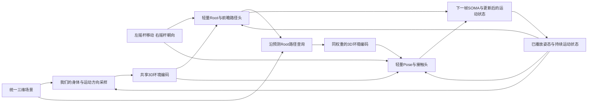

# PFNN 全量数据与 3D 实时运动控制计划

2026-10-21。用户要求：先使用PFNN全部数据，采用我们的环境感知算法，先规划并加强论文复核。
本文件是提案。本轮未启动训练、未连接A100、未更换操控页模型。

## 方向

先把PFNN范围内的行走、跑步、起停、侧移、倒退、转向和已有地形动作做好。
主线是**完整3D场景查询 + 持续运动状态 + 逐帧控制网络**。
保留MotionBricks的已训练资产、环境编码经验和Root先规划/Pose再适应的分工；
现有8token/4Pose pass生成器作为固定对照与可选离线先验。

最终逐帧控制器直接预测下一帧，不能由重复生成32帧后只取第1帧实现。
MB每4帧执行的版本可以作为开发对照，133ms的固定采纳周期不能承担最终逐帧响应目标。

上一轮生成历史训练使前进0.846->1.195m/s，却使16s静止漂移0.270->1.179m、
停止0.933->2.200s、峰穿透2.65->3.55cm。新计划同时训练控制、时序状态和接触，
从原始最终权重建立对照，不把失败小试作为默认初始化。

## 1. “全部PFNN”的具体范围

| 项目 | 已核实范围 |
| --- | --- |
| 源动作 |40原始文件+40镜像；34录制家族；原始独立动捕时长约1.079小时 |
| 30Hz转换 |233,010帧，含镜像；原始单侧116,505帧 |
| 训练 |28家族；12,058准入动作-场景窗口；48,232四方向增强样本 |
| 验证 |4家族；3,533窗口；14,132增强样本 |
| 测试 |2家族；604窗口；2,416增强样本 |
| 全部准入 |16,195窗口、64,780增强样本；地形类别含flat/jumpy/rocky/beam |

新优化样本只来自PFNN训练划分，不继续使用上轮96窗口子集，也不混入新的PARC/BONES训练样本。
若复用混合训练的环境编码或MB先验，模型卡记录其初始化来源。
验证和测试按原录制家族划分；镜像、四方向和同动作的不同地形不跨划分。

每个coverage epoch先保证48,232条训练样本各出现一次，再安排12,058次稀缺任务补采，
形成80%全覆盖/20%补采。补采关注真实起步、制动、静止、侧移/倒退，报告各类实际数量。
总计60,290次窗口曝光/coverage epoch；源文件数、唯一时间覆盖、增强曝光分别计账。
所有失败/未准入记录保留，不通过删除难样本提高成绩。

已有world_v2动捕、地形、接触sidecar与cache复用。先对既有完整索引做轻量覆盖表：
每个源文件有多少准入时间、每个配对场景可连续监督多长、稀缺行为有多少独立事件。
已知80文件均已转换，不等于每段的每一帧都有合格环境监督。暂缺环境准入的时间段列为覆盖缺口；
可以在明确的动作先验任务中使用真实运动，不能直接赋予正确地形标签。

长片段必须来自**同一个场景变换和接触时钟内**的真实连续区间，不能把同BVH的不同地形配对拼接。
原完整索引在远端，本轮依据已下载审计报告规划，长片段数量在实施前核定。
十五张交互地图是部署场景，不等同于7,125个训练配对场景。

数据细节：[完整数据审计](pfnn_all_data_inventory_review_20261021.md)。

## 2. 使用我们的完整3D环境感知

当前实现是在三维位置采样，但场景查询由heightfield生成，空间拓扑仍是2.5D。
这次把场景查询后端升级到真正三维，保留我们的观测算法与特征接口：

- 身体周围、请求运动方向、实际运动方向三个8x8x8区域，共1,536个采样点。
- 查询相对位置、距离、法线、有效性，复用15维特征和共享环境编码。
- Root给出前瞻路径后，沿**预测Root路径**重采样走廊，再交给Pose；当前身体观测每帧更新。
- 原始PFNN地表作为一般三维场景中的一个部件，另可包含独立墙、顶棚、桥面和立体障碍。
- 一份SceneManifest和世界变换同时生成渲染几何、神经查询与独立穿透评估几何。

已有`scene_geometry_field.py`的有界OBB场景和`scene_control_v3/geometry.py`的BVH经验可复用。
需要完成PFNN地表与一般三维部件组合、表面内外定义、最近表面法线及批处理。
开放网格明确为双面表面或先封闭成实体；不能猜测符号。多个实体相交时，内部穿透深度需按并集外边界核验。

旧PFNN几何的表面和接触关系必须保持，不能为了漂亮网格悄悄改变原先的碰撞地面。
新加三维场景使用单独版本和清单。查询加速与独立质量评估分别实现，但消费同一场景。

几何必测：低顶棚+起伏地面、侧墙+台阶、桥上/桥下同时可通行。
“能正确观察这些结构”和“已学会穿越它们”分别验收。
PFNN第一阶段使用实际覆盖的动作；若源数据存在合格低姿态动作，可另建保持其真实轨迹的顶棚配对。
对新增障碍造成冲突的旧动作不继续施加模仿目标；无爬行/攀爬种子的能力留待后续数据阶段。

## 3. 模型与实时接口

**当前指令明确进入模型。** 输入包括期望速度、独立朝向、当前实际速度以及零输入停止状态。
移除新actor中“把指令只放在第31帧终点”的解释。停止由摇杆归零表达，不增加技能按钮。
Root/Pose都看到最新指令，保留移动方向与朝向分离的操作方式。

PFNN没有录制游戏手柄输入，任务标签需明确构造：平稳运动取源后续稳定段的目标速度，
停止事件从真实减速开始标记停止意图，同时保留源动作原有制动过程；移动方向与目标朝向分别提取。
提前量、事件边界和缺失事件记入清单，并与“下一帧实际速度”标签做对照。
这样模型能看到“身体还在移动、当前指令已经停止”的训练例，而不是等身体静止后才收到停止条件。
这些标签是源动作推断的意图；任意反事实输入不能继续沿用不兼容的未来姿态监督。

**持续状态跨帧保存。** 先比较紧凑因果状态与相位/接触辅助状态；不在重规划或输入轻微变化时重置。
相位只由过去观测与模型自身预测更新。离线提取的完整序列相位可以作训练标签，不能成为运行时未来输入。
静止、启动、制动是独立课程，状态能够表达非周期过渡。

**每帧产出真正的新动作。** 新的连续一步头学习Root运动与身体旋转，通过官方FK得到位置/速度并回写历史。
所有历史通道来自实际播放结果，减少冗余位置/速度/朝向通道互相矛盾。
没有运行时IK、锁脚、碰撞投影、输出滤波或独立Root替换。

**保留MB的用途。** 原模型作为固定比较；合格的源动作表示可作辅助先验。
源PFNN动作是监督主体，失败的MB生成不会被当成正确教师。
首版不同时扩大码本或重训VQ编码器；若随后调整编码器/码本，需冻结新codec后重新生成标签。

单帧头的具体宽度、层数与状态维度在P0性能测量后锁定；候选限制为小型MLP/GRU或小型门控网络，
不新增大型Transformer或扩散精化链。其感知输入与MB比较分支保持一致。

## 4. 训练课程

| 阶段 | 训练内容 | 进入下一阶段的依据 |
| --- | --- | --- |
| P0：接口与覆盖 |核对全量索引；3D查询一致性；批处理与单帧原型耗时；新模块梯度/冻结检查 |已有地形查询一致，三种立体结构正确，吞吐与本地帧预算可测 |
| P1：全量一步监督 |完整PFNN覆盖，训练下一帧Root/姿态/速度/接触；环境编码从旧权重起步，小学习率适配；MB词表保持 |每个地形/方向的误差下降，真实步态幅度保留，数据覆盖表完整 |
| P2：渐进闭环 |按0、25%、50%、75%逐步增加自生成历史；展开先4/8/16帧，再延长；保留真实历史监督流 |起步、停止、转向与接续同时改善，不只检查短窗口重建 |
| P3：长时任务 |在合法连续源区间训练更长片段；对另行定义的摇杆任务展开训练制动、静止、进展与几何约束 |16秒静止/停走、独立朝向和地形切换通过；无腿部动作塌缩 |

拟定P1、P2各最多10个coverage epoch，每阶段602,900次窗口曝光；P3按真实长区间与任务episode另计，
先登记数量和曝光上限再运行。不能将33帧窗口复制/补帧成16秒真值。
目标展开长度2/4/8/16秒是课程候选；每种监督只在真实数据或明确任务约束支持的长度上使用。

训练目标分开记录：

1. 源动作的Root运动、全身旋转/FK、关节速度和接触时序，保留自然步态。
2. 当前指令的有符号移动速度、独立朝向、起步响应、松杆制动和停止后的位移。
3. 原源stance区间内的足部滑动、支撑高度与接触释放；预测contact不能自行关闭监督。
4. 实际解码身体对当前3D场景的穿透和摆脚净空；训练可用重点表面采样，验证保持完整skin门。
5. 相邻实际帧的速度/加速度及状态接续，避免只让Root移动、双腿几乎不动。

训练中的动作模仿目标与任务约束分开：
源对齐片段使用真实源标签；改变地形或执行反事实指令后，冲突的源姿态不再作为正确模仿目标。
长时停止可以有零速度/有限制动位移的任务损失，但不能把人工复制的站姿当作录制序列。
对于仅给速度、没有位置目标的任务，不要求网络纠正输入中不可见的“源路径绝对偏移”。
若使用固定路径误差，该路径必须成为显式任务条件，且运行时由用户目标或规划器提供。

速度、停止、接触和步态分别设门，选模型时不能用更快的前进抵消更差的静止漂移。

## 5. 环境是否真的被使用

除了查询数值正确，还要做动作层的受控检查：固定姿态/意图，改变前方台阶高度、侧墙或净空，
检查输出是否提前改变摆脚、Root与身体姿态。保留同样输入下的正确环境、打乱环境和关闭环境对照。
对已播放状态重新采样，禁止把源历史的cached observation直接用于生成历史。

3D查询坐标可按固定观测进行梯度处理，但身体对环境的穿透损失必须对预测身体位置/旋转有梯度。
未知查询点通过valid mask表达；实际身体质量评估仍要求零unknown/uncertain。

## 6. 对照与验收

先跑原始MB固定对照、同数据的单帧主模型，再做最必要的三项消融：
只有高度地形输入、只按输入方向采样而不沿Root预测路径采样、不进行渐进闭环训练。
持续运动状态/相位与接触损失的消融放在主模型有效后，避免同时铺开大量大训练。

PFNN官方demo的IK开/关各留一份结果；模型对比尽可能匹配SOMA骨架、场景、30Hz与相同操作序列。
官方原始骨架/帧率演示单列，不能与重定向后的数值混成一个排名。
模型初始化、额外预训练数据、曝光和GPU时间都记录，区分等数据与等算力比较。

固定检查包括所有15地图的合法路线、平地16秒静止、起步、停止、左右侧移、倒退、原地转向、
快速接近崎岖地形、连续Xbox双摇杆轨迹及跨动作段接续。
按地形与动作类别报告，保留全部失败；完整18,056顶点、8substeps、峰穿透<=2cm、原stance与零unknown/uncertain不变。

控制研发目标：1.2m/s指令下稳定速度80%–120%；停止后0.5s内速度低于0.1m/s并保持；
16秒静止位移<=5cm；朝向P95<=15度。速度/急转组合必须结合数据覆盖单列。
实测本地控制30Hz、显示>=30fps、输入到画面P95<=100ms；完整关键计算链P99目标<=20ms，报告超期率。
这些是研发验收目标，尚未实测通过。

既有测试录制家族仅为两组上楼梯。平地/复杂操控另用预先封存的场景与输入序列评价，
单列为交互泛化测试，不将它写成未见真人平地动捕的泛化结果。

## 7. A100与性能预算提案

规划按两张当时真正空闲的A100计算，不固定占用编号。P0先测完整训练step和本地推理耗时，
再锁定实际batch与epoch预算。优先批量化我们的场景查询和多角色训练，不能沿用单样本Python循环硬跑全量。
初始尝试global256、每卡micro16；最后不完整batch按实际样本数计权，保证不丢尾部数据。

| 工作 | 首批aggregate GPU-hour上限提案 |
| --- | ---: |
| P0几何/批量/帧预算及小型梯度预检 |4 |
| P1全量一步监督 |16 |
| P2渐进闭环与初步长时课程 |24 |
| P3任务/接触细化 |12 |
| 必要对照、固定端点评估 |8 |
| 合计 |64 |

epoch上限与wall/GPU上限取先到者。达到时间上限时记录实际覆盖程度，不能缩小数据后仍称“全量”。
吞吐不足先处理批处理；本轮64GPU小时是下一执行阶段的预算建议，并未提交任何作业。
训练模型不进入用户页面，直到控制、几何与本地实时检查全部通过。

## 8. 论文依据与实际下一步

本轮直接阅读PFNN、MotionBricks、DartControl、RTC、PARC、AAMDM和SceMoS原文，
并复核DeepPhase作者技术解释及MANN/Local Motion Phases/NSM作者资料。
逐条机制与取舍见[论文复核](pfnn_3d_literature_review_20261021.md)。

建议执行顺序：先完整索引覆盖表和3D场景统一，再做帧级模型的性能原型；
预算与接口锁定后，启动PFNN全量训练，最后进入Xbox操控验收。
