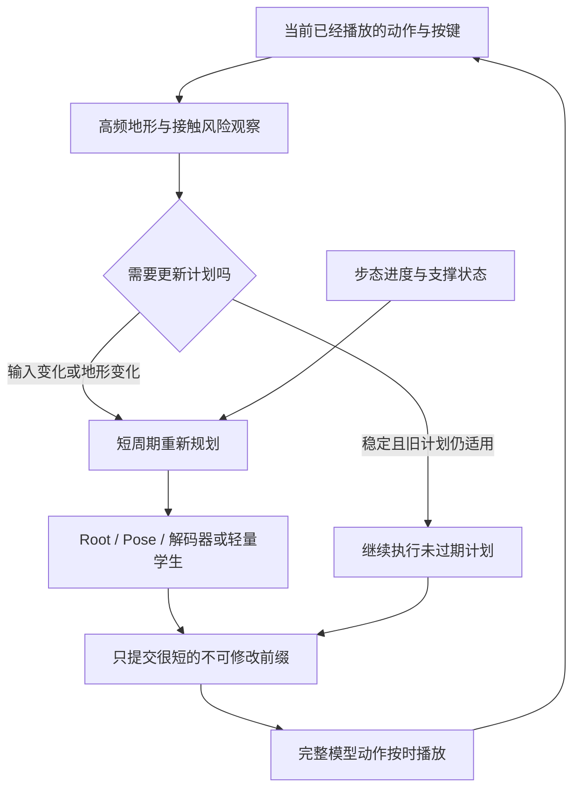

# PFNN 地形响应与调参记录

当前方法的易读论文图：`figures/pfnn_method_simple_20261017_final/terrain_aware_motionbricks_method_zh.png`。同目录含中英版SVG/PDF和`caption.txt`；用五个功能步骤说明当前链路，未将后续设想画成已实现模块。较复杂的初版图保留，但主展示采用此简版。

2026-10-17 Asia/Singapore。当前人工任务包括：解决快速进入崎岖地形时的穿插、解释与原版PFNN响应速度的区别、提供更详细的调参页面。新增工作全部为零optimizer诊断和运行时工程，未批准或执行额外训练。

## 实测结论

原服务在指令不变时，每次生成32帧窗口并播放其中24帧，所以每0.8秒才重新观察地形。30fps是播放频率，不能当作模型30Hz重规划。另有八帧提前计算造成的指令滞后，但用户明确强调高速进入崎岖地形，本轮重点测地形更新。

在原003地图、原固定入口、同一最终权重上，预先固定idle、forward/left、1.6/4m/s指令，比较24帧与8帧反馈。每条移动测试72帧，idle48帧；无训练、无IK、无平滑、无失败删除。完整18056顶点、8substeps、原prism查询；全部unknown/uncertain为0。

| 测试 | 重规划间隔 | 最大身体穿透 | 2.4秒实际XZ路程 |
| --- | ---: | ---: | ---: |
| 前进4m/s | 24帧 | 1.2857m | 6.0030m |
| 前进4m/s | 8帧 | 0.5629m | 4.8754m |
| 前进4m/s | 4帧离线反馈 | 0.0845m | 3.3697m |
| 前进4m/s | 1帧离线反馈 | 0.0977m | 4.1144m |
| 左行4m/s | 24帧 | 0.2927m | 7.6872m |
| 左行4m/s | 8帧 | 0.1662m | 6.9763m |
| 左行4m/s | 4帧离线反馈 | 0.1392m | 6.1242m |
| 左行4m/s | 1帧离线反馈 | 0.1958m | 7.5594m |

这些是固定短脚本，不是完整路线批准。频繁反馈改变了实际速度和路径，不能把全部穿透下降归因于观察延迟；两条慢速8帧反馈的边界加速度也升高。1帧并不在所有方向优于4帧。全部移动设置仍未过原2cm门。

从已保存生成状态做6次新的原生预测，不重复旧rollout：输入已有明确地形起伏，体积观察已知比例99.74%-100%；高速offset16的新Root预测距其对应地面最低仅0.552m，解码后0.556m。Root与解码高度差最大3.35-7.38cm。此证据表明刚更新观察的预测也有规划/姿态残差，不能只靠提频宣称彻底解决，也不证明具体训练损失或大batch是唯一原因。

## PFNN 的差异

作者`pfnn.cpp`的网络为342输入、两个512隐藏层、311输出，在每次主循环执行一次回归，权重按步态相位选择/插值。它同时逐次更新轨迹地形采样。原演示默认enable_ik=true，包含脚跟/脚尖地形修正、锁脚及extra_joint_smooth=0.5。这些后处理当前模型没有，仍不擅自加入。

本机共享RTX3080下，逐帧离线模型+观察+history循环平均约56-65ms，尚不满足30Hz的33.3ms预算，也不是独占GPU基准。八帧包内部按1帧重规划需要约604ms，按4帧约122ms，8帧约73ms。1帧是高负载实验档，不能把目标30Hz称为实际30Hz。

## 运行时调参实现

新`motionbricks.pfnn_runtime_tuning.v1`只用于PFNN地图浏览器，原FullCorpusAcceptanceRuntime固定合同仍保留。默认仍24帧。提供1/2/4/8/16/24重规划档、6-16编码长度、1-8轮Pose、前视距离/增益/基础距离、观察半宽、速度和镜头设置。路径修正0、无IK/输出修正、四帧history、八帧完整传输与30Hz播放时钟不变。

1/2/4档在一个不可修改的八帧动作包内部，使用已经生成的前缀重新观察并预测，每帧仍是原生模型输出；不能将它误称为键盘每帧重新采样或全流程单帧网络传输。实际播放history仍只在八帧确认后更新。下一包预取与串行计算必须逐值一致。非默认预测长度/轮数/高度观察参数使用原生执行，恢复原始Transformer参考，绝不套不兼容的旧图。

调参页位于`/settings`，与原场景通过同源BroadcastChannel通信。参数分为待应用和实际播放生效值；个人预设及JSON导入导出保存本地，模型不训练。原始预设可一键恢复。对话中最新详细调参请求授权这些实验运行参数，不代表新增训练预算或模型质量批准。

`pfnn_tuning_runtime_v2`已通过六种重规划档的独立串行/预取逐值比较、八帧不丢失及播放前history不变，并实际运行12编码、2轮、手工前视和4帧+2轮组合；全部模型hash未变，0optimizer。v1暴露了最终八帧publication与内部重编码history在浮点末位上的差异，已将_last_published_history绑定实际publication修正；失败证据保留。69项Python、5项JS检查通过（与其他旧套件有重叠，不累计）。实际页面验收另记。

## 未采用的优化

单独捕获地形查询的v1未过逐值输入比较（约5.96e-8差）；v2按既有compiled观察门检查后，又未过原history1e-5比较（约1.43e-5差）。两份源码和日志保留在terrain_scene_graph_v1/v2，均未部署，没有进一步放宽门。正式ReusableTerrainExecution已恢复SHA f7f98e10f7e7db80333b8eefb07b5a8e42ba170c97b14e3e653bfdc8523b97d6。不得将这两个失败探针当速度或质量证明。

## 证据

- `terrain_refresh_diagnosis_v1/complete.json` SHA3c2bf67460db91954717d1477c9330ce0034b03a1f56a0506aa0fc0ca96b7a3b。
- `terrain_refresh_inputs_v1/complete.json` SHAbcfeafc746e975a7d6221d0a0a9b80ace02b55860d53f10c69798f2a34e70ddf。
- `terrain_frame_feedback_v1/complete.json` SHAad9a36a0acfebecc6c33d7e3884689b1d480f6ccd9c0a9566b0613ba26d39d01。
- `pfnn_tuning_runtime_v2/complete.json` SHA69712ddbfbec782f56fca25c1067165a373c434d56e40a18a2a41e208a46fbd5。

全部位于`out/pfnn_mixed_20261015/`。本轮并未证明穿插已根治；新增训练仍需独立具体预算，旧512000曝光codec小试未批准、未执行。

## 2026-10-17 路线调查与执行计划

最新请求：demo与小调参面板必须同窗口；同时仔细调查各种能兼顾地形质量与快速响应的办法，先给可比较、可验证的计划。下述新研究路线均为待验证方案，没有启动新训练。

### 先纠正一个过强结论

“MotionBricks是分段模型，因此无法快速响应”并不成立。原论文附录C推荐3-9帧重规划，并在指令变化时触发；还观察到过度频繁重规划损伤动作细节与连贯性。它的工程演示使用ONNX/TensorRT，报告的2ms来自RTX5090，不能当作本机3080加地形查询/蒙皮/通信的成绩。[MotionBricks 原论文，7.4、附录C/G](https://arxiv.org/html/2604.24833v1#A3)

本项目当前24帧缓存、八帧传输和较重的Python地形查询/诊断是需要逐项测量的实现选择；换掉整个生成模型不是第一步。另一方面，原PFNN的轻型相位网络、逐次地形输入和默认脚部IK不能混为单一“网络速度”优势。[PFNN 作者说明](https://theorangeduck.com/page/phase-functioned-neural-networks-character-control)

### 要优化的三种延迟

| 指标 | 定义 | 当前问题或目标 |
| --- | --- | --- |
| 输入生效延迟 | 按键变化到首个使用该指令的已播放动作 | 要区分浏览器排队、预取旧指令、生成计算、不可修改包的剩余播放时间 |
| 地形观察年龄 | 一帧动作实际使用的地形查询相距当前状态多久 | 原24帧计划约0.8s；4帧内部重规划约0.133s，但仍提前生成整包 |
| 运动反应延迟 | 地形变化被看到后，到抬腿/身体升高/接触切换 | 取决于模型学到的步态与支撑；减少计算时间不会自动消除这部分 |

30fps只表示播放时钟。需要另记几何采样频率、真实推理频率及input-to-photon的P50/P95。若想30Hz每帧都完整重算，模型和观察链路总P95需低于33.3ms，并给渲染/传输留出余量；60Hz则16.7ms。本机达成与否必须实测，不引用别人的GPU成绩替代。

### 各条途径的取舍

| 路线 | 实际改变 | 可解决的问题 | 局限/成本 | 优先级 |
| --- | --- | --- | --- | --- |
| 1. 固定短周期重规划 | 在8/4/2/1帧反馈间隔做受控比较 | 减少较老地形计划继续播放 | 已见较慢/较抖，1帧不总优于4帧；不能独自保证接触 | 先用零更新实验确定可行区间 |
| 2. 指令/地形事件触发 | 稳定平地可复用；转向或即将越过明显高度变化时提前生成 | 降低平均计算与危险区域观察年龄 | 触发必须来自当前允许查询；需避免频繁开关、保证每包history身份 | 首选工程路线 |
| 3. 缩短不可修改的前缀 | 将传输八帧和真正不可撤销的播放承诺分开 | 减少已经算好旧包仍必须等待的指令延迟 | 新会话协议和独立profile；不能改写已播放帧、补帧或偷偷替换旧协议 | 与路线2组合评估 |
| 4. 推理和观察执行优化 | 先分项profile，再减少CPU同步、诊断序列化、分配和重复查询；再试ONNX/TensorRT | 同样数学结果下减少算力等待 | BVH动态输入和浮点一致性要独立准入；失败的查询capture不得复活当成功 | 与路线2并行准备 |
| 5. 步态/接触连续的短周期模型 | 预测时保留脚处于支撑还是摆动、周期进度，训练连续短反馈 | 避免反复从片段开头生成、脚步停滞或换脚跳动 | 增加状态与训练；接触不能依赖虚构地面真值 | 首选模型改进 |
| 6. 对准可能落脚处的观察 | 保留近处密集地形，沿预测运动和摆动脚候选位置查询；保持原观察做对照 | 避免只看到输入直线、实际侧移/转向后漏掉落脚台阶 | 新输入必须配套训练；来自静态场景查询，不可使用源未来姿态/Root答案 | 先检查漏看证据，再实施 |
| 7. 接触几何损失与闭环训练 | 在训练计算真实FK/skin、接触期滑动及边界连续；加入生成history恢复 | 模型已看到地形却未抬脚、Root高度不足、滚动误差累积 | 新训练预算；只压穿透可能造成漂浮/减速，要配支撑和路径约束 | 最有依据的质量路线 |
| 8. 轻量逐帧学生模型 | 大模型供训练监督，小模型用当前状态/地形/相位直接生成1-4帧 | 争取PFNN式低计算、低反馈延迟 | 需要训练且教师本身失败时不能直接蒸馏错误；须保留合法源运动与几何监督 | 当工程优化仍不够快时进入 |
| 9. Motion Matching / Learned Motion Matching | 根据当前动作和地形检索可接续片段，或学一个紧凑替代 | 质量容易追溯，逐次响应可控 | 数据地形覆盖、内存与接续成本；传统版本常用混合/IK，不直接套用当前约束 | 作为独立对照控制器 |
| 10. 慢规划 + 快速物理跟踪 | 生成器给参考，小策略按当前身体/接触/地形逐步执行 | 执行中实际碰撞与支撑反馈，可从偏离中恢复 | 需要带碰撞体的物理角色、控制策略与新训练；网格仍须原精度验收 | 长期架构备选 |
| 11. 多候选/在线约束搜索 | 生成多个动作候选按地形与接触打分 | 在固定模型内提高找到可行运动的概率 | 延迟和显存明显增加；在线迭代不适合当前首要速度目标；新profile | 低优先，限离线可行性对照 |
| 12. IK/锁脚/投影及输出平滑 | 直接修正已生成姿态 | 可快速改善局部视觉接触 | 与当前明确约束冲突，不能当作本轮模型改进 | 仅列出，不实施 |

路线5中的相位不是必须使用手工正弦钟：PFNN显式周期状态是一种选择，DeepPhase可学习身体各部位的周期特征。它提供连续性思路，不直接证明在本项目崎岖地形上有效。[DeepPhase 作者/研究机构介绍](https://www.ea.com/news/deepphase-periodic-autoencoders-learning-motion-phase-manifolds)

路线7有直接相关的研究依据：PARC讨论历史动作条件可能压过地形条件，并使用穿透监督与物理数据增强；DART在训练中逐步引入生成history以提高长序列稳定性。这些机制值得作对照，但论文模型与当前token链不同，不能照搬或宣称保证2cm门。[PARC 5.3](https://arxiv.org/html/2505.04002v1#S5.SS3)、[DART 3.2](https://arxiv.org/html/2410.05260v3#S3.SS2)

路线8/9的参考是用较小网络近似可解释控制步骤，而非盲目改成另一个大生成器。Learned Motion Matching说明了把匹配步骤学成小网络的做法；若采用其思路，需要另建SOMA和当前地形条件下的训练及对照。[Learned Motion Matching 作者原论文](https://theorangeduck.com/media/uploads/other_stuff/Learned_Motion_Matching.pdf)

路线10参考CLoSD将计划与逐步物理执行分开，以及PARC的30Hz控制/120Hz仿真。高层计划的生成速度不等于真实接触控制速度。物理路线也不能承诺完整皮肤绝不穿插，因为碰撞体常是近似体。[CLoSD 4.2-4.3](https://arxiv.org/html/2410.03441v1#S4.SS2)、[PARC 6](https://arxiv.org/html/2505.04002v1#S6)

### 我建议采用的组合

第一选择是保留现有MotionBricks的动作能力，组合“高频轻量地形检测 + 4-8帧的正常重规划 + 地形/输入变化事件触发 + 更短的不可修改前缀”。需要时再加入“步态与支撑状态”及“生成history接触训练”。若同机优化后仍达不到预算，才把高频执行部分蒸馏成小模型，形成慢规划/快执行，而不是让完整大模型每帧都重算。

“风险”只用来决定何时重新生成或记录失败，不通过抬高Root、锁脚或碰撞投影去改输出。地形高差/坡度必须在技能可完成的范围内；对于物理不可行的4m/s要求，要明确报告速度/进度和所需步态，不把减速或绕路隐瞒成同速成功。

### 依次推进，每一步都有退出条件

1. **建立公平基线，0更新。** 复用已完成诊断记录，不重做数据准备。新增比较分两种：同一个冻结history和指令的一步预测，用来隔离计算/观察问题；生成闭环的完整通过，用来检查误差累积。报告同时间以及同前进路程的误差，失败和未走完都保留。003已有结果属于探索，不用于新训练抽样或模型选择；新研究方案只用独立的训练/验证分组，test仅最终验收。
2. **分项测量与工程对照，0更新。** 分别记观察/BVH、地形编码、Root、四轮Pose、解码、FK/skin、CPU同步、序列化、网络和浏览器排队的P50/P95。比较8/4帧与事件触发的额外收益，预先限定最多6种设置，每设置同一组12条验证脚本。预算为每条最多6秒、合计最多12960个生成播放帧，遇unknown按失败停该条，不重复补跑。该数量是后续检查上限，尚未执行。先目标让4帧设置每包P95低于200ms并保持30fps，再争取单次重规划P95小于50ms；这些是目标，不是已实现成绩。
3. **区分“没看见”和“看见没做到”，0更新。** 对既有状态记录观察覆盖、实际走向与脚候选落点、Root高度和解码差异。核对渲染三角面与训练/查询的台阶prism在陡坡处的差别；不据此直接更换原几何定义或重新审计全数据。若输入覆盖不足，先做路线6；若输入已充分但输出失败，优先路线5/7。
4. **准备小规模训练对照，待独立授权。** 建议固定同一最终父模型/源训练集合/新增曝光预算，分“继续原目标”“新增地形接触目标”“接触目标+生成history+步态连续”三臂；第一轮每臂500Adam、global256，合计1500Adam/384000新增曝光作为提议上限，尚无批准。训练模块、loss系数和生成history目标对齐必须先完成零更新梯度/冻结/原生前向校验。默认先固定codec编码器/码本，针对共享地形适配、Root/Pose适配和解码适配验证梯度可达性；不因试验方便解冻全部模型。若scope无法同时改善Root与脚接触，重新提出范围，不追加此预算。此前512000曝光codec方案仍是另一个未批准提案，不与本方案叠加或自动启动。
5. **再决定是否训练小学生。** 只有通过同速地形几何与接续检查的教师/合法源监督才可成为学生目标。教师失败窗口只能用于明确失败/几何约束或学习恢复，不能被标成正确姿态。先比较一步/四步小网络的预测上限和P95，确认值得投入才提出单独预算。Motion Matching、物理跟踪和多候选仅作架构对照，不同时开启多个大训练。
6. **完整验收。** 所有候选仍过18056顶点、8substeps、峰穿透<=2cm、零unknown/uncertain、原stance门、完整路线、平地idle16秒及起停转向、跨块连续、训推一致、真实本地WASD30fps。另报告实际平均/峰值速度、进度、漂浮、足底滑动、关节加速度和输入延迟；不以均值掩盖峰值，不通过删失败/降低速度/换短路线达标。

### 同屏调参交付

页面已改为demo内右侧338px小面板，响应/地形/生成/镜头/约定分页；窄屏为上下分区。折叠时渲染画布恢复全宽，展开时按画布实际尺寸设置相机和WebGL viewport，角色与参数互不遮挡。个人预设/导入导出和实际值对照收在可展开区域。面板绑定所在demo的会话ID，避免误控另一个标签。

页面服务此前已退出，当前恢复为28943/PID60524，完整cmdline为`scripts.soma_pfnn_maps_server`加原bundle/catalog及`--readiness-report .../pfnn_inline_tuning_readiness_v1.json`；readiness SHA807029490b678c66fdb2315933d016c034a1bef463db31607a982cb9f7bf51dd。没有恢复/启动旧训练，原模型graph source仍f7f98e...。新面板曾实际应用4帧档并显示已生效，007静止观察超过1000帧时采样约30.0fps/0underrun；这是UI/性能验证，不是快速越障质量通过。最终当前设置以浏览器验收记录为准。

最后已恢复24帧原始预设和007/2m/s，继续播放；同屏数值输入2→2.5→2和实际生效确认通过，收起后画布1280px、展开后942px+338px互不重叠。390x844窄屏角色与面板均可见、无页面水平溢出，viewport恢复默认1280x720。5项既有JS参数合同测试和语法检查通过，额外改动不涉及模型。最终证据`pfnn_inline_tuning_browser_v1.json`、`pfnn_inline_tuning_desktop_final.jpg`、`pfnn_inline_tuning_mobile_v1.jpg`；旧单独/settings不再从demo按钮打开，原来独立页仍可访问但不是主要操作入口。
