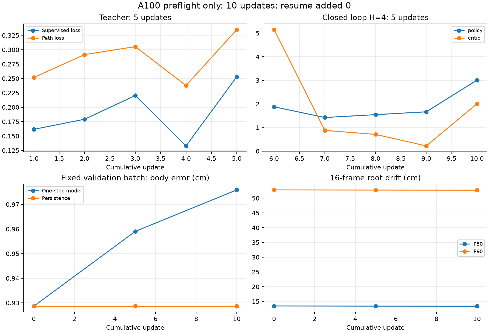
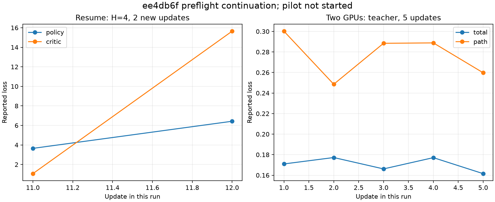
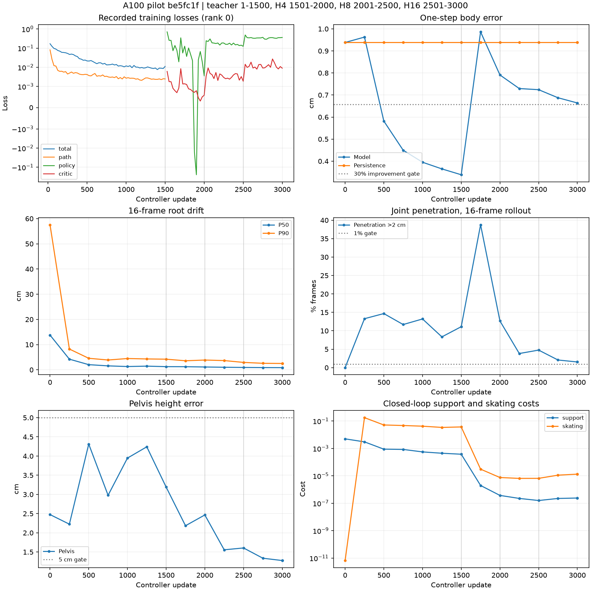

# 第7步A100 pilot：迁移、单卡冒烟与resume检查

执行日期：**2026-10-25（Asia/Singapore）**，文件名日期沿用任务约定。用户已批准[训练计划](terrain_controller_pilot_plan_20261024.md)，执行源码固定为`9785c012cfd51b113fd8dc245034a6e46f98d36f`。

**依赖已修复，82项测试、全量迁移校验和单卡冒烟均通过；resume未通过，正式pilot尚未启动。** resume应从10次更新继续到12次，实际仍为10次，脚本累计exposures也保持400而非528。恢复前后的模型与critic权重逐tensor一致，测量器记录新增更新为0。

按预检失败即停止的规则，双卡冒烟、H=16显存预检和正式pilot均未启动。没有修改训练实现、调整超参数或追加预算。

## 1. 环境修复与测试

最初补装pandas使用`--no-deps`，遗漏pytz，造成81通过、1失败；这份[初次依赖诊断](../../examples/results/terrain_controller_pilot_a100_20261024/preflight_report.json)保留原始traceback。用户确认依赖小问题自行修复后，在同一独立依赖目录补齐pytz和tzdata：

```bash
$PY -m pip install --target "$STEP7_ROOT/runtime_extra" pytz==2025.2 tzdata==2025.2
export PYTHONPATH="$STEP7_ROOT/runtime_extra:$KIMODO_ROOT"
```

实际环境：Python3.11.17、Torch2.5.1+cu124、NumPy1.26.4、pandas2.3.3、pytz2025.2、tzdata2025.2、pytest9.1.1。基础环境没有修改，Kimodo沿用项目已有资源。CPU准备工作使用`CUDA_VISIBLE_DEVICES=''`，OMP/OpenBLAS/MKL为单线程，`TMPDIR`使用项目临时目录。

```bash
$PY -m pytest tests/test_bones_env_dataset.py tests/test_terrain_controller.py \
  tests/test_skeleton_ray_sampler.py tests/test_bones_terrain_fit.py \
  tests/test_bones_terrain_scene.py tests/test_bones_terrain_screen.py \
  tests/test_bones_terrain_survey.py -q --full-trace --color=no \
  --junitxml=runs/tmt_pilot_coord/tests_ready.xml
```

结果：**`82 passed, 11 warnings in 7.96s`，0失败、0跳过**。原始日志和JUnit留在A100的`runs/tmt_pilot_coord/`。

## 2. 从PRO6000迁移默认E集

源为PRO6000的`runs/bones_env_v1`，包含5,650个shard、`manifest.jsonl`和`report.json`。源端逐文件计算SHA-256，在新传输目录打包，经既有M78链路上传私有Google Drive；A100从Drive下载并逐文件复核。A100 SSH仅用于控制和状态，没有承载文件payload。

| 项目 | 结果 |
| --- | ---: |
| 源文件数 / 已核对文件数 | 5,652 / 5,652 |
| 源字节 / 目的字节 | 1,711,809,448 / 1,711,809,448 |
| 不一致文件 | 0 |
| 归档字节 | 1,399,488,336 |
| 源端打包秒数 | 45.502 |
| 源端打包加上传秒数 | 297.914 |
| A100下载、解包及复核秒数 | 50.221 |

| 对象 | SHA-256 |
| --- | --- |
| 归档 | `2998ba8131aba43976083cb02c6d01a2186e9d26e955f57abefa7b8923c4872c` |
| 逐文件SHA清单 | `5aaa9e1ada746ad02d61a5c499ba896213f52fba0d75200e7104ec90d4497e5a` |
| 源与目的dataset manifest | `67808b6813a42b676b58607b47bedc0bda9566819bee258f6ac4416c5a33c74d` |

数据位于A100任务仓库的`runs/bones_env_v1/`；逐文件清单和校验回执为`runs/tmt_pilot_coord/transfer/files.json`、`transfer_verified.json`。后续接手可复用这份已核验的数据。

## 3. 单卡冒烟

每次GPU启动前均扫描所有GPU的index、UUID、显存、利用率和计算PID。最初候选为GPU1/3；迁移期间空闲状态改变，启动时重新选择并固定**物理GPU0、GPU1**。单卡阶段只使用该对卡中的GPU0，通过UUID设置`CUDA_VISIBLE_DEVICES`。

```bash
$PY scripts/train_terrain_controller.py --dataset runs/bones_env_v1 \
  --output runs/tmt_smoke_1gpu --phases teacher:5 loop:4:5 \
  --batch 16 --max-hours 0.2 --eval-every 5 --log-every 1 --eval-batch 32
```

实际由协调目录的测量包装器执行上述原始脚本和参数，外层`timeout`为750秒，记录全部命令、退出码和每次更新的耗时。训练函数和AdamW仍调用原实现；计时从前向/损失开始到模型optimizer.step结束，两端同步CUDA，不含数据加载和评估。

**单卡冒烟通过，退出0，完成10次更新，损失与评估有限。** 外层壁钟13.109秒，原脚本最终elapsed为7.3秒。写出`phase0_teacher.pt`、`phase1_loop4.pt`及`latest.pt`，均留在A100。

| 阶段 | 更新 | 平均秒/更新 | 中位秒/更新 | 最大秒/更新 |
| --- | --- | --- | --- | --- |
| teacher:0 | 5 | 0.112330 | 0.072061 | 0.279179 |
| loop:4 | 5 | 0.320269 | 0.317822 | 0.339143 |

`torch.cuda.max_memory_allocated`为**136,466,432 bytes，约130.14MiB**；`torch.cuda.get_device_properties().total_memory`为**85,100,068,864 bytes**。这是batch16、H=4冒烟的峰值；计划中的batch512、H=16显存预检未执行，因此尚未决定pilot批量。

## 4. Resume失败证据

```bash
$PY scripts/train_terrain_controller.py --dataset runs/bones_env_v1 \
  --output runs/tmt_smoke_resume --phases teacher:5 loop:4:7 \
  --resume runs/tmt_smoke_1gpu/latest.pt \
  --batch 16 --max-hours 0.2 --eval-every 5 --log-every 1 --eval-batch 32
```

进程退出0、输出`stopped=complete`，外层壁钟8.262秒，但计数检查失败：

| 字段 | 恢复起点 | 预期结束 | 实际结束 |
| --- | ---: | ---: | ---: |
| update | 10 | 12 | 10 |
| 脚本exposures | 400 | 528 | 400 |
| 本次新增更新 | 0 | 2 | 0 |
| 本次新增exposures | 0 | 128 | 0 |

checkpoint的恢复状态为`phase_index=2, phase_update=0`。训练入口[第128行](../../scripts/train_terrain_controller.py#L128)直接恢复这份state，[第171行](../../scripts/train_terrain_controller.py#L171)从该phase_index迭代；新命令仍只有两个阶段，因此`range(2, 2)`为空。原运行在[第223行](../../scripts/train_terrain_controller.py#L223)将完成游标推进到2，最终`latest.pt`保存了这个游标。把第二阶段配额从5改为7，没有重新定位到第二阶段已完成的第5次更新。

测量器记录resume的optimizer调用次数为0；恢复前后model、critic各自所有state tensor逐一相等。这里没有异常traceback，失败证据是计数和权重不变。结构化证据在[report.json](../../examples/results/terrain_controller_pilot_a100_20261024/report.json)。训练源码保持批准版本，本次未修补恢复逻辑或换用其他checkpoint继续。

## 5. 已有评估与曲线

固定验证批量为32窗。以下保留原脚本产生的全部5行评估：单卡阶段更新0/5/10，以及单卡结束时的重复更新10、resume结束时的更新10。重复评估没有增加优化器更新。

| 运行/序号 | 更新 | 一步cm | 保持基线cm | 根漂移P50cm | 根漂移P90cm | 穿透超2cm帧比例 | 骨盆高度误差cm |
| --- | --- | --- | --- | --- | --- | --- | --- |
| a/0 | 0 | 0.928659 | 0.928659 | 13.4661 | 52.7991 | 0 | 2.69591 |
| a/1 | 5 | 0.959057 | 0.928659 | 13.4137 | 52.7458 | 0 | 2.69694 |
| a/2 | 10 | 0.975893 | 0.928659 | 13.3902 | 52.7117 | 0 | 2.70074 |
| a/3 | 10 | 0.975893 | 0.928659 | 13.3902 | 52.7117 | 0 | 2.70074 |
| b/0 | 10 | 0.975893 | 0.928659 | 13.3902 | 52.7117 | 0 | 2.70074 |

| 运行/序号 | command_velocity | command_heading | penetration | support | skating | smoothness |
| --- | --- | --- | --- | --- | --- | --- |
| a/0 | 0.417704 | 0.0258499 | 1.71906e-08 | 0.00532174 | 7.02294e-12 | 0.418298 |
| a/1 | 0.4173 | 0.025811 | 2.32541e-07 | 0.00520067 | 0.000159428 | 0.415534 |
| a/2 | 0.417004 | 0.0258274 | 4.01226e-07 | 0.0048651 | 0.000221213 | 0.414351 |
| a/3 | 0.417004 | 0.0258274 | 4.01226e-07 | 0.0048651 | 0.000221213 | 0.414351 |
| b/0 | 0.417004 | 0.0258274 | 4.01226e-07 | 0.0048651 | 0.000221213 | 0.414351 |

全部精度与闭环代价的原始数值见[评估TSV](../../examples/results/terrain_controller_pilot_a100_20261024/evaluation_table.tsv)。



曲线来自已保存的`progress.jsonl`与`eval.jsonl`，未新增推理或训练。正式pilot未启动，六个验证窗口的source/闭环接触图未生成。

## 6. 计划第4节的阈值诊断

下表使用10次冒烟更新的末值。正式pilot验收状态为**未评估**。

| 判据 | 阈值 | 冒烟末值 | 冒烟诊断 |
| --- | --- | --- | --- |
| 数值 | 全程有限；完成或到时保存 | 两次命令退出0、数值有限且有checkpoint | 通过 |
| 一步全身误差 | 比保持基线至少低30% | 0.975893cm，基线0.928659cm | 失败 |
| 根漂移P50 | 低于初始且<10cm | 13.466064 → 13.390215cm | 失败 |
| 关节穿透超2cm帧比例 | ≤1% | 0.000% | 通过 |
| 骨盆高度误差 | <5cm | 2.700739cm | 通过 |
| 滑步和支撑代价 | 均低于初始 | skating 7.02294e-12 → 0.000221213；support 0.00532174 → 0.0048651 | 失败 |

## 7. 最终账本与执行状态

| 范围 | 控制器更新 | 窗口曝光 | 训练闭环生成帧 |
| --- | ---: | ---: | ---: |
| 单卡teacher预检 | 5 | 80 | 0 |
| 单卡H=4预检 | 5 | 80 | 320 |
| resume新增 | 0 | 0 | 0 |
| 预检合计 | **10** | **160** | **320** |
| 正式pilot | **0** | **0** | **0** |

脚本的`exposures=400`把teacher窗口80与loop生成帧320相加，因此上表将窗口与生成帧分开。另有5次固定批次验证，共160窗次、2,560个闭环诊断帧和160个单步预测，不计入训练曝光。

critic另执行了5次优化器更新。读取checkpoint确认，控制器optimizer的step值为10，critic为5；resume后的critic仍为5。正式pilot的控制器与critic更新均为0。

双卡冒烟、H=16显存预检、正式pilot均未执行；没有触发3小时停止、没有恢复或扩展pilot预算，也没有部署模型。后续应先修复并验证“已完成阶段延长后恢复”的计数行为，再继续剩余预检。

## 8. 发布与文件位置

checkpoint和原始日志留在A100的`runs/tmt_smoke_1gpu/`、`runs/tmt_smoke_resume/`、`runs/tmt_pilot_coord/`。公共[结果目录](../../examples/results/terrain_controller_pilot_a100_20261024/README.md)仅发布报告、评估表和预检曲线；checkpoint只记录路径、大小与SHA-256。数据传输和结果取回均使用私有Drive。

发布前检查源码哈希未改变、迁移总数一致、resume权重相等证据、账本、PNG、TSV列宽，以及仓库链接和所有变更记录的UTF-8/U+FFFD。

## 9. ee4db6f 续跑

以下为**2026-10-25**的追加记录，上文旧失败及其结果文件原样保留。新执行源码固定为`ee4db6f40bcd5dbe50ff56292967b5a40d8c0d2e`。

**84项测试和resume2通过；双卡冒烟完成运行，但检查未通过，显存预检与正式pilot未启动。** 双卡输出了2个checkpoint文件，而要求为1个；另外，两个rank从不同的模型参数开始训练，结束时仍不一致。原始checkpoint、日志和rank记录留在A100。

### 9.1 更新、测试与复用

A100 checkout经`git pull --ff-only origin main`更新到上述版本，独立依赖目录、Torch2.5.1+cu124与Kimodo沿用已验证环境。运行原七个测试文件加新增的`tests/test_train_terrain_controller.py`：

```bash
$PY -m pytest tests/test_bones_env_dataset.py tests/test_terrain_controller.py \
  tests/test_skeleton_ray_sampler.py tests/test_bones_terrain_fit.py \
  tests/test_bones_terrain_scene.py tests/test_bones_terrain_screen.py \
  tests/test_bones_terrain_survey.py tests/test_train_terrain_controller.py \
  -q --full-trace --color=no --junitxml=runs/tmt_pilot_coord_v2/tests.xml
```

结果为**`84 passed, 11 warnings in 8.13s`**，0失败、0跳过。

直接复用已通过的5,652文件迁移及`runs/tmt_smoke_1gpu/latest.pt`，没有重传数据或重跑单卡冒烟。再次读取旧checkpoint的SHA-256，与先前记录一致。每个新GPU任务前重新扫描全部GPU的UUID、显存、利用率与计算PID，锁定空闲的物理**GPU0和GPU1**；resume2仅使用GPU0。

### 9.2 Resume2通过

```bash
$PY scripts/train_terrain_controller.py --dataset runs/bones_env_v1 \
  --output runs/tmt_smoke_resume2 --phases teacher:5 loop:4:7 \
  --resume runs/tmt_smoke_1gpu/latest.pt \
  --batch 16 --max-hours 0.2 --eval-every 5 --log-every 1 --eval-batch 32
```

日志记录的恢复位置完全符合要求：

```json
{"resumed_at_update": 10, "phase_index": 1, "phase_update": 5}
```

最终**update=12、exposures=528**，较旧单卡冒烟新增**2次控制器更新、2次critic更新、32个窗口、128个H=4生成帧**。退出码0，外层耗时9.532秒，损失与评估均有限。

### 9.3 双卡运行与检查

```bash
torchrun --standalone --nnodes 1 --nproc_per_node 2 \
  scripts/train_terrain_controller.py --dataset runs/bones_env_v1 \
  --output runs/tmt_smoke_2gpu --phases teacher:5 \
  --batch 64 --max-hours 0.2 --log-every 1 --eval-batch 64
```

实际通过只记录计时、参数摘要和保存事件的包装器执行同一训练入口与参数。没有改变损失、随机种子、梯度平均或保存逻辑。外层耗时**13.458秒**，两个rank均退出0、各完成5次控制器更新；全局batch128，累计640窗口，exposures=640。

| Rank | 退出码 | 更新 | 保存事件 |
| --- | --- | --- | --- |
| 0 | 0 | 5 | phase0_teacher.pt, latest.pt |
| 1 | 0 | 5 | 无 |

只有rank0写文件，实际文件为`phase0_teacher.pt`与`latest.pt`。原入口在阶段结束时保存前者，最终再次保存后者，分别见冻结源码的[阶段保存](https://github.com/darthsoluke/TerrainAwareKinetics/blob/ee4db6f40bcd5dbe50ff56292967b5a40d8c0d2e/scripts/train_terrain_controller.py#L240)与[最终保存](https://github.com/darthsoluke/TerrainAwareKinetics/blob/ee4db6f40bcd5dbe50ff56292967b5a40d8c0d2e/scripts/train_terrain_controller.py#L243)。因此“两个rank完成”通过，“恰好一个checkpoint文件”未通过。

另记录了每个rank在首个训练步骤之前、训练结束之后的逐参数SHA-256。摘要计算位于更新计时区间之外，没有新增训练步骤。

| 时点 | 控制器不同参数张量 | Critic不同参数张量 |
| --- | --- | --- |
| 训练前 | 72/134 | 6/6 |
| 训练后 | 72/134 | 6/6 |

控制器初始化摘要为：

- rank0：`bf930a301bd4e6db089189680dadbb0520be223901f16c3b86a97d55441e1e18`
- rank1：`fc1a16fd712ef5c7146d32a97182149f3af6afcef9e8796a17d26728a660eb8a`

不同的参数包括`age`、`command_in.0.weight`、`command_in.0.bias`、`command_in.2.weight`、`command_in.2.bias`和`contact_head.bias`；完整名称与摘要见[续跑报告](../../examples/results/terrain_controller_pilot_a100_20261024/continuation_ee4db6f/report.json)。这是额外的多卡一致性诊断。

源码[第97行](https://github.com/darthsoluke/TerrainAwareKinetics/blob/ee4db6f40bcd5dbe50ff56292967b5a40d8c0d2e/scripts/train_terrain_controller.py#L97)使用`torch.manual_seed(args.seed + rank)`初始化各rank；随后只在[梯度平均](https://github.com/darthsoluke/TerrainAwareKinetics/blob/ee4db6f40bcd5dbe50ff56292967b5a40d8c0d2e/scripts/train_terrain_controller.py#L148)中all-reduce，没有同步初始模型或critic参数。实测两rank的模型从不同参数开始，5次平均梯度更新之后仍不同。

本次不修改训练实现或保存规则。按预检失败即停止的条件，未进入H=16/batch512显存检查，未选择pilot的512/256批量，也未启动`runs/tmt_pilot_v1`。

### 9.4 每阶段耗时与显存

| 运行 | Rank | 阶段 | 更新 | 平均秒/更新 | 中位秒/更新 | 峰值MiB |
| --- | --- | --- | --- | --- | --- | --- |
| b2 | 0 | loop:4 | 2 | 0.635094 | 0.635094 | 137.267 |
| c | 0 | teacher:0 | 5 | 0.181422 | 0.090268 | 159.279 |
| c | 1 | teacher:0 | 5 | 0.181444 | 0.089624 | 104.179 |

峰值来自`torch.cuda.max_memory_allocated`；每卡`total_memory`为85,100,068,864 bytes。表中仅为已经执行的batch16/H=4及batch64/teacher数据，计划要求的batch512/H=16峰值尚无结果。计时从前向和损失开始到模型optimizer.step结束，两端同步CUDA，不含数据加载、评估或参数摘要。

### 9.5 新增评估与曲线

resume2使用固定32窗验证批量，双卡运行使用64窗；下面分别保留各自的全部评估。

| 运行 | 验证batch | 更新 | 一步cm | 保持基线cm | 根漂移P50cm | P90cm | 穿透超2cm帧比例 | 骨盆高度误差cm |
| --- | --- | --- | --- | --- | --- | --- | --- | --- |
| resume2 | 32 | 12 | 0.976279 | 0.928659 | 13.3894 | 52.7109 | 0 | 2.70091 |
| two_gpu | 64 | 0 | 0.967278 | 0.967277 | 14.9659 | 58.1541 | 0 | 2.81307 |
| two_gpu | 64 | 5 | 0.975396 | 0.967277 | 14.9754 | 58.1535 | 0 | 2.81281 |

| 运行/更新 | command_velocity | command_heading | penetration | support | skating | smoothness |
| --- | --- | --- | --- | --- | --- | --- |
| resume2/12 | 0.416996 | 0.0258266 | 3.98981e-07 | 0.00485196 | 0.000223669 | 0.414344 |
| two_gpu/0 | 0.430068 | 0.0216219 | 8.91541e-09 | 0.00455835 | 7.00315e-12 | 0.448475 |
| two_gpu/5 | 0.429861 | 0.0215963 | 3.56801e-08 | 0.00450555 | 5.50788e-05 | 0.446976 |

完整精度数值见[评估TSV](../../examples/results/terrain_controller_pilot_a100_20261024/continuation_ee4db6f/evaluation_table.tsv)。



图表均从已经保存的progress/eval日志生成。没有执行额外闭环推理；六个验证窗口的source/闭环接触图仍未生成。计划第4节正式pilot的数值、一步误差、漂移、穿透、骨盆高度以及滑步/支撑验收均为**未评估**，本次停止位置在预检。

### 9.6 新增及累计账本

| 范围 | 控制器全局迭代 | Critic更新 | 窗口曝光 | 训练闭环生成帧 |
| --- | ---: | ---: | ---: | ---: |
| resume2新增 | 2 | 2 | 32 | 128 |
| 双卡teacher冒烟 | 5 | 0 | 640 | 0 |
| 本次续跑合计 | **7** | **2** | **672** | **128** |
| 含旧单卡冒烟的全部预检 | **17** | **7** | **832** | **448** |
| 正式pilot | **0** | **0** | **0** | **0** |

双卡每一轮按一个全局迭代计，两个rank各执行5次optimizer.step。本次控制器optimizer调用合计12次，全部预检合计22次。`resume2`checkpoint累计update=12；双卡任务是另一个新初始化运行，checkpoint update=5，不把它们描述成单个模型的17次连续训练。

正式3,000更新/3小时预算未启动，没有恢复或增加pilot预算。后续需要处理checkpoint保存数量，并使两rank的控制器和critic初始化一致，再继续剩余预检。

### 9.7 产物与发布

旧记录和旧结果文件保留。新公共结果位于[continuation_ee4db6f](../../examples/results/terrain_controller_pilot_a100_20261024/continuation_ee4db6f/README.md)，包括结构化报告、评估表与预检曲线；原始日志、rank记录和checkpoint保留在A100的`runs/tmt_pilot_coord_v2/`、`runs/tmt_smoke_resume2/`、`runs/tmt_smoke_2gpu/`。结果经私有Drive取回，没有导出checkpoint。

发布前核对新增源码哈希、84项测试、resume计数与日志、双rank保存记录和参数摘要、账本、图表与表格，并确认本节之前的Markdown逐字节不变，再运行仓库及UTF-8/U+FFFD检查。

## 10. be5fc1f pilot

本节记录2026-10-25从双卡冒烟继续执行的结果，源码固定为`be5fc1fc23526200d9ee604a14fea317748499b3`。第1至9节保留原文。本次复用已经通过的5,652文件数据迁移、单卡冒烟和resume2，不重复这些步骤。

**正式pilot完成3,000次更新，耗时47分12.48秒。执行与两卡同步检查通过；计划第4节六项验收中3项通过、3项未通过。** 未通过的是一步误差改善幅度、关节穿透帧比例，以及滑步/支撑联合门中的滑步条件。结果保留，没有追加训练或部署。

### 10.1 更新、测试与数据身份

该版本在初始化后广播模型和critic参数，并在每次评估时记录两rank的参数摘要差异。模型结构、损失权重、学习率、训练阶段和数据划分均按批准计划执行。

```bash
git pull --ff-only
$PY -m pytest tests/test_bones_env_dataset.py tests/test_terrain_controller.py \
  tests/test_skeleton_ray_sampler.py tests/test_bones_terrain_fit.py \
  tests/test_bones_terrain_scene.py tests/test_bones_terrain_screen.py \
  tests/test_bones_terrain_survey.py tests/test_train_terrain_controller.py \
  -q --full-trace --color=no --junitxml=runs/tmt_pilot_coord_v3/tests.xml
```

结果为**`84 passed, 11 warnings in 20.92s`，0失败、0跳过**。Python为3.11.17，Torch为2.5.1+cu124；沿用项目独立环境和Kimodo资源，OMP/OpenBLAS/MKL均为单线程。准备与报告步骤使用CPU。

默认E集仍为`runs/bones_env_v1`。沿用的迁移校验覆盖5,652个文件、1,711,809,448字节，差异为0；dataset manifest SHA-256为`67808b6813a42b676b58607b47bedc0bda9566819bee258f6ac4416c5a33c74d`。源数据、既有运行和旧模型未改动。

### 10.2 双卡同步与显存预检

```bash
torchrun --standalone --nnodes 1 --nproc_per_node 2 \
  scripts/train_terrain_controller.py --dataset runs/bones_env_v1 \
  --output runs/tmt_smoke_2gpu_v2 --phases teacher:5 --batch 64 \
  --max-hours 0.2 --log-every 1 --eval-batch 64

$PY scripts/train_terrain_controller.py --dataset runs/bones_env_v1 \
  --output runs/tmt_memory_1gpu --phases loop:16:2 --batch 512 \
  --max-hours 0.2 --log-every 1 --eval-batch 32
```

实际命令通过协调目录的测量包装器调用同一训练入口，记录optimizer更新、计时、参数SHA-256和保存事件。双卡冒烟耗时**19.123秒**，两个rank均退出0、各完成5次更新；两次评估的`rank_parameter_disagreement`都为**0.0**。训练前后，两个rank的控制器和critic逐参数SHA-256一致，`latest.pt`逐参数与两个rank都一致。

只有rank0写出`phase0_teacher.pt`和`latest.pt`。按本次用户明确的判据，这两个文件是正常的阶段保存与最终保存，预检通过。

显存预检耗时**15.782秒**，完成2次H=16更新。`torch.cuda.max_memory_allocated`为**12,234,071,040 bytes**，卡容量为**85,100,068,864 bytes**，占**14.3761%**，低于80%上限。因此正式pilot使用**每卡batch512、全局batch1024**。

### 10.3 正式命令与边界

```bash
torchrun --standalone --nnodes 1 --nproc_per_node 2 \
  scripts/train_terrain_controller.py --dataset runs/bones_env_v1 \
  --output runs/tmt_pilot_v1 \
  --phases teacher:1500 loop:4:500 loop:8:500 loop:16:500 \
  --batch 512 --max-hours 3 --eval-every 250 --eval-batch 256
```

每个GPU步骤启动前扫描全部GPU的index、UUID、显存、利用率和计算PID；正式pilot固定到启动时空闲的**物理GPU1、GPU3**。使用`nohup`主管和独立进程组，外层`timeout`为10,800秒，训练入口同时执行3小时预算。启动时间为**2026-10-25 09:24:12.495 UTC**。

测量包装器在原评估函数开始前检查`rank_parameter_disagreement`；一旦非零，保留失败记录并抛出异常，由torchrun停止其他rank。optimizer事件按rank逐次落盘，因而可以区分实际完成更新与checkpoint中保存的更新。没有恢复、补跑或扩预算。

### 10.4 固定验证与展示窗口

正式评估使用同一批**256个validation窗口**，每250次更新执行一次16帧闭环；最终再次评估，保留原日志中的重复终点行。一步误差计算去除root平移后的关节位置误差。穿透按原实现计算每个关节的`max(0, -SDF - radius)`，每帧取所有关节的最大值，超过0.02m即计为超限帧。

展示窗口在训练启动前的**09:17:17.869 UTC**固定：按文件名SHA-256排序，每对使用不同演员，选择各片段中间的有效窗口。共2个平地、1个蹲行、1个匍匐、2个已知尺寸箱体窗口。验证集中stairs和box_support均为0条，因此箱体使用`known_dimension_support`组。

对照图使用最终checkpoint在CPU上生成16帧，蓝色为源动作、橙色为闭环输出、灰色为该窗口对应的拟合场景。闭环只读取历史、指令和场景，源未来姿态用于对照。六个窗口额外生成96帧，单列为展示推理，不计入训练曝光。

### 10.5 完成状态、耗时与参数核对

主管在**10:11:24.976 UTC**结束，退出码0；外层壁钟**2,832.480秒**，未触发3小时上限。两个rank均完成3,000次控制器更新和1,500次critic更新。14行评估中的`rank_parameter_disagreement`全部为**0.0**。

初始和最终的控制器134个参数张量、critic 6个参数张量，两rank逐一SHA-256相同；最终`latest.pt`与两个rank也逐一相同。只有rank0执行保存，最终有`phase0_teacher.pt`、`phase1_loop4.pt`、`phase2_loop8.pt`、`phase3_loop16.pt`和`latest.pt`。

最终checkpoint保存的update为**3000**，exposures为**15,872,000**，文件大小为22,340,725字节，SHA-256为`7604f773cc87d3267dac7c00e4fb4664c2a173223d7f7d5f97369c1a01afc67c`。

| 运行 / 阶段 | 全局更新 | rank0平均秒/更新 | rank1平均秒/更新 | rank0中位秒/更新 |
| --- | ---: | ---: | ---: | ---: |
| 双卡冒烟 / teacher | 5 | 0.187340 | 0.188434 | 0.083384 |
| 显存预检 / H16 | 2 | 1.703538 | 单卡 | 1.703538 |
| pilot / teacher | 1,500 | 0.225475 | 0.225042 | 0.185424 |
| pilot / H4 | 500 | 1.051419 | 1.050787 | 0.742907 |
| pilot / H8 | 500 | 1.571640 | 1.571346 | 1.109025 |
| pilot / H16 | 500 | 2.172779 | 2.172551 | 2.153028 |

计时区间为前向/损失计算至模型optimizer.step结束，包含闭环阶段的critic更新和两卡梯度通信，两端同步CUDA；不含数据加载、评估或参数哈希。正式pilot的GPU峰值为rank0 **12,264,128,000 bytes**、rank1 **12,266,700,288 bytes**，最高占卡容量**14.4144%**。运行使用NVIDIA A100 80GB PCIe，驱动555.42.06。完成后主管和训练进程均已退出。

### 10.6 全部评估与验收

下表来自同一批256窗口，每次闭环16帧。表中穿透列以百分比显示；[完整精度TSV](../../examples/results/terrain_controller_pilot_a100_20261024/pilot_be5fc1f/evaluation_table.tsv)同时列出每次的指令速度、朝向、穿透、支撑、滑步和平滑代价。

| 更新 | 一步误差cm | 保持基线cm | 根漂移P50 cm | 根漂移P90 cm | 穿透超2cm帧比例 | 骨盆高度误差cm |
| --- | ---: | ---: | ---: | ---: | ---: | ---: |
| 0 | 0.938170 | 0.938170 | 13.770324 | 57.559715 | 0.000000% | 2.474805 |
| 250 | 0.962659 | 0.938170 | 4.218843 | 8.239785 | 13.281250% | 2.225265 |
| 500 | 0.581897 | 0.938170 | 2.039013 | 4.566839 | 14.672852% | 4.311455 |
| 750 | 0.449627 | 0.938170 | 1.555945 | 3.883108 | 11.694336% | 2.977942 |
| 1000 | 0.395228 | 0.938170 | 1.292623 | 4.470850 | 13.208008% | 3.946154 |
| 1250 | 0.364998 | 0.938170 | 1.452610 | 4.305073 | 8.349609% | 4.240174 |
| 1500 | 0.338440 | 0.938170 | 1.249118 | 4.210442 | 11.108398% | 3.191494 |
| 1750 | 0.986391 | 0.938170 | 1.230597 | 3.581332 | 38.769531% | 2.184135 |
| 2000 | 0.790908 | 0.938170 | 1.111264 | 3.870840 | 12.670898% | 2.465325 |
| 2250 | 0.729328 | 0.938170 | 1.010587 | 3.661466 | 3.833008% | 1.557270 |
| 2500 | 0.724129 | 0.938170 | 0.926748 | 2.931962 | 4.760742% | 1.605430 |
| 2750 | 0.687572 | 0.938170 | 0.876815 | 2.579068 | 2.075195% | 1.338081 |
| 3000 | 0.663997 | 0.938170 | 0.852408 | 2.513716 | 1.538086% | 1.277630 |
| 3000最终重复评估 | 0.663997 | 0.938170 | 0.852408 | 2.513716 | 1.538086% | 1.277630 |

| 计划第4节判据 | 最终证据 | 判定 |
| --- | --- | --- |
| 数值有限，正常结束或到时保存 | 记录值均有限，`stopped=complete`，checkpoint保存到3000 | 通过 |
| 一步误差比保持基线改善至少30% | 0.663997 / 0.938170 cm，改善**29.2243%**；要求≤0.656719 cm | **未通过** |
| 根漂移P50低于初始且<10cm | 13.770324降至**0.852408 cm** | 通过 |
| 穿透超2cm的帧比例≤1% | **1.538086%**，即4096帧中的63帧 | **未通过** |
| 骨盆高度误差<5cm | **1.277630 cm** | 通过 |
| 滑步与支撑代价都低于初始 | 支撑下降；滑步未低于初始，详见下表 | **未通过** |

| 闭环代价 | 初始化 | 最终 | 是否下降 |
| --- | ---: | ---: | --- |
| command_velocity | 0.441904 | 0.000476940 | 是 |
| command_heading | 0.0249327 | 0.00613682 | 是 |
| penetration | 8.10186e-7 | 2.39172e-6 | 否 |
| support | 0.00497645 | 2.40332e-7 | 是 |
| skating | 6.61440e-12 | 1.32905e-5 | 否 |
| smoothness | 0.419256 | 0.146027 | 是 |

教师监督阶段的一步误差在1500次更新时达到0.338440cm；切换到H4后，一步误差和穿透比例先变差，后续H8/H16逐步改善。最终根漂移和骨盆高度通过，但一步拟合未恢复到教师监督阶段水平，穿透和滑步也没有满足全部门槛。判定使用最终模型，保留各阶段checkpoint供后续分析。



训练损失图采用可显示负数的对称对数轴：1875和1900次更新的policy loss分别为-0.016268和-0.246854，均完整保留。其余面板的指标和训练记录没有改动。

### 10.7 六个窗口的逐图检查

已逐张检查每张图中的全部16帧。图内保持同一相机和坐标范围，地面显示范围按窗口取景；人物、箱体、墙体和顶棚来自该窗口的数据，没有修改姿态或场景几何。

| 窗口 / PNG | 末帧根漂移cm | 骨盆高度平均误差cm | 逐图观察 |
| --- | ---: | ---: | --- |
| [平地转跑 A255](../../examples/results/terrain_controller_pilot_a100_20261024/pilot_be5fc1f/contact_sheets/turn_jog_270_R_003__A255__s40.png) | 1.6153 | 1.9357 | 前几帧接近重合，后半段手臂与摆动腿逐渐分开，整体行进方向一致。 |
| [侧移收步 A030](../../examples/results/terrain_controller_pilot_a100_20261024/pilot_be5fc1f/contact_sheets/walk_sideway_045_stop_002__A030__s60.png) | 1.5707 | 1.7742 | 直立姿态与收步方向接近，后半段手脚有持续的小偏移，未出现高度塌陷。 |
| [蹲行 A412](../../examples/results/terrain_controller_pilot_a100_20261024/pilot_be5fc1f/contact_sheets/item_pick_up_crouch_walk_R_003__A412__s32.png) | 1.9934 | 0.7067 | 保持低头屈膝姿态；后半段源动作抬脚明显，生成腿更直、足点更低。 |
| [匍匐转换 A129](../../examples/results/terrain_controller_pilot_a100_20261024/pilot_be5fc1f/contact_sheets/change_idle_crawl_to_idle_crawl_right_001__A129__s48.png) | 0.0446 | 0.9387 | 低顶下的匍匐姿态保持，躯干接近重合，手脚仍有小偏移。 |
| [50cm上箱 A224](../../examples/results/terrain_controller_pilot_a100_20261024/pilot_be5fc1f/contact_sheets/come_up_50cm_box_R_002__A224__s24.png) | 1.7308 | 1.1304 | 抬身、收腿和上箱结束姿态基本跟随，末段头部和腿端出现小偏移。 |
| [50cm上箱 A164](../../examples/results/terrain_controller_pilot_a100_20261024/pilot_be5fc1f/contact_sheets/come_up_50cm_box_R_003__A164__s24.png) | 1.8986 | 0.4228 | 上箱过程中头部逼近顶板，源与生成骨架大体重合，脚端仍有细小偏差。 |

### 10.8 精确账本

这里的“更新”按一次全局参数更新计数，两rank各执行一次optimizer.step不算两次全局更新。“窗口”是输入给训练器的一段历史；“生成帧”只统计闭环训练实际展开的帧。

| 正式pilot阶段 | 控制器全局更新 | 窗口曝光 | 训练闭环生成帧 |
| --- | ---: | ---: | ---: |
| teacher | 1,500 | 1,536,000 | 0 |
| H4 | 500 | 512,000 | 2,048,000 |
| H8 | 500 | 512,000 | 4,096,000 |
| H16 | 500 | 512,000 | 8,192,000 |
| **正式pilot合计** | **3,000** | **3,072,000** | **14,336,000** |
| 本轮新增预检：双卡v2＋显存 | 7 | 1,664 | 16,384 |
| 含旧单卡、resume2与旧双卡的全部预检 | 24 | 2,496 | 16,832 |

正式pilot的控制器optimizer调用合计6,000次，critic为1,500次全局更新、两rank合计3,000次调用；全部预检另有34次控制器optimizer调用及9次critic更新。预检不与正式模型合并成连续训练，也不并入历史38.4M账本。

脚本`exposures=15,872,000`等于**1,536,000教师窗口＋14,336,000闭环生成帧**，是两种单位的累计字段，不等同于3,072,000个窗口。正式评估额外生成57,344帧，六窗口展示额外生成96帧，均单列为推理，未增加optimizer更新。

### 10.9 产物与发布检查

公共结果位于[pilot_be5fc1f](../../examples/results/terrain_controller_pilot_a100_20261024/pilot_be5fc1f/README.md)：结构化报告、全部14行评估TSV、训练曲线、六张对照图和图表修订说明。数据、模型、checkpoint和原始日志留在A100：

- `runs/tmt_pilot_v1/`：config、progress、eval及五个checkpoint。
- `runs/tmt_pilot_coord_v3/`：主管记录、JUnit、逐rank计时和参数摘要、预选窗口、渲染记录。
- `runs/tmt_pilot_coord_v3/review_motion_private.npz`：六窗口的原始对照关节数组。

小型结果经私有Drive和PRO6000既有M78链路取回。原始结果包5,871,472字节，SHA-256为`7c4b36d82c54184b2845cdbe63b10b6faf43047d1bd6731ce32ec97f4d469031`，A100、PRO6000和本地一致；随后单独取回保留负损失点的曲线，修订PNG哈希见`plot_revision.json`。

发布前核对冻结源码、84项测试结果、逐rank计数与哈希、最终checkpoint状态、账本、14行表格、六张对照图和训练曲线；检查旧记录前19,151字节逐字节不变，再执行仓库及UTF-8/U+FFFD检查。没有修改训练实现、超参数、源BVH、既有运行或已批准模型。
