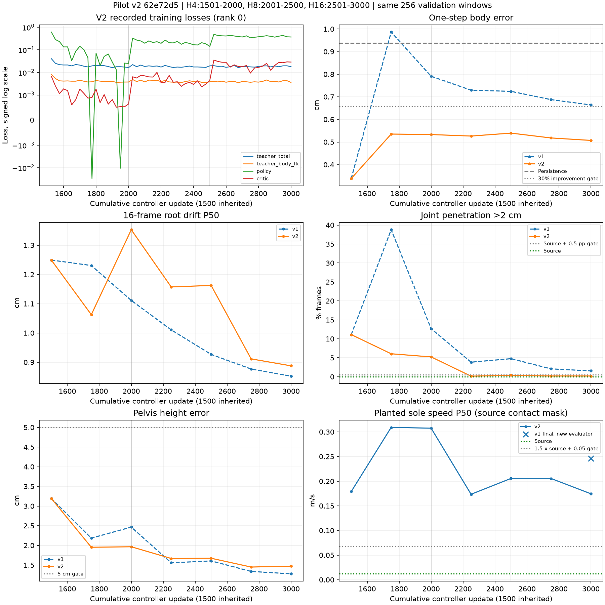

# 第7步 pilot v2：A100执行与结果

2026-10-25，按用户批准的[v2计划](terrain_controller_pilot_v2_plan_20261025.md)执行。源码固定为`62e72d5a75d2f500360cf9ae88efdbe0b00c7462`。本轮从v1教师阶段结束的checkpoint继续，只新增1,500次闭环更新，墙钟上限2小时。

**全部1,500次新增更新完成，耗时26分48.076秒，六项验收通过5项。** 一步误差改善45.95%，穿透超限帧从v1的63帧降至8帧；着地脚速度仍为0.1744m/s，高于0.0681m/s门槛，是本轮未通过的项目。

本轮使用`teacher-mix=1.0`和`penetration-weight=2500`，其余训练设置按计划保留。v1 checkpoint、原始数据和已有运行保持原样。训练与预检使用A100上的空闲GPU，准备和出图使用CPU；没有部署。

## 1. 更新、环境与测试

A100仓库此前处于detached HEAD，更新时显式指定远端分支：

```bash
git pull --ff-only origin main
git log -1 --oneline
$PY -m pytest tests/test_bones_env_dataset.py tests/test_terrain_controller.py \
  tests/test_skeleton_ray_sampler.py tests/test_bones_terrain_fit.py \
  tests/test_bones_terrain_scene.py tests/test_bones_terrain_screen.py \
  tests/test_bones_terrain_survey.py tests/test_train_terrain_controller.py \
  -q --full-trace --color=no --junitxml=runs/tmt_v2_coord/tests.xml
```

结果为**`84 passed, 11 warnings in 14.97s`，0失败、0跳过**，包括新增的源穿透、源着地脚速度和分组评估检查。

沿用独立Python3.11.17、Torch2.5.1+cu124环境及既有Kimodo资源。OMP/OpenBLAS/MKL均设为1。复用已经迁移并校验的`runs/bones_env_v1`；manifest SHA-256保持`67808b6813a42b676b58607b47bedc0bda9566819bee258f6ac4416c5a33c74d`，没有重复迁移或重建数据。

## 2. 单卡预检

先记录v1五个checkpoint的SHA-256，再将`runs/tmt_pilot_v1/phase0_teacher.pt`复制到新的`runs/tmt_v2_coord/phase0_teacher.copy.pt`。原件与副本SHA-256均为`0c75f4429789d619a5dfd30b86fde4fec3ff7a02ceeb76b63a15d068bd68045b`。

```bash
$PY scripts/train_terrain_controller.py --dataset runs/bones_env_v1 \
  --output runs/tmt_v2_smoke --resume runs/tmt_v2_coord/phase0_teacher.copy.pt \
  --phases teacher:1500 loop:4:2 --batch 32 \
  --teacher-mix 1.0 --penetration-weight 2500 --max-hours 0.2 \
  --log-every 1 --eval-every 1 --eval-batch 64
```

在启动时空闲的物理GPU0上完成，退出0，外层耗时**11.850秒**。恢复日志为：

```json
{"resumed_at_update": 1500, "phase_index": 1, "phase_update": 0}
```

| 检查 | 结果 |
| --- | --- |
| 正确继续两次更新 | 最终update=1502，新增控制器/critic各2次更新 |
| 混合监督确实执行 | 每次更新均有`teacher_total`和`teacher_body_fk`，测得两次teacher调用 |
| 新评估字段 | `source_joint_penetration_over_2cm_frames`、`source_planted_sole_speed_mps_p50`、`by_group`齐全 |
| 数值与checkpoint | 记录值有限，保存参数与运行结束参数一致 |
| v1原件 | 五个checkpoint哈希全部未变 |

本次冒烟另计**64个窗口、256个闭环生成帧、64个混合教师一步预测**。checkpoint的原有exposures为1,536,000，结束时为1,536,256。正式v2从v1原始教师checkpoint启动，没有继承冒烟新增的更新。

## 3. 用新评估口径补测v1

在空闲GPU0上对v1的教师阶段checkpoint和最终checkpoint分别评估同一批256个validation窗口，闭环长度16帧。此步骤**0次optimizer更新**，耗时**3.083秒**，共生成8,192个诊断帧。

验证批次沿用训练入口的固定随机种子1，包含原历史、指令、源接触和对应场景。批次所有输入字段的摘要为`29c47a5525e2e0f2d97d715daee5e933387b79fb62b55363d57f009788c486da`；正式v2每次评估核对此摘要。

| checkpoint | 一步误差cm | 生成穿透超2cm帧比例 | 源穿透帧比例 | 生成着地脚速度P50 m/s | 源着地脚速度P50 m/s |
| --- | ---: | ---: | ---: | ---: | ---: |
| v1教师结束，update1500 | 0.338440 | 11.108398% | 0% | 0.178958 | 0.012061 |
| v1最终，update3000 | 0.663997 | 1.538086% | 0% | 0.246222 | 0.012061 |

“着地脚速度”在源动作标注为接触的脚点上统计水平方向速度，两种动作使用同一接触掩码。本批次对应的v2门槛为：穿透帧比例**≤0.5%**，着地脚速度中位数**≤0.068092 m/s**。新口径下v1最终模型仍未通过这两项。

## 4. 正式v2命令与预算

```bash
torchrun --standalone --nnodes 1 --nproc_per_node 2 \
  scripts/train_terrain_controller.py --dataset runs/bones_env_v1 \
  --output runs/tmt_pilot_v2 --resume runs/tmt_pilot_v1/phase0_teacher.pt \
  --phases teacher:1500 loop:4:500 loop:8:500 loop:16:500 \
  --teacher-mix 1.0 --penetration-weight 2500 --batch 512 \
  --max-hours 2 --eval-every 250 --eval-batch 256
```

正式启动前重新扫描全部GPU的index、UUID、显存、利用率及计算PID，选择当时空闲的**物理GPU0和GPU3**并按UUID固定。全局batch为1,024。开始时间为**2026-10-25 11:24:27.109 UTC**。

运行由`nohup`主管启动，外层`timeout`为7,200秒，训练入口同时执行2小时上限。每rank逐次记录控制器、critic和teacher调用，评估前检查参数一致性，评估后检查数值有限性。测量包装器沿用原训练函数、优化器、损失及梯度平均，仅记录运行证据并执行停止条件。

恢复使用原入口的optimizer和scheduler状态，采样器epoch计数从0开始。阶段列表中的前1,500次教师更新已由checkpoint完成，本次只运行后面三个闭环阶段。没有自动重启或增加预算。

## 5. 完成状态、耗时与显存

主管在**2026-10-25 11:51:15.207 UTC**正常结束，退出码0；外层壁钟**1,608.076秒**，未触及2小时上限。两个rank各完成1,500次新增控制器更新、1,500次critic更新和1,500次混合teacher调用。

7行正式评估的`rank_parameter_disagreement`全部为**0.0**。恢复后及结束时，两个rank的控制器134个参数张量、critic 6个参数张量逐一SHA-256相同；最终checkpoint也与两个rank逐参数相同。只有rank0写出`phase1_loop4.pt`、`phase2_loop8.pt`、`phase3_loop16.pt`和`latest.pt`。

| 阶段 | 新增全局更新 | rank0平均秒/更新 | rank1平均秒/更新 | rank0中位秒/更新 |
| --- | ---: | ---: | ---: | ---: |
| H4 | 500 | 0.707401 | 0.706267 | 0.716998 |
| H8 | 500 | 0.896001 | 0.894563 | 0.815357 |
| H16 | 500 | 1.546053 | 1.543361 | 1.536937 |

计时包括闭环和混合teacher前向、反向、两个优化器更新及两卡通信，两端同步CUDA；不含数据加载、评估和参数哈希。GPU峰值为rank0 **12,710,927,360 bytes**、rank1 **12,716,841,984 bytes**，最高占85,100,068,864字节卡容量的**14.9434%**。硬件为NVIDIA A100 80GB PCIe，驱动555.42.06。

最终`latest.pt`为22,342,389字节，保存update=3000、exposures=15,872,000，SHA-256为`794d4ce660a4883b1b2d154be088b940c8995ec7d32a6fcac4d6aedf38474eba`。结束时再次核对，v1五个原checkpoint及预检输入副本均未改变，训练进程已退出。

## 6. 全部评估与验收

每行使用同一批256窗口、16帧闭环；保持上一帧基线始终为**0.938170cm**。表中1500行为独立补测的共同教师起点，其余7行来自v2原生评估日志，包括最后一次重复终点评估。[完整TSV](../../examples/results/terrain_controller_pilot_v2_a100_20261025/evaluation_table.tsv)还保留曝光计数、参数差异和全部闭环代价。

| 累计更新 | 一步cm | 漂移P50 cm | 漂移P90 cm | 生成穿透帧比例 | 源穿透 | 生成着地脚P50 m/s | 源着地脚P50 m/s | 骨盆cm |
| --- | ---: | ---: | ---: | ---: | ---: | ---: | ---: | ---: |
| 1500教师参考 | 0.338440 | 1.249118 | 4.210442 | 11.108398% | 0% | 0.178958 | 0.012061 | 3.191494 |
| 1750 | 0.535130 | 1.062592 | 3.494828 | 6.054688% | 0% | 0.309191 | 0.012061 | 1.952518 |
| 2000 | 0.533044 | 1.352876 | 3.342991 | 5.224609% | 0% | 0.307532 | 0.012061 | 1.965333 |
| 2250 | 0.526354 | 1.157344 | 3.529653 | 0.146484% | 0% | 0.173461 | 0.012061 | 1.667028 |
| 2500 | 0.539383 | 1.162504 | 3.453584 | 0.390625% | 0% | 0.205594 | 0.012061 | 1.673211 |
| 2750 | 0.517956 | 0.911533 | 2.640281 | 0.1953125% | 0% | 0.205511 | 0.012061 | 1.449787 |
| 3000 | 0.507091 | 0.887700 | 2.622078 | 0.1953125% | 0% | 0.174437 | 0.012061 | 1.472525 |
| 3000最终 | 0.507091 | 0.887700 | 2.622078 | 0.1953125% | 0% | 0.174437 | 0.012061 | 1.472525 |

| 计划第4节判据 | 最终证据 | 判定 |
| --- | --- | --- |
| 数值有限、各卡参数一致 | 正常完成，记录值有限，7次评估差异均为0，最终逐参数哈希一致 | 通过 |
| 一步误差比保持基线低至少30% | 0.507091对0.938170cm，改善**45.948956%** | 通过 |
| 16帧漂移P50<10cm | **0.887700cm** | 通过 |
| 穿透帧比例≤源动作＋0.5个百分点 | **0.1953125%≤0%＋0.5%**，8/4096帧超限 | 通过 |
| 着地脚速度P50≤源动作×1.5＋0.05m/s | **0.174437>0.068092m/s** | **未通过** |
| 骨盆高度误差<5cm | **1.472525cm** | 通过 |

着地脚速度较v1最终模型的0.246222m/s下降**29.1547%**，仍高于门槛。混合一步监督和更强穿透代价改善了一步拟合及穿透，支撑脚的运动仍是剩余问题。



曲线的横轴包含继承的前1,500次更新；本轮只对应1501至3000。训练损失使用可显示负值的对称对数轴，保留所有记录点。

## 7. 匹配更新位置的v1与v2

下表使用v1原始评估和v2评估中的共同指标；两者都从同一个教师checkpoint继续。v1最终模型用新评估器补测后，一步误差、保持基线、根漂移P50/P90、穿透和骨盆高度这六个共同字段与旧结果的差值均为**0.0**。

| 累计更新 | v1一步cm | v2一步cm | v1漂移P50 cm | v2漂移P50 cm | v1穿透 | v2穿透 | v1骨盆cm | v2骨盆cm |
| --- | ---: | ---: | ---: | ---: | ---: | ---: | ---: | ---: |
| 1750 | 0.986391 | 0.535130 | 1.230597 | 1.062592 | 38.769531% | 6.054688% | 2.184135 | 1.952518 |
| 2000 | 0.790908 | 0.533044 | 1.111264 | 1.352876 | 12.670898% | 5.224609% | 2.465325 | 1.965333 |
| 2500 | 0.724129 | 0.539383 | 0.926748 | 1.162504 | 4.760742% | 0.390625% | 1.605430 | 1.673211 |
| 3000 | 0.663997 | 0.507091 | 0.852408 | 0.887700 | 1.538086% | 0.1953125% | 1.277630 | 1.472525 |

v2最终一步误差和穿透优于v1，根漂移和骨盆误差略高，两者仍满足计划门槛。[匹配更新TSV](../../examples/results/terrain_controller_pilot_v2_a100_20261025/matching_updates.tsv)提供完整精度和P90；[v1新口径TSV](../../examples/results/terrain_controller_pilot_v2_a100_20261025/v1_new_evaluation.tsv)提供最终模型的源基线和着地脚速度。

## 8. 最终分组结果

v1列全部来自新评估器的最终checkpoint补测。各组窗口数在v1和v2间完全一致，合计256；源动作在每一组的穿透超限比例均为0。

| 组 | 窗口 | v1漂移P50 cm | v2漂移P50 cm | v1穿透 | v2穿透 | v1骨盆cm | v2骨盆cm |
| --- | ---: | ---: | ---: | ---: | ---: | ---: | ---: |
| crouch | 48 | 1.190462 | 1.248746 | 5.598959% | 0.390625% | 2.343586 | 3.001071 |
| flat_control | 43 | 1.107095 | 1.474470 | 2.906977% | 0% | 1.447455 | 1.681947 |
| kneel | 35 | 0.149207 | 0.223091 | 0% | 0% | 0.537432 | 0.671753 |
| known_dimension_support | 20 | 0.997864 | 0.936293 | 0% | 0% | 1.056627 | 1.218448 |
| prone | 13 | 0.206466 | 0.157419 | 0% | 0% | 0.640098 | 0.743342 |
| quadruped | 90 | 1.032922 | 1.115645 | 0% | 0% | 0.836788 | 0.876990 |
| wall_contact | 7 | 0.243598 | 0.418618 | 0% | **4.464286%** | 4.109409 | 3.445482 |

v1的63个超限帧来自crouch 43帧和flat_control 20帧。v2剩余8帧来自crouch **3帧**、wall_contact **5帧**；wall_contact这7个窗口的穿透发生了退步。分组完整值及源穿透列见[by_group.tsv](../../examples/results/terrain_controller_pilot_v2_a100_20261025/by_group.tsv)。

## 9. 同一组六个窗口的逐图观察

复用v1在训练前固定的六个validation窗口、演员、起始帧和场景变体。两次渲染的源动作关节数组逐值相同。图中蓝色为源动作、橙色为v2的16帧闭环、灰色为对应场景；没有修改姿态或几何。已检查每张图的全部16帧。

| 窗口 / PNG | 末帧根漂移cm | 骨盆平均误差cm | 观察 |
| --- | ---: | ---: | --- |
| [平地转跑 A255](../../examples/results/terrain_controller_pilot_v2_a100_20261025/contact_sheets/turn_jog_270_R_003__A255__s40.png) | 2.6528 | 1.8718 | 整体转向与抬腿跟随，后半段肩臂和足端逐渐偏离源动作。 |
| [侧移收步 A030](../../examples/results/terrain_controller_pilot_v2_a100_20261025/contact_sheets/walk_sideway_045_stop_002__A030__s60.png) | 2.1656 | 1.3279 | 保持直立和收步方向，末段手臂张开幅度及双足位置与源动作有差异。 |
| [蹲行 A412](../../examples/results/terrain_controller_pilot_v2_a100_20261025/contact_sheets/item_pick_up_crouch_walk_R_003__A412__s32.png) | 0.7438 | 1.2883 | 低姿态保持，后半段手臂、膝踝偏差明显，抬脚仍不足。 |
| [匍匐转换 A129](../../examples/results/terrain_controller_pilot_v2_a100_20261025/contact_sheets/change_idle_crawl_to_idle_crawl_right_001__A129__s48.png) | 0.3140 | 1.0700 | 低顶下匍匐姿态保持，躯干基本重合，末段手脚有小偏移。 |
| [50cm上箱 A224](../../examples/results/terrain_controller_pilot_v2_a100_20261025/contact_sheets/come_up_50cm_box_R_002__A224__s24.png) | 1.7162 | 1.8237 | 抬身与收腿基本跟随，站上箱后头部、躯干和脚端有可见偏移。 |
| [50cm上箱 A164](../../examples/results/terrain_controller_pilot_v2_a100_20261025/contact_sheets/come_up_50cm_box_R_003__A164__s24.png) | 1.8728 | 0.5206 | 上箱结束姿态接近源动作，后半段头部靠近顶板，足端仍有小偏移。 |

验证集没有stairs或box_support组，这两个箱体窗口沿用v1的known_dimension_support选择。原[v1六窗口对照图](../../examples/results/terrain_controller_pilot_a100_20261024/pilot_be5fc1f/README.md#六个固定窗口)保留。

## 10. 独立账本

每次全局更新由两个rank共同完成，各rank的一次optimizer.step不分别算作两次全局更新。混合teacher复用同一批窗口进行一步监督，不增加窗口抽样数。

| 本轮阶段 | 新增控制器全局更新 | 新增窗口曝光 | 闭环训练生成帧 | 混合teacher一步预测 |
| --- | ---: | ---: | ---: | ---: |
| H4 | 500 | 512,000 | 2,048,000 | 512,000 |
| H8 | 500 | 512,000 | 4,096,000 | 512,000 |
| H16 | 500 | 512,000 | 8,192,000 | 512,000 |
| **正式v2合计** | **1,500** | **1,536,000** | **14,336,000** | **1,536,000** |
| v2单卡冒烟，另计 | 2 | 64 | 256 | 64 |
| 继承的v1教师阶段，未重跑 | 1,500 | 1,536,000 | 0 | 不属于本轮mix |

正式v2另有1,500次critic全局更新；两rank共执行控制器optimizer 3,000次、critic optimizer 3,000次。最终checkpoint的update=3000包含继承的1,500次更新。

原脚本`exposures=15,872,000`由**继承的1,536,000个教师窗口＋本轮14,336,000个闭环生成帧**组成，不含本轮另记的1,536,000次混合teacher一步预测。v1完整实验、v2冒烟和历史38.4M账本各自保留，不合并为一条连续训练。

推理另计：v2正式评估28,672帧，v1教师及最终模型补测8,192帧，v2冒烟评估3,072帧，六窗口出图96帧；这些步骤没有增加optimizer更新。

## 11. 产物与检查

公共结果位于[结果目录](../../examples/results/terrain_controller_pilot_v2_a100_20261025/README.md)，包含结构化报告、四张TSV表、训练曲线和六张对照图。checkpoint、原始日志和运动数组留在A100：

- `runs/tmt_pilot_v2/`：正式config、progress、eval及四个checkpoint。
- `runs/tmt_v2_smoke/`：两次更新的预检结果。
- `runs/tmt_v2_coord/`：JUnit、输入哈希、主管记录、逐rank事件、v1补测和渲染证据。
- `runs/tmt_v2_coord/review_motion_private.npz`：六窗口的源与生成关节数组。

小型结果经私有Drive和PRO6000既有M78链路取回。归档5,962,452字节，SHA-256为`11e26b9c39b2d7b44a66b44d1686fcd0e17a3ff0534c8cb862db107320e2dcd4`，三端一致。

发布检查覆盖冻结源码、84项测试、v1原件及v2参数哈希、实际更新与teacher调用、固定验证批次、各张表、7张PNG及UTF-8/U+FFFD；v1执行文档保持逐字节不变，再运行`tools/check_repository.py`。未修改训练实现、追加预算或部署模型。
