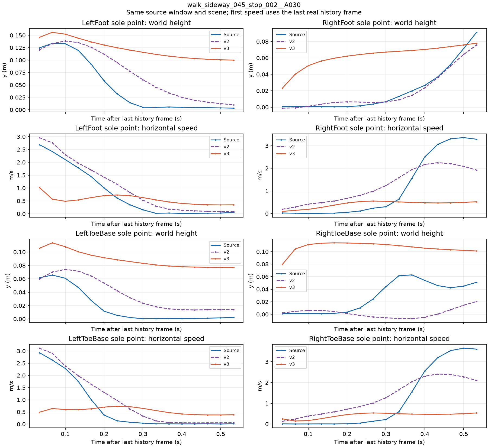
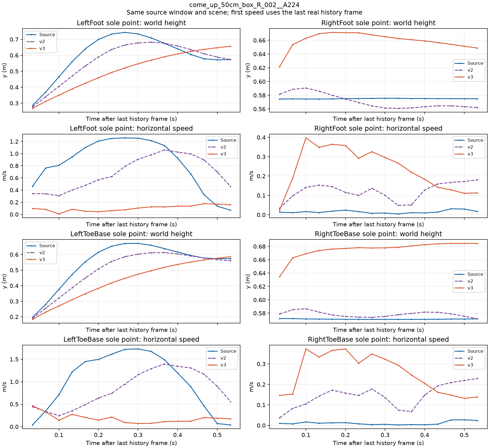

# 第7步 pilot v3：几何滑步代价与着地审计

按用户批准的[v3计划](terrain_controller_pilot_v3_plan_20261025.md)执行，源码固定为`eeab6422f34c6366f140be31d94316519957b4aa`。从v1教师阶段的`phase0_teacher.pt`恢复，预算为新增1,500次更新、2小时上限，沿用每卡batch512。两项v3设置为`skating-mode=geometric`和`skating-weight=100`；v2的一步监督混合1.0与穿透权重2500保留。

**完成新增1,500次更新，耗时26分34.219秒，六项验收通过4项。** 最终关节穿透超限帧为0，几何着地脚速度为0.00773m/s，但着地比例只有2.12%，低于16.13%门槛；一步误差1.064cm，较保持基线差13.38%。两张足底曲线直接显示了生成脚底抬高、减少着地的现象。没有调参、补跑或部署。

## 1. 更新与测试

A100执行`git pull --ff-only origin main`，本地通过PRO6000既有M78代理完成相同源码同步。网络重试未触发训练。沿用Python3.11.17、Torch2.5.1+cu124、Kimodo资源和独立项目环境，OMP/OpenBLAS/MKL均为1。

```bash
$PY -m pytest tests/test_bones_env_dataset.py tests/test_terrain_controller.py \
  tests/test_skeleton_ray_sampler.py tests/test_bones_terrain_fit.py \
  tests/test_bones_terrain_scene.py tests/test_bones_terrain_screen.py \
  tests/test_bones_terrain_survey.py tests/test_train_terrain_controller.py \
  -q --full-trace --color=no --junitxml=runs/tmt_v3_coord/tests.xml
```

结果：**`84 passed, 11 warnings in 10.84s`，0失败、0跳过**，包括几何滑步代价和几何着地指标。复用既有`runs/bones_env_v1`；manifest SHA-256为`67808b6813a42b676b58607b47bedc0bda9566819bee258f6ac4416c5a33c74d`。

## 2. 预检与输入身份

启动前记录v1/v2共九个checkpoint的哈希，将v1教师checkpoint复制到新的`runs/tmt_v3_coord/phase0_teacher.copy.pt`。原件与副本的SHA-256均为`0c75f4429789d619a5dfd30b86fde4fec3ff7a02ceeb76b63a15d068bd68045b`。

```bash
$PY scripts/train_terrain_controller.py --dataset runs/bones_env_v1 \
  --output runs/tmt_v3_smoke --resume runs/tmt_v3_coord/phase0_teacher.copy.pt \
  --phases teacher:1500 loop:4:2 --batch 32 --teacher-mix 1.0 \
  --penetration-weight 2500 --skating-mode geometric --skating-weight 100 \
  --max-hours 0.2 --log-every 1 --eval-every 1 --eval-batch 64
```

预检退出0，耗时**15.807秒**；恢复日志为`resumed_at_update=1500, phase_index=1, phase_update=0`，结束update=1502。progress中的混合teacher项齐全，几何着地速度、生成与源着地比例均存在，滑步代价和其余记录值均有限。v1/v2九个checkpoint哈希不变。

冒烟新增2次控制器及2次critic更新、64个窗口、256个闭环生成帧、64个混合teacher一步预测，单独记账。正式训练仍从原v1教师checkpoint恢复。

## 3. v1/v2的新口径补测

对共同教师起点、v1最终和v2最终checkpoint各执行一次256窗口、16帧闭环评估，**0次训练更新**，共12,288个诊断帧，耗时**3.793秒**。

验证批次与v2完全相同，包含历史、指令、源接触、场景及分组字段；SHA-256为`29c47a5525e2e0f2d97d715daee5e933387b79fb62b55363d57f009788c486da`。v3每次原生评估都重新计算并核对此摘要。

| checkpoint | 几何着地脚速度P50 m/s | 几何着地比例 |
| --- | ---: | ---: |
| 源动作 | 0.013670305 | 32.263184% |
| 教师起点，update1500 | 0.170082018 | 31.353760% |
| v1最终，update3000 | 0.271493345 | 36.700439% |
| v2最终，update3000 | 0.186201945 | 33.618164% |

新口径对每种动作分别判定接触：一个脚底点在当前帧及上一帧都满足`SDF<=0.03m`才进入几何着地速度统计。着地比例的分母为256窗口×16帧×4脚底点，共16,384个脚点时刻。源接触标签口径仍完整报告。

对应的联合门槛为：生成几何着地脚速度**≤0.070505457m/s**，生成几何着地比例**≥16.131592%**。训练时使用前后帧`sigmoid((0.03-SDF)/0.01)`的乘积作为滑步权重，水平速度平方再乘100。

## 4. 正式命令与资源

```bash
torchrun --standalone --nnodes 1 --nproc_per_node 2 \
  scripts/train_terrain_controller.py --dataset runs/bones_env_v1 \
  --output runs/tmt_pilot_v3 --resume runs/tmt_pilot_v1/phase0_teacher.pt \
  --phases teacher:1500 loop:4:500 loop:8:500 loop:16:500 \
  --teacher-mix 1.0 --penetration-weight 2500 \
  --skating-mode geometric --skating-weight 100 \
  --batch 512 --max-hours 2 --eval-every 250 --eval-batch 256
```

启动前扫描全部GPU的index、UUID、显存、利用率和计算PID，选定当时空闲的**物理GPU0与GPU3**，按UUID固定。启动时间为**2026-10-25 15:34:55.811 UTC**。

使用`nohup`主管及外层7,200秒`timeout`，原训练入口也执行2小时上限。测量包装器记录每次控制器、critic和teacher调用，并在评估时检查参数一致性、输入批次摘要及数值有限性。训练函数、梯度平均、优化器及原有学习率日程均按批准源码执行。

恢复继承前1,500次教师更新与optimizer/scheduler状态，采样器epoch计数从0开始。本轮只运行H4、H8、H16各500次更新，预检结果不参与正式模型初始化。

## 5. 完成状态与资源消耗

主管在**2026-10-25 16:01:30.053 UTC**结束，即新加坡时间2026-10-26 00:01:30。退出码0，外层壁钟**1,594.219秒**，未触及2小时上限。两个rank各完成1,500次新增控制器更新、1,500次critic更新及1,500次混合teacher调用。

7行正式评估的参数差异均为**0.0**；每次验证输入摘要均与v2一致。初始及最终的控制器134个参数张量、critic 6个参数张量，两rank逐一SHA-256一致；最终checkpoint也与两个rank逐参数相同。v1/v2九个checkpoint和预检副本的哈希保持原样。

| 阶段 | 新增全局更新 | rank0平均秒/更新 | rank1平均秒/更新 | rank0中位秒/更新 |
| --- | ---: | ---: | ---: | ---: |
| H4 | 500 | 0.479940 | 0.479268 | 0.470558 |
| H8 | 500 | 0.859302 | 0.857637 | 0.862894 |
| H16 | 500 | 1.779417 | 1.782515 | 1.656918 |

计时包括闭环和混合teacher前向、反向、两个优化器及两卡梯度通信，两端同步CUDA；不含数据加载、评估和参数哈希。显存峰值为rank0 **12,921,957,376 bytes**、rank1 **12,944,833,536 bytes**，最高占85,100,068,864字节卡容量的**15.2113%**。GPU为NVIDIA A100 80GB PCIe，驱动555.42.06。

只有rank0保存`phase1_loop4.pt`、`phase2_loop8.pt`、`phase3_loop16.pt`和`latest.pt`。最终文件22,342,453字节，update=3000、exposures=15,872,000；SHA-256为`fc4afd691fc8d7e1c2645de5185c80d0c75b1dbc68a677d413a5ba05c2bb7220`。主管和训练进程均已退出。

## 6. 全部评估与联合门槛

固定验证批次为256窗口，每窗口16帧。保持上一帧基线恒为**0.938170cm**。1500行为共同教师起点的独立补测，其余为7行v3原生评估，包含最终重复终点。完整精度及全部闭环代价见[evaluation_table.tsv](../../examples/results/terrain_controller_pilot_v3_a100_20261025/evaluation_table.tsv)。

| 累计更新 | 一步误差cm | 漂移P50 cm | 漂移P90 cm | 生成穿透帧比例 | 源穿透帧比例 | 骨盆误差cm |
| --- | ---: | ---: | ---: | ---: | ---: | ---: |
| 1500教师参考 | 0.338440 | 1.249118 | 4.210442 | 11.108398% | 0% | 3.191494 |
| 1750 | 1.313631 | 2.791431 | 8.903073 | 1.733398% | 0% | 3.876192 |
| 2000 | 1.197851 | 3.315661 | 13.188640 | 1.196289% | 0% | 4.251058 |
| 2250 | 1.126433 | 2.371611 | 9.112571 | 0.048828% | 0% | 2.845722 |
| 2500 | 1.088542 | 2.243280 | 7.853906 | 0.366211% | 0% | 2.797221 |
| 2750 | 1.061644 | 1.793409 | 4.834861 | 0% | 0% | 2.431345 |
| 3000 | 1.063717 | 1.649234 | 4.675161 | 0% | 0% | 2.369790 |
| 3000最终 | 1.063717 | 1.649234 | 4.675161 | 0% | 0% | 2.369790 |

下表并列两个速度口径。源标签速度使用相同源接触掩码；几何速度分别按各自动作的SDF接触掩码统计。单位均为m/s，比例为所有脚点时刻中的占比。

| 累计更新 | 生成源标签速度P50 | 源标签速度P50 | 生成几何速度P50 | 源几何速度P50 | 生成着地比例 | 源着地比例 |
| --- | ---: | ---: | ---: | ---: | ---: | ---: |
| 1500教师参考 | 0.178958 | 0.012061 | 0.170082 | 0.013670 | 31.353760% | 32.263184% |
| 1750 | 0.367908 | 0.012061 | 0.041923 | 0.013670 | 0.518799% | 32.263184% |
| 2000 | 0.314075 | 0.012061 | 0.026767 | 0.013670 | 1.147461% | 32.263184% |
| 2250 | 0.231272 | 0.012061 | 0.020123 | 0.013670 | 1.263428% | 32.263184% |
| 2500 | 0.195061 | 0.012061 | 0.010114 | 0.013670 | 2.062988% | 32.263184% |
| 2750 | 0.197675 | 0.012061 | 0.008477 | 0.013670 | 1.843262% | 32.263184% |
| 3000 | 0.172926 | 0.012061 | 0.007727 | 0.013670 | 2.117920% | 32.263184% |
| 3000最终 | 0.172926 | 0.012061 | 0.007727 | 0.013670 | 2.117920% | 32.263184% |

| 计划第4节判据 | 最终证据 | 判定 |
| --- | --- | --- |
| 数值有限、各卡参数一致 | 正常完成，记录值有限；7次评估差异0，最终逐参数哈希一致 | 通过 |
| 一步误差比保持基线低至少30% | 1.063717对0.938170cm，**误差高13.3822%** | **未通过** |
| 根漂移P50<10cm | **1.649234cm** | 通过 |
| 穿透帧比例≤源动作＋0.5个百分点 | **0%≤0%＋0.5%** | 通过 |
| 几何着地速度与比例同时达标 | 速度**0.007727≤0.070505m/s**，比例**2.117920%<16.131592%** | **未通过：比例不足** |
| 骨盆高度误差<5cm | **2.369790cm** | 通过 |

最终生成动作有347/16,384个几何着地脚点时刻，源动作为5,286/16,384；生成数仅为源动作的**6.56%**。模型减少了落入几何接触范围的脚点，剩余少量点的速度很低。第9节的足底曲线显示，两个固定例子中原本需要支撑的脚被抬高，印证了接触流失。


## 7. v1/v2补测与匹配更新对照

v1最终和v2最终使用新评估器补测后，一步误差、保持基线、漂移P50/P90、穿透、骨盆误差、源标签着地速度这七个共同指标与先前结果的差值均为**0.0**。新增几何指标见第3节；全部值保存在[prior_new_evaluation.tsv](../../examples/results/terrain_controller_pilot_v3_a100_20261025/prior_new_evaluation.tsv)。参考模型的滑步代价统一按新几何口径重算。

| 累计更新 | v2一步cm | v3一步cm | v2漂移P50 cm | v3漂移P50 cm | v2穿透帧比例 | v3穿透帧比例 |
| --- | ---: | ---: | ---: | ---: | ---: | ---: |
| 1750 | 0.535130 | 1.313631 | 1.062592 | 2.791431 | 6.054688% | 1.733398% |
| 2000 | 0.533044 | 1.197851 | 1.352876 | 3.315661 | 5.224609% | 1.196289% |
| 2250 | 0.526354 | 1.126433 | 1.157344 | 2.371611 | 0.146484% | 0.048828% |
| 2500 | 0.539383 | 1.088542 | 1.162504 | 2.243280 | 0.390625% | 0.366211% |
| 2750 | 0.517956 | 1.061644 | 0.911533 | 1.793409 | 0.1953125% | 0% |
| 3000 | 0.507091 | 1.063717 | 0.887700 | 1.649234 | 0.1953125% | 0% |

六个相同更新位置上，v3穿透比例更低，但一步拟合和根漂移均比v2差。源标签速度最终从v2的0.174437变为0.172926m/s，变化很小。完整P90、骨盆和源标签速度列见[matching_updates.tsv](../../examples/results/terrain_controller_pilot_v3_a100_20261025/matching_updates.tsv)。

## 8. 最终分组与wall_contact

v1/v2均已使用v3评估代码补测，三者各组窗口数完全一致；各组源穿透均为0。以下列出v2/v3，完整三版共21行结果见[by_group.tsv](../../examples/results/terrain_controller_pilot_v3_a100_20261025/by_group.tsv)。

| 组 | 窗口 | v2漂移P50 cm | v3漂移P50 cm | v2穿透 | v3穿透 | v2骨盆cm | v3骨盆cm |
| --- | ---: | ---: | ---: | ---: | ---: | ---: | ---: |
| crouch | 48 | 1.248746 | 1.840675 | 0.390625% | 0% | 3.001071 | 4.636322 |
| flat_control | 43 | 1.474470 | 2.963730 | 0% | 0% | 1.681947 | 3.288476 |
| kneel | 35 | 0.223091 | 0.701988 | 0% | 0% | 0.671753 | 1.002012 |
| known_dimension_support | 20 | 0.936293 | 2.165906 | 0% | 0% | 1.218448 | 2.705508 |
| prone | 13 | 0.157419 | 0.471677 | 0% | 0% | 0.743342 | 0.569947 |
| quadruped | 90 | 1.115645 | 1.704725 | 0% | 0% | 0.876990 | 1.238956 |
| **wall_contact** | **7** | **0.418618** | **1.225071** | **4.464286%** | **0%** | **3.445482** | **4.946069** |

wall_contact的7个窗口共112帧，超2cm的穿透帧由v2的5帧降到v3的0帧；根漂移和骨盆高度误差同时增大。v3全部组穿透为0，接触比例及源姿态拟合仍未达标。

## 9. 六窗口与足底曲线

复用v1最初固定的六个validation窗口、演员、起始帧和场景变体。v3渲染的源关节数组与v1/v2逐值相同；蓝色为源动作、橙色为v3闭环、灰色为对应场景。已逐张检查全部16帧。

| 窗口 / PNG | 末帧根漂移cm | 骨盆平均误差cm | 观察 |
| --- | ---: | ---: | --- |
| [转跑 A255](../../examples/results/terrain_controller_pilot_v3_a100_20261025/contact_sheets/turn_jog_270_R_003__A255__s40.png) | 3.6821 | 2.0271 | 转向继续，但双腿与源动作逐渐分开，后半段脚端偏高、步态形状明显不同。 |
| [侧移收步 A030](../../examples/results/terrain_controller_pilot_v3_a100_20261025/contact_sheets/walk_sideway_045_stop_002__A030__s60.png) | 3.7246 | 4.3220 | 直立躯干逐渐错开，收步中的脚没有按源动作落地；高度曲线显示持续抬脚。 |
| [蹲行 A412](../../examples/results/terrain_controller_pilot_v3_a100_20261025/contact_sheets/item_pick_up_crouch_walk_R_003__A412__s32.png) | 1.7238 | 2.4084 | 低姿态保留，手臂、膝踝与源动作明显分离，后半段抬腿时序和幅度不一致。 |
| [匍匐转换 A129](../../examples/results/terrain_controller_pilot_v3_a100_20261025/contact_sheets/change_idle_crawl_to_idle_crawl_right_001__A129__s48.png) | 0.2410 | 0.9234 | 躯干基本重合，低顶下姿态保持，后半段脚端有局部偏移。 |
| [50cm上箱 A224](../../examples/results/terrain_controller_pilot_v3_a100_20261025/contact_sheets/come_up_50cm_box_R_002__A224__s24.png) | 2.1235 | 3.1587 | 抬身继续，摆动腿的前送明显不足；右支撑脚高度偏高，详见曲线。 |
| [50cm上箱 A164](../../examples/results/terrain_controller_pilot_v3_a100_20261025/contact_sheets/come_up_50cm_box_R_003__A164__s24.png) | 2.4784 | 2.5851 | 收腿和站上箱的时序与源动作错开，末段脚端与支撑面关系发生偏移。 |

两条足底诊断窗口在v3训练前固定，分别覆盖平地收步和箱体支撑。每张图分别画`LeftFoot`、`LeftToeBase`、`RightFoot`、`RightToeBase`四个官方脚底采样点的世界y高度与水平速度，共16帧；速度第一帧以同一段真实历史的末帧为起点。v2曲线复用其此前保存的CPU关节数组，没有新增推理或训练。

### 9.1 侧移收步：脚没有落回地面



源动作左脚底约在0.30秒落地，16帧最低高度0.00334m；v2最低0.01019m。v3左脚底全段高度为**0.10010–0.15601m**，左脚趾为**0.07699–0.11379m**，没有进入3cm几何着地区间。右脚趾也始终处于0.07939–0.11392m。图中较平缓的水平速度伴随的是脚悬在表面上方。

### 9.2 上箱：原本稳定的右支撑脚被抬高



源动作右脚底高度稳定在**0.57453–0.57570m**，全段水平速度中位数0.01369m/s；v3变为**0.62143–0.67153m**、速度中位数0.24315m/s。右脚趾从源动作约0.571m抬到0.635–0.684m。与此同时，左脚底摆动的水平速度中位数由源动作0.93461m/s降为v3的0.10109m/s，前送轨迹被明显压缩。

这两个固定例子说明了几何着地比例为什么下降。v3的极低几何着地速度统计覆盖的样本已很少；联合门中的着地比例条件正确地将本轮判为未通过。

## 10. 独立账本

| 阶段 | 新增控制器全局更新 | 新增窗口 | 闭环训练生成帧 | 混合teacher一步预测 |
| --- | ---: | ---: | ---: | ---: |
| H4 | 500 | 512,000 | 2,048,000 | 512,000 |
| H8 | 500 | 512,000 | 4,096,000 | 512,000 |
| H16 | 500 | 512,000 | 8,192,000 | 512,000 |
| **正式v3** | **1,500** | **1,536,000** | **14,336,000** | **1,536,000** |
| v3冒烟，另计 | 2 | 64 | 256 | 64 |
| 继承的教师阶段，未重跑 | 1,500 | 1,536,000 | 0 | 不属于本轮mix |

正式v3有1,500次critic全局更新；两个rank合计控制器optimizer调用3,000次、critic调用3,000次。混合teacher复用同一批窗口，单独统计前向预测数，不再次增加窗口抽样数。

最终checkpoint update=3000包含继承的1,500次教师更新；原脚本exposures=15,872,000等于继承的1,536,000个教师窗口加本轮14,336,000个闭环生成帧，不包含另记的混合teacher预测。v1、v2、v3预检及旧38.4M账本各自保留。

推理另计：v3原生评估28,672帧，教师/v1/v2补测12,288帧，冒烟评估3,072帧，六窗口渲染96帧。两张足底曲线复用这些数组，额外生成帧为0。

## 11. 发布与完整性

[公共结果目录](../../examples/results/terrain_controller_pilot_v3_a100_20261025/README.md)包含结构化报告、四张TSV表、训练曲线、六张动作对照图、两张足底曲线。原始日志、权重、checkpoint、运动数组留在A100：`runs/tmt_pilot_v3/`、`runs/tmt_v3_smoke/`和`runs/tmt_v3_coord/`。

小型结果经私有Drive及PRO6000既有M78链路取回，归档6,851,329字节；SHA-256为`308adc8030e286ece6d224747c1b45a9729116d5de877cd29d70faa8d698e683`，三端一致。

发布检查核对冻结源码、84项测试、九个旧checkpoint哈希、逐rank参数、实际更新与teacher调用、每次固定验证批次、表格和九张PNG，并检查UTF-8/U+FFFD及`tools/check_repository.py`。v1/v2执行记录保持逐字节不变；没有追加训练或部署。
