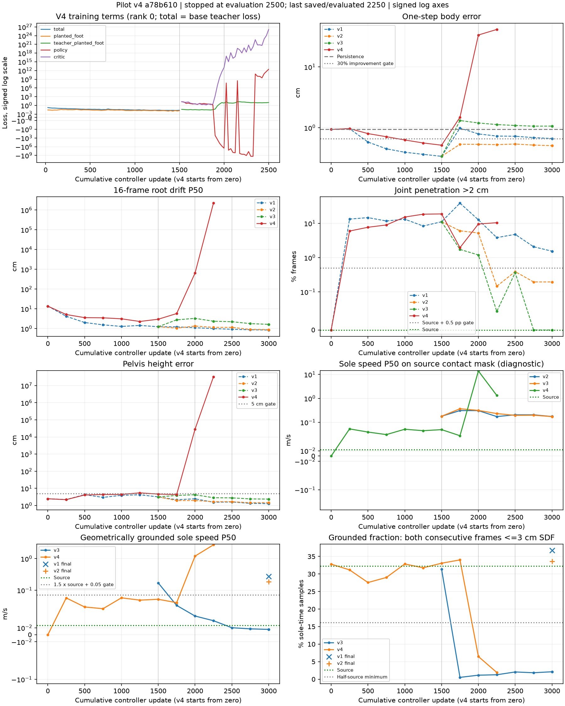
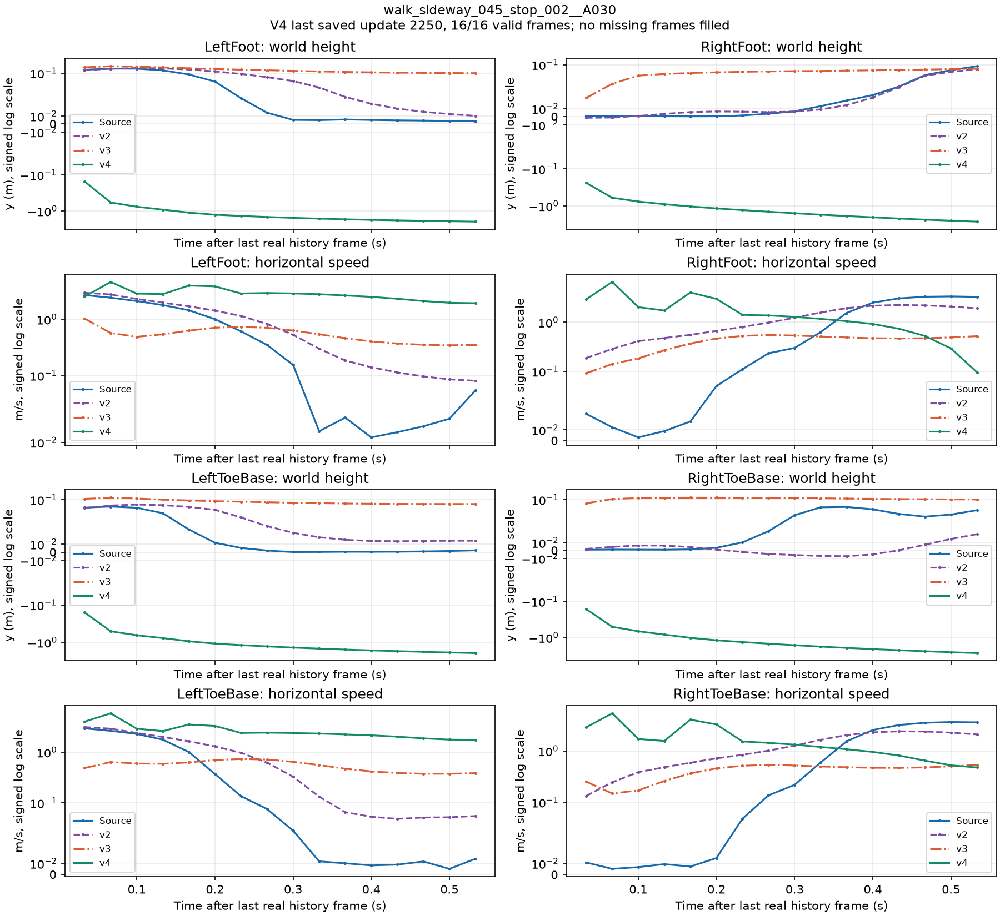
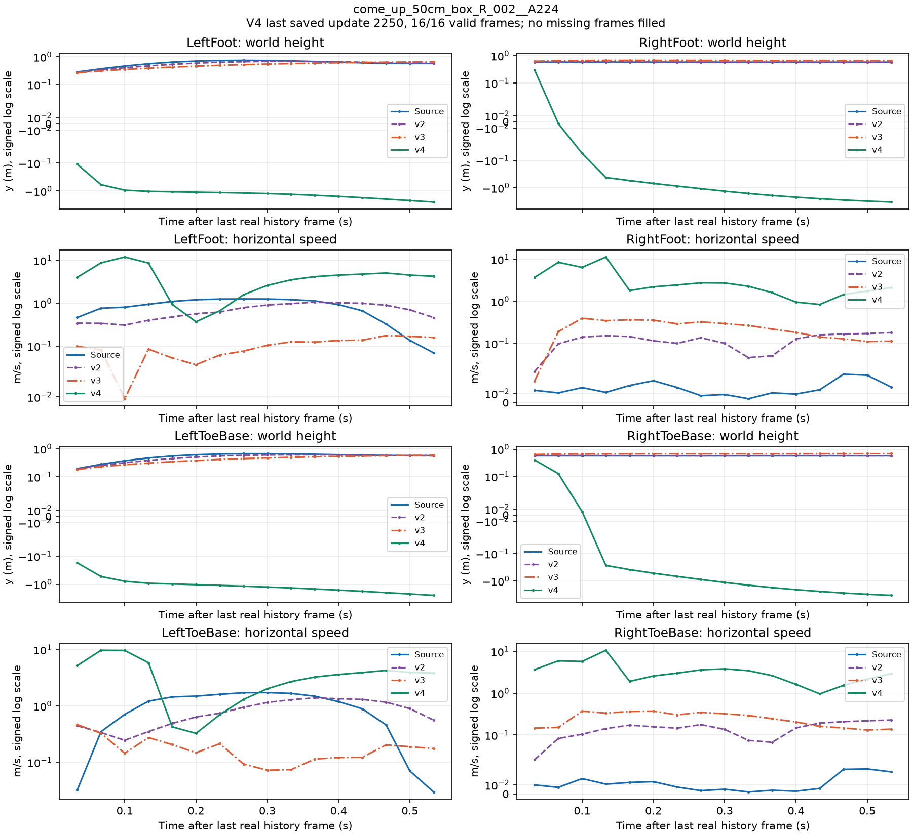

# 第7步 pilot v4：从零训练的支撑脚约束

2026-10-26按用户批准的[v4计划](terrain_controller_pilot_v4_plan_20261025.md)执行，冻结源码为`a78b6105bfd379d33955d6dfbabda12f6e2f4a79`。预算为从零开始3,000次更新、3小时训练上限，每卡batch512、两张空闲A100。

**本轮训练失败，已停止。** 教师阶段1500次的额外滑步门通过，但闭环阶段随后严重退化，update2500的评估触发根四元数一致性断言。两卡各实际完成2,500次更新；最新checkpoint保存到2,250次，末250次计入消耗，H16阶段未开始。没有恢复、补跑、修改断言或部署。

## 1. 设置与数据

本轮使用`teacher-mix=1.0`、`penetration-weight=2500`、`skating-mode=contact`、`skating-weight=100`、`contact-source=source`、`support-weight=2500`及`foot-weight=1.0`。前1,500次教师监督新增源接触脚的世界位移损失；后续三个闭环阶段各500次更新，支撑和滑步使用有效源帧的接触标签。

评估和可视化的闭环只输入历史、指令和场景，源标签用于评分。模型、critic、优化器和学习率日程均重新初始化，未从旧checkpoint恢复。

复用`runs/bones_env_v1`，manifest SHA-256为`67808b6813a42b676b58607b47bedc0bda9566819bee258f6ac4416c5a33c74d`。启动前记录v1/v2/v3共十三个checkpoint的SHA-256。沿用Python3.11.17、Torch2.5.1+cu124、已有Kimodo资源，OMP/OpenBLAS/MKL均为1。

## 2. 更新与测试

```bash
git pull --ff-only origin main
$PY -m pytest tests/test_bones_env_dataset.py tests/test_terrain_controller.py \
  tests/test_skeleton_ray_sampler.py tests/test_bones_terrain_fit.py \
  tests/test_bones_terrain_scene.py tests/test_bones_terrain_screen.py \
  tests/test_bones_terrain_survey.py tests/test_train_terrain_controller.py \
  -q --full-trace --color=no --junitxml=runs/tmt_v4_coord/tests.xml
```

结果为**`84 passed, 11 warnings in 10.33s`，0失败、0跳过**，包含源接触约束和支撑脚教师项。原始JUnit和日志位于A100的`runs/tmt_v4_coord/`。

## 3. 从零单卡预检

```bash
$PY scripts/train_terrain_controller.py --dataset runs/bones_env_v1 \
  --output runs/tmt_v4_smoke --phases teacher:3 loop:4:2 --batch 32 \
  --teacher-mix 1.0 --penetration-weight 2500 --skating-mode contact --skating-weight 100 \
  --contact-source source --support-weight 2500 --foot-weight 1.0 \
  --max-hours 0.2 --log-every 1 --eval-every 1 --eval-batch 64
```

预检退出0，耗时**18.390秒**。从update0完成到5；教师行存在`planted_foot`，闭环行存在`teacher_planted_foot`，所有记录值有限。checkpoint参数与运行结束参数一致，十三个旧checkpoint哈希保持不变。

预检另计5次控制器更新、2次critic更新、160个窗口、256个闭环生成帧；其中96个窗口用于教师阶段，64个窗口额外执行混合teacher预测。原脚本exposures为352，7次预检评估共生成7,168帧。正式模型不继承这些更新。

## 4. 固定验证与教师门槛

继续使用既有256窗口验证批次，每次评估核对全部输入字段的SHA-256：`29c47a5525e2e0f2d97d715daee5e933387b79fb62b55363d57f009788c486da`。本轮核心评估函数和几何指标函数的语法树与v3一致，沿用已核验的参考结果，未重复旧模型评估。

额外门槛为：v4在update1500的几何着地脚速度低于v1教师阶段的完整精度值**0.17008201777935028m/s**。此值对应计划中的0.170m/s，比较时使用未四舍五入的数值。

最终沿用六项门槛：数值有限且两卡一致、一步误差比保持基线低至少30%、根漂移P50<10cm、穿透比例≤源动作＋0.5个百分点、骨盆误差<5cm，以及几何着地速度≤源×1.5＋0.05m/s且着地比例≥源的一半。

## 5. 正式命令与资源等待

```bash
torchrun --standalone --nnodes 1 --nproc_per_node 2 \
  scripts/train_terrain_controller.py --dataset runs/bones_env_v1 \
  --output runs/tmt_pilot_v4 --phases teacher:1500 loop:4:500 loop:8:500 loop:16:500 \
  --teacher-mix 1.0 --penetration-weight 2500 --skating-mode contact --skating-weight 100 \
  --contact-source source --support-weight 2500 --foot-weight 1.0 \
  --batch 512 --max-hours 3 --eval-every 250 --eval-batch 256
```

首次正式启动在分配GPU之前因空闲卡不足被拦下，未执行训练。错误为`AssertionError: Not enough free A100 GPUs`，记录保留在`pilot_initial_resource_block.log`及`pilot_initial_resource_scan.txt`。

一次性等待程序每60秒检查全部GPU的index、UUID、显存、利用率和计算PID。只有至少两张卡满足显存≤64MiB、利用率0且无计算进程时，才调用正式主管；主管再次检查并按UUID固定两张卡。训练采用`nohup`与外层10,800秒`timeout`，不会恢复或重启已开始的训练。资源等待不消耗训练更新预算。

资源释放后，正式训练于**2026-10-26 01:53:12.972（新加坡时间）**启动，使用当时空闲的物理**GPU2、GPU3**。启动前的检查与运行命令保存在新的`pilot_launch.json`，首次资源不足的记录保留。

## 6. 教师阶段额外门槛

第1,500次更新时，v4几何着地脚速度中位数为**0.051629987m/s**，低于v1教师阶段的**0.170082018m/s**，额外门槛通过。v4几何着地比例为**33.074951%**，v1为31.353760%，源动作是32.263184%。一步误差为**0.515827cm**，保持基线0.938170cm。

该评估来自同一固定256窗口，与v1参考输入摘要一致。教师checkpoint在进入H4之前保存；混合teacher仍在后续每次闭环更新中执行。

| update1500指标 | v1教师checkpoint | v4教师checkpoint |
| --- | ---: | ---: |
| 一步误差cm | 0.338440 | 0.515827 |
| 根漂移P50 cm | 1.249118 | 2.993989 |
| 穿透超2cm帧比例 | 11.108398% | 18.798828% |
| 骨盆高度误差cm | 3.191494 | 4.625878 |
| 源标签着地脚速度P50 m/s | 0.178958 | 0.049745 |
| 几何着地脚速度P50 m/s | 0.170082 | 0.051630 |
| 几何着地比例 | 31.353760% | 33.074951% |

支撑脚教师项降低了该阶段的滑步速度，同时一步误差、穿透和骨盆误差高于v1。完整精度见[teacher_comparison.tsv](../../examples/results/terrain_controller_pilot_v4_a100_20261025/teacher_comparison.tsv)。

## 7. 失败位置与保存状态

训练于**2026-10-26 02:10:45.277（新加坡时间）**退出，torchrun退出码**1**，外层耗时**1,052.304秒，即17分32.304秒**，未触发3小时上限。失败调用链为：

```text
train_terrain_controller.py: run_eval
  -> training.evaluate -> ClosedLoop.rollout -> step -> advance
  -> compute_motion_features (motion_features.py:836)
  -> AssertionError
```

原断言比较局部与全局根四元数是否逐元素相同：

```python
assert (
    local_joint_quat[:, :, skeleton.root_idx]
    == global_joint_quat[:, :, skeleton.root_idx]
).all()
```

[完整异常堆栈](../../examples/results/terrain_controller_pilot_v4_a100_20261025/failure_traceback.txt)保留全部调用帧，仅将私人绝对目录替换为`${TAK_ROOT}`和`${PFNN_PROJECT}`。原始完整日志留在A100的`runs/tmt_v4_coord/pilot_run.log`。

update2500的完整评估没有返回，因而没有保存该更新的checkpoint。最新`latest.pt`状态为`update=2250, exposures=5632000, phase_index=2, phase_update=250`，SHA-256为`24920171c931a22995bf8e2662e3933510ceb8b531245179fc6fd7b101b7d0067`。现存三个checkpoint为`phase0_teacher.pt`、`phase1_loop4.pt`和`latest.pt`。

两个rank的逐步事件文件都记录了**2,500次控制器更新、1,000次critic更新、2,500次teacher调用**。rank0写出了错误总结；rank1被torchrun终止后没有最终总结，因此没有终态逐参数对照或rank1峰值显存。已完成的10次评估参数差异均为0.0。rank0终态参数属于2500次更新，与2250次checkpoint哈希不同，两者不是同一更新位置。

rank0记录的峰值显存为**6,657,671,168 bytes**；rank1峰值未取得。rank0平均更新耗时为teacher **0.139176秒**、H4 **0.565486秒**、H8 **0.964833秒**。主管、队列与训练进程均已退出，十三个旧checkpoint哈希不变。

## 8. 可用评估与验收

下面是全部10次成功返回的评估，固定256窗口、16帧闭环。保持基线始终为**0.938170cm**，源穿透始终为0%。update2500评估失败，2750和3000没有运行；不存在这些位置的v4结果。全部指标、代价及原始精度见[evaluation_table.tsv](../../examples/results/terrain_controller_pilot_v4_a100_20261025/evaluation_table.tsv)。

| 更新 | 一步cm | 漂移P50 cm | 漂移P90 cm | 穿透超2cm帧比例 | 骨盆误差cm |
| --- | ---: | ---: | ---: | ---: | ---: |
| 0 | 0.938170 | 13.770324 | 57.559715 | 0% | 2.474805 |
| 250 | 0.967308 | 5.166888 | 35.282974 | 5.957031% | 2.199247 |
| 500 | 0.800929 | 3.602146 | 21.781910 | 7.666016% | 4.121755 |
| 750 | 0.711396 | 3.524211 | 19.094610 | 8.959961% | 4.378690 |
| 1000 | 0.629155 | 3.143233 | 15.911332 | 15.234375% | 4.440669 |
| 1250 | 0.561534 | 2.302025 | 15.112831 | 18.457031% | 5.494347 |
| 1500 | 0.515827 | 2.993989 | 15.131646 | 18.798828% | 4.625878 |
| 1750 | 1.489233 | 5.786054 | 27.004236 | 1.953125% | 4.358099 |
| 2000 | 33.523483 | 648.828857 | 738.533020 | 9.545898% | 28,673.730469 |
| **2250，最后可用** | **41.362873** | **2,225,552.25** | **4,159,118.0** | **10.424805%** | **32,464,312.0** |

速度表中，源接触标签口径与几何口径均保留。固定源动作的标签速度为**0.012061441m/s**，几何速度为**0.013670305m/s**，几何着地比例为**32.263184%**。

| 更新 | 生成源标签速度P50 m/s | 生成几何速度P50 m/s | 生成几何着地比例 |
| --- | ---: | ---: | ---: |
| 0 | 0.000002 | 0.000002 | 32.812500% |
| 250 | 0.052975 | 0.057037 | 31.170654% |
| 500 | 0.045199 | 0.039673 | 27.569580% |
| 750 | 0.040392 | 0.037230 | 29.010010% |
| 1000 | 0.051257 | 0.057428 | 32.861328% |
| 1250 | 0.047759 | 0.049443 | 31.768799% |
| 1500 | 0.049745 | 0.051630 | 33.074951% |
| 1750 | 0.038292 | 0.045862 | 34.020996% |
| 2000 | 13.970993 | 1.204700 | 6.469727% |
| 2250 | 1.326869 | 2.741278 | 1.922607% |

update2225时记录的critic loss已达6.48e19，最后一次训练记录update2500的critic loss为**1.3818e26**、裁剪前梯度范数为**9.1794e14**。已保存记录中的数值仍有限，但闭环输出的尺度已经急剧增大，随后完整评估触发断言。

下表的质量数值取自最后可用的2250次checkpoint；教师额外门单独取1500次。没有3000次终点模型可验收。

| 判据 | 证据 | 判定 |
| --- | --- | --- |
| 数值运行与两卡一致 | 已完成评估差异为0；2500评估断言退出，缺少完整终态 | 未通过 |
| 一步误差比保持基线低至少30% | 41.362873对0.938170cm | 未通过 |
| 根漂移P50<10cm | 2,225,552.25cm | 未通过 |
| 穿透≤源动作＋0.5个百分点 | 10.424805%>0.5% | 未通过 |
| 几何着地速度与比例联合门 | 2.741278m/s>0.070505m/s；1.922607%<16.131592% | 未通过 |
| 骨盆误差<5cm | 32,464,312.0cm | 未通过 |
| **1500次教师额外门** | **0.051630m/s<0.170082m/s** | **通过** |



## 9. 四版匹配位置

[matching_updates.tsv](../../examples/results/terrain_controller_pilot_v4_a100_20261025/matching_updates.tsv)包含四版在六个指定位置的一步误差、保持基线、漂移P50/P90、穿透及骨盆误差。v4缺失位置分别标为`evaluation_assertion`和`not_run`。

| 更新 | v1一步cm | v2一步cm | v3一步cm | v4一步cm |
| --- | ---: | ---: | ---: | --- |
| 1750 | 0.986391 | 0.535130 | 1.313631 | 1.489233 |
| 2000 | 0.790908 | 0.533044 | 1.197851 | 33.523483 |
| 2250 | 0.729328 | 0.526354 | 1.126433 | 41.362873 |
| 2500 | 0.724129 | 0.539383 | 1.088542 | 评估断言，结果不可用 |
| 2750 | 0.687572 | 0.517956 | 1.061644 | 未运行 |
| 3000 | 0.663997 | 0.507091 | 1.063717 | 未运行 |

v4确实从零初始化，rank0训练前模型及critic的逐参数摘要与v1同随机种子初始化一致；没有加载旧模型来继续训练。

## 10. 最后可用checkpoint的分组结果

以下v4数据均为**update2250**。源穿透各组均为0；[by_group.tsv](../../examples/results/terrain_controller_pilot_v4_a100_20261025/by_group.tsv)另保留v1/v2/v3终点对照，并明确标注各自运行名称。

| 组 | 窗口 | 漂移P50 cm | 穿透超2cm帧比例 | 骨盆误差cm |
| --- | ---: | ---: | ---: | ---: |
| crouch | 48 | 17.299261 | 16.536459% | 184.091980 |
| flat_control | 43 | 58.747971 | 27.180234% | 183.043823 |
| kneel | 35 | 3,064,316.0 | 1.250000% | 55,430,712.0 |
| known_dimension_support | 20 | 14.737506 | 24.062501% | 250.789810 |
| prone | 13 | 3,784,519.5 | 0% | 70,630,672.0 |
| quadruped | 90 | 3,245,042.25 | 0.138889% | 60,584,080.0 |
| **wall_contact** | **7** | **8.731472** | **24.107143%** | **174.162582** |

wall_contact的112帧中，v4在2250次时有27帧超限；v2终点为5帧，v3终点为0帧。全批次共有427/4096帧穿透超限。低姿态组同时出现极大空间漂移，已经无法保持源动作。

## 11. 六窗口及两张足底曲线

图像使用最后保存的**2250次checkpoint**，不是未保存的2500次参数。六个窗口、演员、起点、场景变体与前几轮一致；源关节数组与v1/v2/v3逐值相同。CPU逐帧调用原`ClosedLoop.step`，六个窗口均返回完整16帧，共96帧，没有修正动作或替换根节点。

由于漂移巨大，每帧采用源角色与生成角色两个独立镜头，均使用原始世界坐标，图内逐帧打印`root xyz (m)`。镜头只改变取景，源姿态、生成姿态和场景未改动。蓝色为源动作，绿色为v4。

| 窗口 / PNG | 逐图观察 |
| --- | --- |
| [转跑 A255](../../examples/results/terrain_controller_pilot_v4_a100_20261025/contact_sheets/turn_jog_270_R_003__A255__s40.png) | 生成姿态从首帧即偏离，身体逐渐下降到地面以下，末帧root y约-1.764m。 |
| [侧移收步 A030](../../examples/results/terrain_controller_pilot_v4_a100_20261025/contact_sheets/walk_sideway_045_stop_002__A030__s60.png) | 身体扭曲并持续下沉，末帧root y约-2.003m，源动作仍直立在地面。 |
| [蹲行 A412](../../examples/results/terrain_controller_pilot_v4_a100_20261025/contact_sheets/item_pick_up_crouch_walk_R_003__A412__s32.png) | 低姿态动作没有保持，生成角色向下离开地面，末帧root y约-2.711m。 |
| [匍匐 A129](../../examples/results/terrain_controller_pilot_v4_a100_20261025/contact_sheets/change_idle_crawl_to_idle_crawl_right_001__A129__s48.png) | 源动作贴近地面；生成角色首帧root y已约18.85m，随后迅速增大至百万米量级，完全失稳。 |
| [上箱 A224](../../examples/results/terrain_controller_pilot_v4_a100_20261025/contact_sheets/come_up_50cm_box_R_002__A224__s24.png) | 身体穿过箱体并翻倒、下沉，源动作正常上箱，生成末帧root y约-2.979m。 |
| [上箱 A164](../../examples/results/terrain_controller_pilot_v4_a100_20261025/contact_sheets/come_up_50cm_box_R_003__A164__s24.png) | 同样穿过支撑箱并下沉，肢体姿态严重偏离，末帧root y约-3.099m。 |



侧移窗口中，v4左脚底高度从-0.152m降至-1.985m，右脚底最低-2.687m；左右脚底水平速度中位数分别为2.795、1.332m/s。源动作与前两版的厘米级轨迹同时保留，纵轴采用对称对数刻度以显示完整跨度。



上箱窗口中，源右支撑脚底稳定在约0.575m；v4右脚底最低降至-3.297m。v4左右脚底水平速度峰值分别为12.003、11.338m/s。四条曲线使用同一真实历史末帧作为第一帧速度起点；v2/v3复用已有数组，没有额外推理。

## 12. 实际消耗与未保存更新

| 阶段 | 控制器全局更新 | 窗口 | 闭环训练生成帧 | 混合teacher一步预测 |
| --- | ---: | ---: | ---: | ---: |
| teacher | 1,500 | 1,536,000 | 0 | 0 |
| H4 | 500 | 512,000 | 2,048,000 | 512,000 |
| H8 | 500 | 512,000 | 4,096,000 | 512,000 |
| H16 | 0 | 0 | 0 | 0 |
| **实际正式消耗** | **2,500** | **2,560,000** | **6,144,000** | **1,024,000** |
| 其中未保存的2251–2500 | 250 | 256,000 | 2,048,000 | 256,000 |
| 预检，另计 | 5 | 160 | 256 | 64 |

正式训练另有1,000次critic全局更新；两rank合计控制器optimizer调用5,000次、critic调用2,000次。新模型没有继承任何旧更新。

最后进度的原脚本exposures为**7,680,000**，对应1,536,000教师窗口加6,144,000闭环帧；checkpoint2250中的exposures为**5,632,000**。混合teacher预测单列。未保存的250次全部计入消耗；剩余500次预算没有使用，也没有补跑。

完整成功评估共40,960个生成帧；2500次失败评估的部分帧数未被记录，单列为一次失败尝试。预检评估7,168帧，六窗口诊断96帧，两张足底图复用已有数组。旧参考结果直接复用，本轮新增旧模型评估帧为0。所有推理均不计为训练更新。

## 13. 发布与完整性

[公共结果目录](../../examples/results/terrain_controller_pilot_v4_a100_20261025/README.md)包含结构化报告、四张TSV表、完整异常堆栈及九张诊断图。checkpoint、原始训练日志和运动数组仍在A100的`runs/tmt_pilot_v4/`、`runs/tmt_v4_smoke/`和`runs/tmt_v4_coord/`。

小型结果经私有Drive及PRO6000 M78链路取回，归档3,644,680字节，SHA-256为`d5b703eac5e5c7ec3f1f7c5478825aa65085ecef78f86bac52b33c276b62eb59`，三端一致。

发布核对冻结源码、84项测试、两rank事件账本、实际2500/保存2250的边界、旧checkpoint哈希、固定验证摘要、表格、九张PNG和异常堆栈。v1/v2/v3执行文档逐字节未改；随后执行UTF-8/U+FFFD与仓库检查。本轮整体失败，教师额外门通过，模型未部署。
