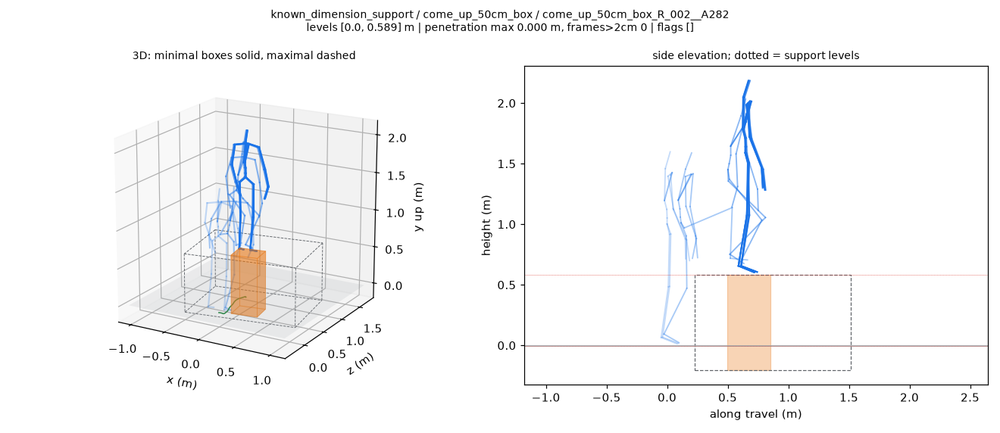
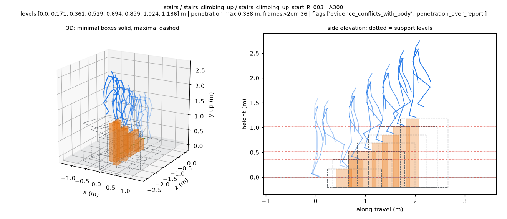
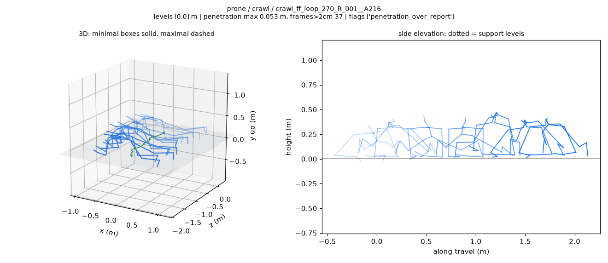
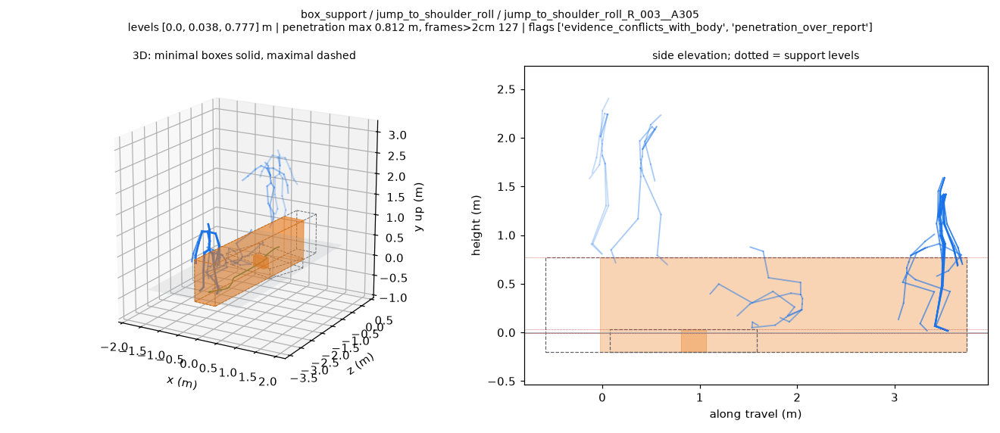

# BONES 支撑几何拟合与审查图

2026-10-23，PRO6000 CPU，16 个 worker，运行源码 `50c1bf1`。

| 运行 | 拟合成功 | 处理失败 | 渲染成功 | 总耗时 |
| --- | ---: | ---: | ---: | ---: |
| 每词干两条试运行 | 196 | 0 | 196 | 161.7 秒 |
| 全量 | 6,788 | 0 | 221 | 585.5 秒 |

测试 `25 passed in 5.01s`。完整执行过程、分组穿透指标、演员尺度和服务器产物位置见 [执行记录](../../../docs/records/bones_terrain_fit_pro6000_20261023.md)。

## 先看图片

蓝色是源动作骨架，橙色是拟合的最小支撑箱体，灰色虚线是最大箱体，红色水平虚线是支撑层。

上 50 cm 箱体示例，坐标采用 SOMA Uniform 尺度：



楼梯示例，保留穿透与支撑冲突标记：



匍匐示例，按地面板检查身体空间：



最严重穿透样例，拟合箱体覆盖了落地翻滚区域：



[全部 221 张接触图](full/viz/README.md) 共 33.89 MB，保留组目录。全量有 2,520 条触发穿透报告阈值，严重样例包含在公开审查集合中。

## 文件导航

| 内容 | 文件 |
| --- | --- |
| 全量报告、参数、失败与渲染记录 | [full/report.json](full/report.json) |
| 全量打印的分组 JSON | [full/by_group.json](full/by_group.json) |
| 演员尺度与尺寸校验 | [full/actor_scale.json](full/actor_scale.json) |
| 全部 6,788 条紧凑表 | [full/fits_compact.tsv](full/fits_compact.tsv) |
| 全量 stdout 最后 80 行 | [full/stdout_tail.txt](full/stdout_tail.txt) |
| 试运行报告与分组 JSON | [pilot/report.json](pilot/report.json)、[pilot/by_group.json](pilot/by_group.json) |
| 38 条 viewer 索引 | [full/viewer/index.json](full/viewer/index.json) |
| PNG 与 viewer 选择清单 | [publication_selection.json](publication_selection.json) |
| 测试和绘图库导入 | [execution/tests.txt](execution/tests.txt)、[execution/imports.txt](execution/imports.txt) |
| 环境与输入哈希 | [execution/environment.json](execution/environment.json) |
| 图像、GIF 和 viewer 完整性检查 | [execution/artifact_checks.json](execution/artifact_checks.json) |
| 原始与公开副本的哈希对应 | [publication_manifest.json](publication_manifest.json) |
| 本目录文件校验和 | [SHA256SUMS](SHA256SUMS) |

## 播放 viewer

从仓库根目录启动静态服务：

```bash
python -m http.server 8000 --bind 127.0.0.1
```

然后打开：

```text
http://127.0.0.1:8000/web/terrain_fit_review/?index=/examples/results/bones_terrain_fit_v1_20261023/full/viewer/index.json
```

38 条中包含全部 25 条额外 worst_penetration 样例、每组 sample 和指定词干。GIF 与完整 `fits/*.json` 位于 PRO6000，路径见执行记录。
