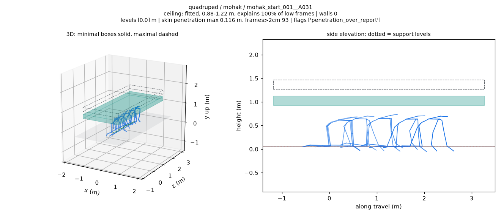
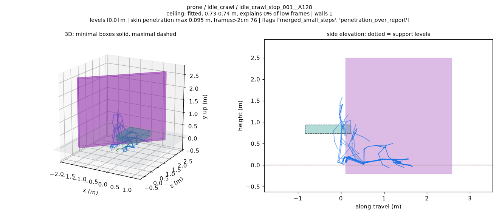

# BONES 地形 v3：分片结果与审查图

实际执行：2026-10-24，PRO6000 CPU，源码 `f49e5ab`。S/L1/L2 处理 6,788 条，E 处理 120 条，处理和渲染失败均为 0。

**方法质量门尚未通过。** 主任务的 27,152 个变体中，23,590 个通过非地面穿透门；777 条墙体超过 2 cm。2,904 条成功顶棚在本次 15 Hz 蒙皮采样中穿透为零。完整定义、分组对照、校准值和运行账本见 [执行报告](../../../docs/records/bones_terrain_fit_v3_pro6000_20261023.md)。

## 先看两个例子

手膝动作的顶棚覆盖：青色为紧顶棚，虚线为松顶棚，蓝色为源骨架；图中仍保留地面穿透指标。



低解释率样例：这段匍匐收尾动作拟合了墙和一小块顶棚，图上的解释率为 0%。



## 统计与记录

| 内容 | 入口 |
| --- | --- |
| 完整说明、v1/v3 对比、校准和内存账本 | [执行报告](../../../docs/records/bones_terrain_fit_v3_pro6000_20261023.md) |
| 11 个组的合并结果 | [merged/by_group.json](merged/by_group.json) |
| 全部 6,788 条紧凑表 | [merged/fits_compact.tsv](merged/fits_compact.tsv) |
| S 原始报告 | [report.json](shards/S/report.json)、[by_group.json](shards/S/by_group.json)、[actor_scale.json](shards/S/actor_scale.json) |
| L1 原始报告 | [report.json](shards/L1/report.json)、[by_group.json](shards/L1/by_group.json) |
| L2 原始报告 | [report.json](shards/L2/report.json)、[by_group.json](shards/L2/by_group.json) |
| 48-worker 试运行 | [report.json](pilot/report.json)、[by_group.json](pilot/by_group.json) |
| 原始对比数据与生成表格 | [comparison.json](comparison.json)、[tables.md](tables.md) |
| 紧顶棚高度 P5/P50/P95 | [ceiling_calibration.json](ceiling_calibration.json) |
| 逐组顶棚和墙体检查 | [geometry_gate_audit.json](execution/geometry_gate_audit.json) |
| on_the_edge 120 条结果 | [by_group.json](edge/by_group.json)、[fits_compact.tsv](edge/fits_compact.tsv)、[screen_report.json](edge/screen_report.json) |
| 选样与补充渲染名单 | [publication_selection.json](publication_selection.json) |
| 测试与站立头顶高度 | [tests_updated.txt](execution/tests_updated.txt)、[standing_top.txt](execution/standing_top.txt) |
| 产物校验与来源哈希 | [artifact_checks.json](execution/artifact_checks.json)、[publication_manifest.json](publication_manifest.json)、[SHA256SUMS](SHA256SUMS) |

三个分片各自保留紧凑 TSV 和 stdout 尾部。各任务的命令、耗时、内存采样和审查位于 [execution/](execution/)。

## 图片目录

主集合 238 张 PNG（225 张自动样例、13 张补充审查），edge 另有 11 张。总计 249 张、33,982,087 bytes，全部发布。

| 组 | PNG 目录 |
| --- | --- |
| 已知尺寸支撑 | [known_dimension_support](viz/known_dimension_support/) |
| 箱体支撑 | [box_support](viz/box_support/) |
| 楼梯 | [stairs](viz/stairs/) |
| 越障 | [obstacle_clearance](viz/obstacle_clearance/) |
| 梯子 | [ladder](viz/ladder/) |
| 平地对照 | [flat_control](viz/flat_control/) |
| 蹲姿 | [crouch](viz/crouch/) |
| 手膝着地 | [quadruped](viz/quadruped/) |
| 匍匐 | [prone](viz/prone/) |
| 跪姿 | [kneel](viz/kneel/) |
| 靠墙 | [wall_contact](viz/wall_contact/) |
| on_the_edge | [edge_balance](edge/viz/edge_balance/) |

## 播放 viewer

主集合 [viewer/index.json](viewer/index.json) 含 68 条：旧版 38 条全部保留，另有五组各 3 条样本及全部 29 条 `worst_penetration`。旧 38 条的骨架帧与 v1 完全一致。edge 集合 [edge/viewer/index.json](edge/viewer/index.json) 含全部 11 条渲染。

从仓库根目录启动静态服务：

```bash
python -m http.server 8000 --bind 127.0.0.1
```

主集合与 edge 地址分别为：

```text
http://127.0.0.1:8000/web/terrain_fit_review/?index=/examples/results/bones_terrain_fit_v3_20261023/viewer/index.json
http://127.0.0.1:8000/web/terrain_fit_review/?index=/examples/results/bones_terrain_fit_v3_20261023/edge/viewer/index.json
```

GIF、完整拟合 JSON 和全部场景变体保留在 PRO6000 的各分片运行目录，位置见执行报告。
