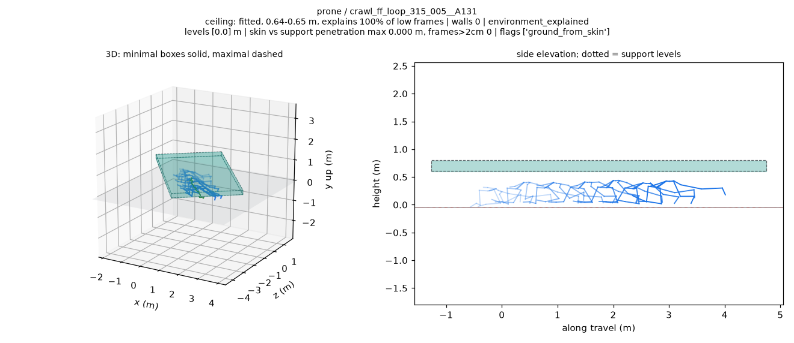
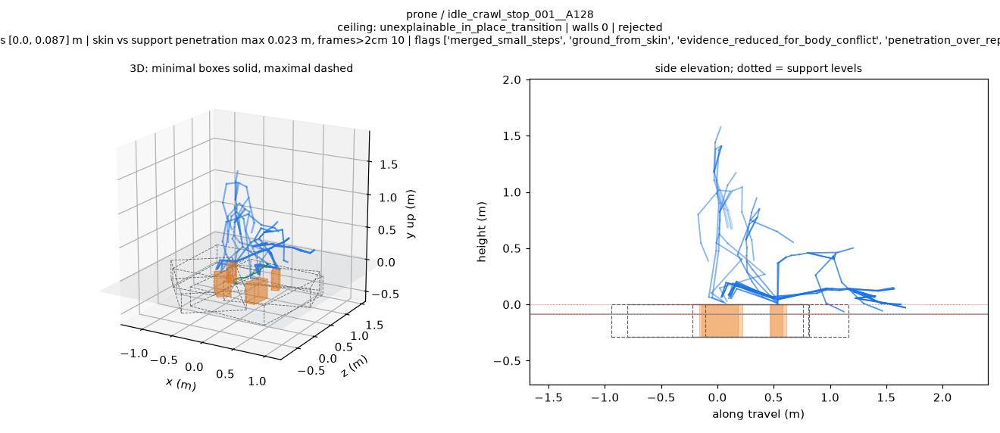
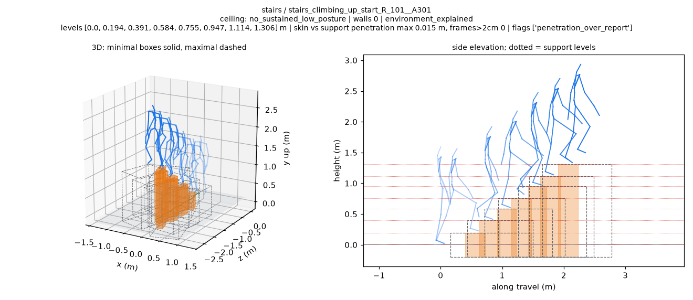

# BONES 地形拟合 v4

2026-10-24 在 PRO6000 CPU 上执行，运行源码 `c9039da`。46 项测试全部通过；试运行 87.1 秒通过阶段门，三路全量完成 6,788 条拟合和 216 份可视化，处理、渲染失败均为 0。

**质量目标部分通过。** 平地仅 4/900 条配墙，900/900 条环境可解释；保留墙和拟合顶棚没有超过 2 cm 的采样帧。已知尺寸组最大支撑超限由同口径 v3 的 705 条降到 177 条，但匍匐、手膝、跪姿仍有 595、311、35 条最大支撑超限。

完整定义、对照和逐项判定见 [执行报告](../../../docs/records/bones_terrain_fit_v4_pro6000_20261023.md)。当前资格分类为 4,814 条环境可解释、639 条仅几何一致但低姿态缺少环境解释、1,335 条拒绝；本轮没有训练。

## 对照数据

| 内容 | 文件 |
| --- | --- |
| 每组一行，v3/v4 两列的完整比较 | [comparison.md](comparison.md) |
| 表格与程序读取版本 | [comparison.tsv](comparison.tsv)、[comparison.json](comparison.json) |
| 全部 11 个组的 v4 统计 | [by_group.json](by_group.json) |
| 全部 6,788 条紧凑表 | [fits_compact.tsv](fits_compact.tsv) |
| 11 条 inverted-foot 标记完整清单 | [inverted_foot_level_dropped.json](inverted_foot_level_dropped.json) |
| 指定点检名单 | [spot_selection.json](spot_selection.json) |
| 未配墙的五条补充实例及原因 | [wall_contact_no_wall_examples.json](wall_contact_no_wall_examples.json) |
| S / L1 / L2 原始报告 | [S](shards/S/report.json)、[L1](shards/L1/report.json)、[L2](shards/L2/report.json) |
| 48-worker 试运行 | [pilot/report.json](pilot/report.json) |
| 同口径 v3 只读复测与精确一致性 | [v3_normalization_receipt.json](execution/v3_normalization_receipt.json) |
| 测试和蒙皮部位检查 | [tests.txt](execution/tests.txt)、[part_labels.txt](execution/part_labels.txt) |
| 子代理图片审查 | [S](execution/S_review.md)、[L1](execution/L1_review.md)、[L2](execution/L2_review.md) |
| 产物检查与公开文件哈希 | [artifact_checks.json](execution/artifact_checks.json)、[publication_manifest.json](publication_manifest.json)、[SHA256SUMS](SHA256SUMS) |

每路耗时、实际命令和内存采样均位于 [execution/](execution/)。v3 未保存的新字段在对照表中标为未记录。支撑和地面的比较经过同口径复测；两版变体接受率采用各自版本的准入规则。

## 审查图片

选定 63 张 PNG 和匹配的 63 条 viewer，PNG 合计 9,493,963 bytes。完整名单和选择原因见 [publication_selection.json](publication_selection.json)。青色是顶棚，紫色是墙，橙色是最小支撑箱，虚线是较大的范围，蓝色是源动作骨架。

持续匍匐的合理例子：地面参考降低后没有额外支撑箱，顶棚解释率 100%。



仍有问题的转换例子：原地爬起不加顶棚，但低矮支撑箱与身体冲突，变体被拒绝。



楼梯最大范围仍有穿透，需同时看图和 TSV 的 maximal 指标。



## 播放 viewer

从仓库根目录启动静态服务：

```bash
python -m http.server 8000 --bind 127.0.0.1
```

打开：

```text
http://127.0.0.1:8000/web/terrain_fit_review/?index=/examples/results/bones_terrain_fit_v4_20261023/viewer/index.json
```

[viewer/index.json](viewer/index.json) 只列本次发布的 63 条。完整拟合 JSON、其余渲染及 GIF 保留在 PRO6000 各分片的运行目录。
