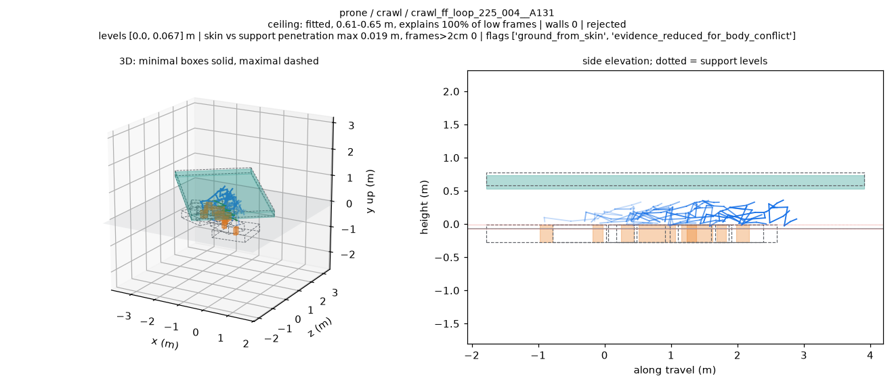
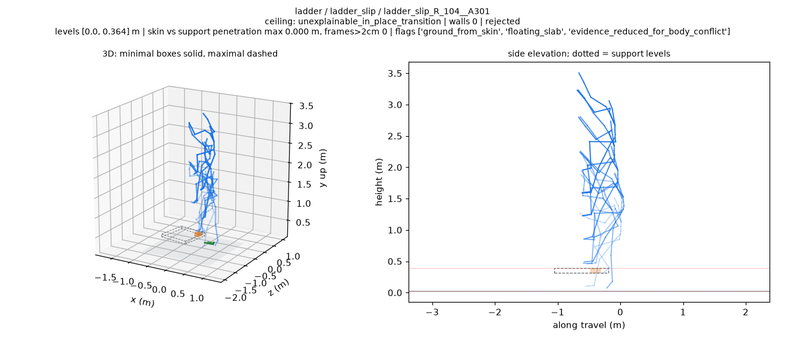

# BONES terrain v5：结果与图片审查

实际执行：2026-10-24，PRO6000 CPU；源码 `981157235447cf416627f373b7557bbae17f2c04`。文件夹日期沿用任务名称。完整过程见 [执行记录](../../../docs/records/bones_terrain_fit_v5_pro6000_20261023.md)。

**6,788 条全部完成，支撑超限清零；匍匐和手膝的联合目标未通过。** 两组的缺支撑拒绝次数仍上升。77 张审查图还显示了碎片状低支撑、缺失的梯子/障碍和部分可疑墙体。

| 项目 | 实际结果 |
| --- | --- |
| 四文件测试 | 49 passed，0 skipped；本提交实际收集 49 项，任务预期为 50 |
| 定向检查 | 41 条、98.6 秒，全部拟合/渲染成功；指定箱子和楼梯保留支撑 |
| 48-worker 试跑 | 196 条、90.0 秒，失败为零，低于 261 秒门槛 |
| 全量 | 6,788 条、196 条渲染，失败均为零；三路各 20 CPU workers |
| maximal 支撑超限 | 0/6,788；阈值为采样帧中蒙皮深度超过 2 cm |
| crouch 墙体 | 327 → 58；10 张残留墙体图中 8 张仍可疑 |
| wall_contact | 112/350 配墙，32.00%，通过 ≥30% 目标 |
| 平地 | 900/900 环境可解释，3/900 配墙 |
| 已知尺寸新标记 | 身体承托足部 3/1,760，0.17%；悬空平台 0 |
| 低姿态联合目标 | kneel 通过；prone、quadruped 未通过 |

## 从哪里看

| 内容 | 文件 |
| --- | --- |
| v3/v4/v5 每组完整比较 | [comparison.md](comparison.md)、[TSV](comparison.tsv)、[JSON](comparison.json) |
| 每组 v5 统计与全部紧凑行 | [by_group.json](by_group.json)、[fits_compact.tsv](fits_compact.tsv) |
| 每项目标、全部超限 bug、已知尺寸标记 | [target_results.json](target_results.json)、[bug 清单](maximal_over_2cm_bug_clips.json)、[标记清单](known_size_flagged_clips.json) |
| 新标记的所有片段与悬空板尺寸 | [flagged_clips.json](flagged_clips.json) |
| 41 条定向 v4/v5 对照与逐图判断 | [对照表](targets/target_comparison.md)、[图评](targets/target_visual_review.md)、[进入试跑的门槛](execution/target_gate.json) |
| S / L1 / L2 图片审查 | [S 的 11 张](execution/S_review.md)、[L1 的 15 张](execution/L1_review.md)、[L2 的 10 张](execution/L2_review.md) |
| 原始分片报告 | [S](shards/S/report.json)、[L1](shards/L1/report.json)、[L2](shards/L2/report.json) |
| 测试与环境 | [测试日志](execution/tests.txt)、[JUnit](execution/tests.xml)、[环境](execution/environment.json) |
| Pilot 与最慢 10 条 | [试跑报告](pilot/report.json)、[耗时清单](execution/P48_slowest10.json) |
| 合并与保留实体检查 | [合并回执](merge_receipt.json)、[墙体/顶棚检查](retained_surface_checks.json) |
| 文件校验 | [artifact_checks.json](execution/artifact_checks.json)、[publication_manifest.json](publication_manifest.json)、[SHA256SUMS](SHA256SUMS) |

v3/v4 使用原来记录的箱顶垂直深度；v5 考虑箱底，并取到上下表面较近的垂直距离。完整表标明这一口径变化。E 为环境可解释，G 为仅几何一致、低姿态未获环境解释；任务中的“可用比例”按 E+G 统计。

## 审查图

77 张 PNG 合计 **11,435,700 bytes**，其中 41 张为主线程定向审查，其余 36 张由三个子代理审查。蓝色为源动作骨架，橙色为最小支撑，虚线为最大范围，青色为顶棚，紫色为墙。

指定楼梯保留七级支撑，最大范围的皮肤峰值为 15.2 mm：

低姿态仍会产生碎片状矮支撑，即使超限帧数为零：

唯一悬空平台位于脚部下降轨迹附近，厚 7.29 cm、板底离地 29.09 cm；接触解释仍失败：

三份分片审查文档中的文件名均可直接打开对应图片。完整 fit JSON、GIF、viewer 动作数据和源 BVH 位于服务器，公开目录仅保存统计、执行记录及审查 PNG。
