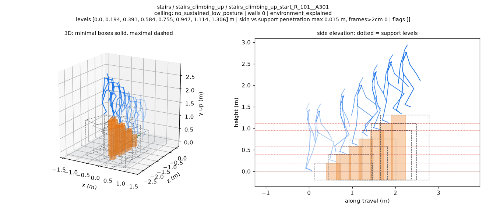
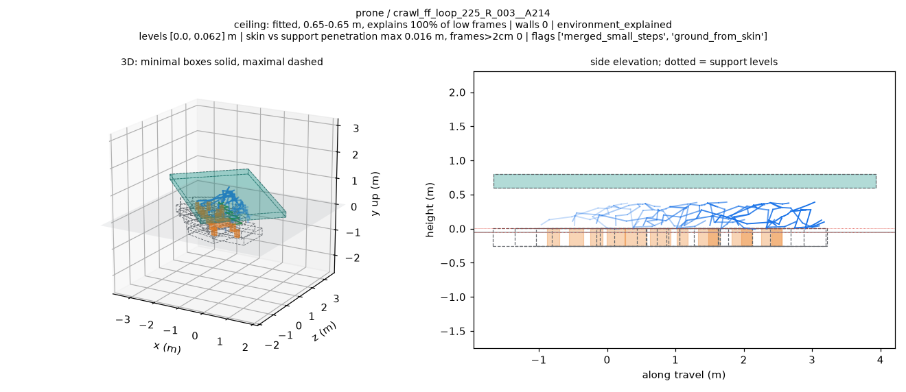
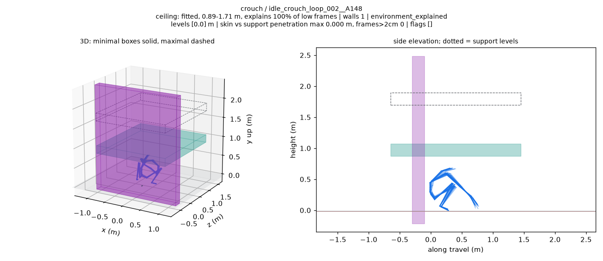

# BONES terrain v6：全量结果与审查

实际执行：2026-10-24，PRO6000 CPU；源码 `5a015448fe02321a75cb49d26a31445e10728c26`。完整过程见 [执行记录](../../../docs/records/bones_terrain_fit_v6_pro6000_20261023.md)。

**6,788 条全部完成，低姿态碎片支撑目标仍未通过。** 新同脚判据增加了少量证据剔除，但 prone/quadruped 的“四箱以上”片段数不变；缺支撑拒绝只下降 1.04% / 0.18%。

| 项目 | 结果 |
| --- | --- |
| 地形 / 骨骼射线测试 | 53 passed / 6 passed，均零跳过；Torch 对照实际通过 |
| 定向检查 | 71 条拟合和渲染成功，113.8 秒；三项停止条件均未触发 |
| 48-worker 试跑 | 196 条，零失败，92.9 秒，低于 180 秒 |
| 全量 | 6,788 条拟合、196 条渲染，失败均为零 |
| 最大支撑超限 | 0/6,788，隔帧蒙皮检查，阈值 2 cm |
| 正常组同脚丢弃 | 已知尺寸 0/3,615 raised patches；楼梯 0/242 |
| crouch / wall_contact | 保留墙 58→55；覆盖 106/350=30.29% |
| 平地 | 900/900 环境可解释，墙 3/900 |
| prone | F 1,834→1,815；E+G 464→469；至少四箱 381→381，联合目标未通过 |
| quadruped | F 2,211→2,207；E+G 279→280；至少四箱 82→82，联合目标未通过 |

E 为环境可解释，G 为仅几何一致、低姿态未获环境解释；任务可用比例按 E+G。F 是变体级 `foot_evidence_not_supported` 次数。

## 文件入口

| 内容 | 文件 |
| --- | --- |
| v4/v5/v6 每组完整比较 | [comparison.md](comparison.md)、[TSV](comparison.tsv)、[JSON](comparison.json) |
| 新版统计和全部紧凑行 | [by_group.json](by_group.json)、[fits_compact.tsv](fits_compact.tsv) |
| 目标数值、全部超限 bug | [target_results.json](target_results.json)、[空 bug 清单](maximal_over_2cm_bug_clips.json) |
| 正常组同脚丢弃清单 | [normal_group_foot_lower_drops.json](normal_group_foot_lower_drops.json)，本轮为空 |
| 原有标记与悬空平台尺寸 | [flagged_clips.json](flagged_clips.json) |
| 71 条 v5/v6 定向对照 | [逐片段表](targets/target_comparison.md)、[逐图判断](targets/target_visual_review.md)、[门槛回执](execution/target_gate.json) |
| 全量专项图评 | [S 的 10 张](execution/S_review.md)、[L1 的 22 张](execution/L1_review.md)、[L2 的 10 张](execution/L2_review.md) |
| 原始分片报告 | [S](shards/S/report.json)、[L1](shards/L1/report.json)、[L2](shards/L2/report.json) |
| 试跑及慢片段 | [pilot/report.json](pilot/report.json)、[最慢 10 条](execution/P48_slowest10.json) |
| 测试 | [地形日志](execution/terrain_tests.txt)、[射线日志](execution/ray_tests.txt)、[JUnit 核查回执](execution/test_receipt.json) |
| 环境、合并和保留实体检查 | [environment.json](execution/environment.json)、[merge_receipt.json](merge_receipt.json)、[retained_surface_checks.json](retained_surface_checks.json) |
| 校验 | [artifact_checks.json](execution/artifact_checks.json)、[publication_manifest.json](publication_manifest.json)、[SHA256SUMS](SHA256SUMS) |

每组表包含所有 v5 列，以及 raised patch 检查/保留/丢弃原因、四箱片段数、单片最大箱数和沿墙滑动拒绝次数。原因可重叠：同脚判据命中 360 个 patch，其中 307 个也被旧规则命中，新增剔除 53 个。

## 图片

共 **113 张不同 PNG，16,592,959 bytes**：主线程定向审查 71 张，三位子代理审查另外 42 张。蓝色为源动作骨架，橙色为最小支撑，虚线为最大范围，青色为顶棚，紫色为墙。

正常七级楼梯保留，没有被新同脚判据删成平地：

仍被归为 E 的匍匐片段，脚下保留 13 个约 6.25 cm 高的小支撑：

这条静止蹲姿保留墙的接触漂移约 4.21 cm；图中背靠关系仍未确认：

10 条 E 低姿态审查样本都仍有局部小箱；20 条保留墙中，14 条位置与手撑/背靠姿态相符，6 条待复核。逐图表中可直接打开每张图片。

完整 fit JSON、GIF、viewer 动作数据和源 BVH 保留在 PRO6000。公开目录保存统计、执行记录和审查 PNG。
