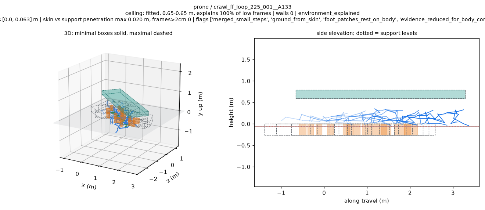

# BONES terrain v7：全量结果与审查

实际执行：**2026-10-24，PRO6000 CPU**。源码 `c4b776a920d69fc3f997f8e38821f1300837f177`。完整过程见 [执行记录](../../../docs/records/bones_terrain_fit_v7_pro6000_20261023.md)。

**6,788 条全部完成，本轮总体目标未通过。** 低姿态的缺支撑拒绝大幅减少，但残留多箱片段仍超出目标，正常三组的新规则丢弃比例也均超过 1%。

| 项目 | 结果 |
| --- | --- |
| 地形 / 骨骼射线测试 | 55 passed / 6 passed，零跳过，Torch 对照实际运行 |
| 定向检查 | 与 v6 相同的 71 条，零失败，91.0 秒，三项停止条件均未触发 |
| 48-worker pilot | 196 条，零失败，92.4 秒，低于 185.8 秒 |
| 全量 | 6,788 条拟合、196 条渲染，零失败；最长分片 1,673.7 秒 |
| maximal 支撑超限 | 0/6,788；全部蒙皮顶点，stride 2，2 cm 阈值 |
| prone | F 1,815→582；E+G 51.03%→84.33%；至少四箱 381→150，联合目标未通过 |
| quadruped | F 2,207→436；E+G 33.69%→86.88%；至少四箱 82→21，联合目标未通过 |
| kneel | F 420→140，通过 |
| 正常支撑保护 | 已知尺寸 82/3,615、箱体 14/161、楼梯 3/242 个 patch 被新规则丢弃，三组均超过 1% |
| 未建模组 | 梯子 64 条、越障 86 条全部排除，保留实际排除前资格 |
| 墙体与平地 | crouch 墙 55；wall_contact 106/350=30.29%；平地 900/900 E，墙 3/900 |

E 为环境可解释，G 为仅几何一致、低姿态未获环境解释；F 为场景变体的 `foot_evidence_not_supported` 拒绝次数。最终资格为 **E 5,506 / G 772 / R 360 / X 150**，X 为未建模几何排除。

## 文件入口

| 内容 | 文件 |
| --- | --- |
| v5/v6/v7 每组完整比较 | [Markdown](comparison.md)、[TSV](comparison.tsv)、[JSON](comparison.json) |
| 新版统计与全部紧凑行 | [by_group.json](by_group.json)、[fits_compact.tsv](fits_compact.tsv) |
| 每项目标与穿透 bug | [target_results.json](target_results.json)、[空 bug 清单](maximal_over_2cm_bug_clips.json) |
| 86 条正常组受影响片段 | [全部 patch 数值和 PNG](normal_group_body_rests_lower_drops.md)、[JSON](normal_group_body_rests_lower_drops.json) |
| 标记与悬空板统计 | [flagged_clips.json](flagged_clips.json) |
| 相同 71 条定向对照 | [逐片段表](targets/target_comparison.md)、[逐图判断](targets/target_visual_review.md)、[门槛](execution/target_gate.json) |
| 正常支撑专项 | [S 图评](execution/S_review.md)，包含 10 条 v6/v7 对照及受影响片段 |
| 跪姿与新转 E 低姿态 | [L1 的 5 条](execution/L1_review.md)、[L2 的 10 条](execution/L2_review.md) |
| 残留小箱的实测来源 | [四条保存结果诊断](residual_support_diagnostic.json) |
| 原始分片报告 | [S](shards/S/report.json)、[L1](shards/L1/report.json)、[L2](shards/L2/report.json) |
| Pilot 与最慢片段 | [pilot/report.json](pilot/report.json)、[最慢 10 条](execution/P48_slowest10.json) |
| 测试 | [地形日志](execution/terrain_tests.txt)、[射线日志](execution/ray_tests.txt)、[JUnit 回执](execution/test_receipt.json) |
| 环境与合并 | [environment.json](execution/environment.json)、[merge_receipt.json](merge_receipt.json)、[保留实体检查](retained_surface_checks.json) |
| 文件校验 | [artifact_checks.json](execution/artifact_checks.json)、[publication_manifest.json](publication_manifest.json)、[SHA256SUMS](SHA256SUMS) |

完整比较保留 v6 所有字段，并增加按组排除与排除前资格。patch 的丢弃原因可重叠，唯一丢弃数单独列出。正常组清单包含每个受影响 patch 的 `body_below_fraction` 和 `body_drop_median_m`。

## 图片与残留机制

公开 **191 张 PNG，29,329,934 bytes**：181 张 v7 和 10 张 v6 正常支撑对照。蓝色是源动作骨架，橙色是最小支撑，虚线是最大范围，青色是顶棚，紫色是墙。完整 fit、GIF、viewer 动作数据和 BVH 保留在 PRO6000。

指定七级楼梯在定向检查中保留：

该匍匐样本已从 R 转为 E，仍有 13 个低矮碎片，v6 为 11 个：

残留机制已用保存结果核对：低于 6 cm 的足底证据会跳过新检查，随后可以向上归到旧支撑层；膝部事件再在该层形成小箱。删除连接不同接触点的足底证据后，空间簇还可能分裂，造成箱数上升。另一个定向样本的 11 个受检 patch 全部被删，但仍生成 1 个足底箱和 7 个膝部箱，具体数值见诊断 JSON。

L2 的 10 条新转 E 样本中，8 条仍有碎片小箱，2 条已清除。原始场景变体接受率为 82.85%；最终梯子/越障排除资格单独执行，没有用该接受率替代目标判定。
