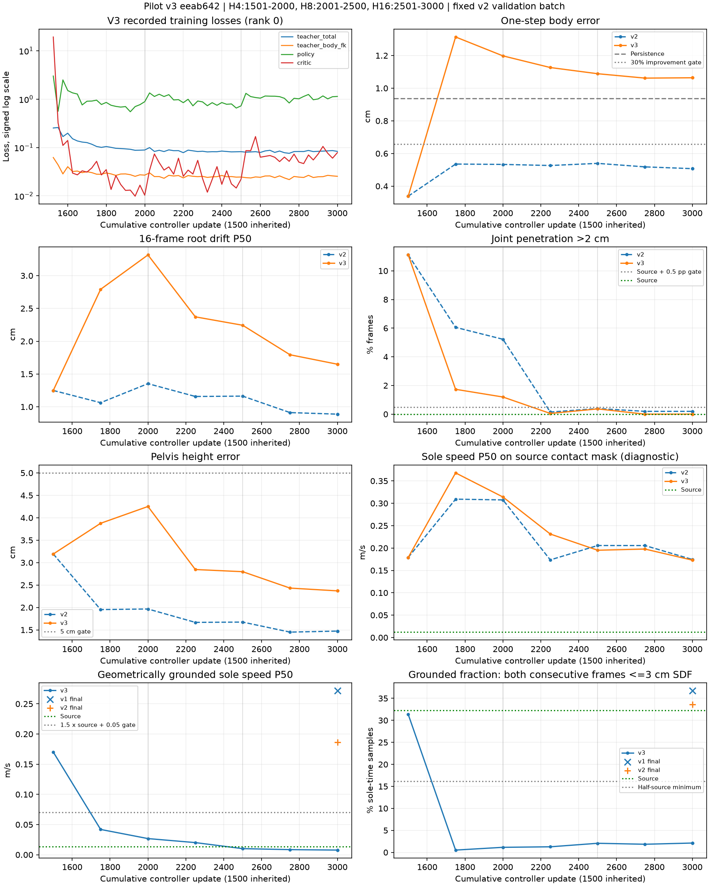

# A100 pilot v3：几何速度下降，接触大量丢失

源码`eeab642`，从v1教师checkpoint新增1,500次更新，耗时26分34.219秒。84项测试通过，两rank正常退出，七次验证的参数差异为0，输入批次与v2相同。

**六项验收通过4项。** 穿透超限帧为0，几何着地速度0.007727m/s，但着地比例只有**2.117920%**，低于16.131592%门槛；一步误差**1.063717cm**，比保持上一帧基线差13.38%。足底曲线显示生成脚底抬高并失去支撑。未追加预算或部署。

| 文件 | 内容 |
| --- | --- |
| [完整执行记录](../../../docs/records/terrain_controller_pilot_v3_a100_20261025.md) | 预检、命令、耗时、显存、验收、分组结果和逐图观察 |
| [report.json](report.json) | 冻结源码、输入/参数摘要、v1/v2补测、计划门槛、账本及图表摘要 |
| [evaluation_table.tsv](evaluation_table.tsv) | 教师起点与七行v3评估，保留源标签速度、新几何速度、双方着地比例及闭环代价 |
| [prior_new_evaluation.tsv](prior_new_evaluation.tsv) | v1-final和v2-final用新指标补测，零训练更新 |
| [matching_updates.tsv](matching_updates.tsv) | 六个共同更新位置上的v2/v3对照 |
| [by_group.tsv](by_group.tsv) | v1/v2/v3最终分组共21行，源穿透一并列出 |
| [training_curves.png](training_curves.png) | 拟合、漂移、穿透、两种速度及几何接触比例 |

wall_contact的7个窗口、112帧中，穿透超限由v2的5帧降至0帧；其根漂移P50从0.419升至1.225cm，骨盆误差从3.445升至4.946cm。

正式v3新增**1,536,000个窗口、14,336,000个闭环训练生成帧、1,536,000个混合teacher一步预测**。继承的1,500次教师更新、两次单卡预检和所有评估推理分别记账。

## 六窗口对照

沿用v1训练前固定的窗口、演员、起点和场景变体；源动作数组与v1/v2逐值相同。蓝色为源动作、橙色为v3，灰色为对应场景。

| 类别 | 对照图 | 观察 |
| --- | --- | --- |
| 转跑 | [A255](contact_sheets/turn_jog_270_R_003__A255__s40.png) | 后半段腿形和脚端高度明显偏离。 |
| 侧移收步 | [A030](contact_sheets/walk_sideway_045_stop_002__A030__s60.png) | 收步中的脚没有跟随源动作落地。 |
| 蹲行 | [A412](contact_sheets/item_pick_up_crouch_walk_R_003__A412__s32.png) | 保持低姿态，手臂与膝踝差异明显。 |
| 匍匐转换 | [A129](contact_sheets/change_idle_crawl_to_idle_crawl_right_001__A129__s48.png) | 躯干接近重合，脚端仍有偏移。 |
| 上箱 | [A224](contact_sheets/come_up_50cm_box_R_002__A224__s24.png) | 摆动腿前送不足，右支撑脚偏高。 |
| 上箱 | [A164](contact_sheets/come_up_50cm_box_R_003__A164__s24.png) | 收腿时序和脚端与箱面关系偏移。 |

## 两张足底曲线

[侧移收步](sole_curves/walk_sideway_045_stop_002__A030__s60__soles.png)：源左脚底落到约0m，v2接近地面，v3全程保持0.100–0.156m。左右脚趾也明显偏高。

[50cm上箱](sole_curves/come_up_50cm_box_R_002__A224__s24__soles.png)：源右支撑脚底稳定在约0.575m，v3抬至0.621–0.672m，水平速度中位数同时升高。

每张图分别给出左右脚底点、脚趾点的世界y高度与水平速度，覆盖同一16帧；Source/v2/v3共三条曲线。第一帧速度使用同一真实历史末帧，v2复用已有数组。

checkpoint、运动数组和原始日志保留在A100；公开目录只含小型数值结果与审查图。
